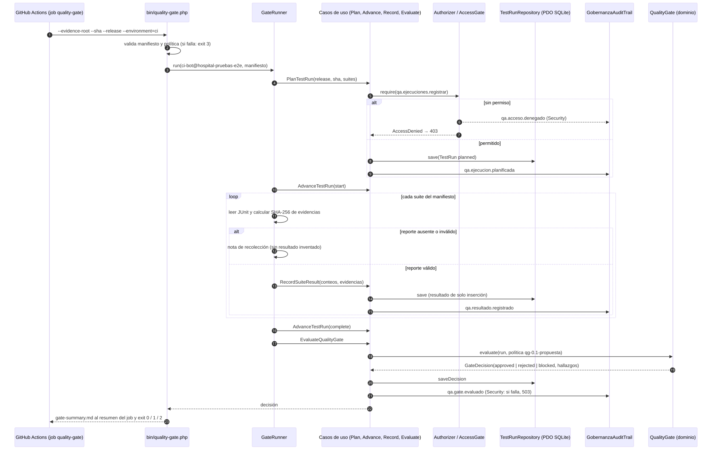

# Semana 1 — UML de casos de uso, actividad y secuencia + narrativa de alcance

**Módulo:** QA, pruebas E2E, CI y guía de despliegue final (fila 25 del README, ASII-25) · **Estudiante:** Cindy Mayté Ruano Calderón (`cindyruano`)
**Adaptación:** gestión de ejecuciones automatizadas y calidad de versiones.
**Proceso modelado:** planificación de pruebas → ejecución E2E → conservación de evidencia → aplicación de quality gates.

## Diagramas

| # | Diagrama | Fuente editable | SVG |
|---|---|---|---|
| 1 | Casos de uso | [fuentes/01-casos-de-uso.mmd](fuentes/01-casos-de-uso.mmd) | [01-casos-de-uso.svg](01-casos-de-uso.svg) |
| 2 | Actividad (decisiones, excepciones y resultado) | [fuentes/02-actividad.mmd](fuentes/02-actividad.mmd) | [02-actividad.svg](02-actividad.svg) |
| 3 | Secuencia (participantes, mensajes, validaciones, respuesta) | [fuentes/03-secuencia.mmd](fuentes/03-secuencia.mmd) | [03-secuencia.svg](03-secuencia.svg) |

## Narrativa de alcance

**Objetivo.** Que ninguna versión del Sistema Hospitalario Integrado se integre a `develop` o se despliegue sin una decisión reproducible y auditable: qué se probó (plan), sobre qué commit, en qué ambiente aislado, con qué resultado y con qué evidencia conservada.

**Actores.**

| Actor | Tipo | Qué hace | Cómo se identifica |
|---|---|---|---|
| Líder QA / responsable de versión | Persona | Planifica, aborta y evalúa el gate; consulta | Usuario autenticado del hospital de pruebas |
| Desarrollador/a de módulo | Persona | Abre el PR que dispara el pipeline | GitHub (no entra al módulo directamente) |
| Pipeline CI (`ci-bot`) | Sistema | Ejecuta etapas, registra resultados y evalúa el gate | Cuenta de servicio ficticia `ci-bot@hospital-pruebas-e2e` |
| Observador (revisora de integración, docente) | Persona | Consulta ejecuciones y decisiones | Usuario con permiso de solo lectura |
| RBAC (María) | Sistema externo | Decide cada permiso | Puerto `AccessGate` |
| Gobernanza y Auditoría (Cindy) | Sistema externo | Guarda cada acción y cada denegación | Puerto `AuditTrail` → `RecordAuditEvent` |

**Incluido:** plan de pruebas por versión y commit; etapas automatizadas (sintaxis, lint, build, unitarias, integración, contrato de rutas, E2E); registro de resultados con huella SHA-256 de cada evidencia; evaluación del gate con política versionada; consulta por tenant; auditoría de cada acción.

**Fuera de alcance:** casos manuales, campañas de regresión y defectos (los gestiona ASII-28 QA funcional de Madelin; ver acuerdo propuesto en [semana-05/contratos-integracion.md](../semana-05/contratos-integracion.md)); despliegue a producción automático (la guía de despliegue es manual y verificable, ver [guia-despliegue](../guia-despliegue/README.md)); datos reales de pacientes (todo dato de prueba es ficticio).

**Supuestos pendientes de validar:** los permisos `qa.*` no existen en `config/rbac.php` (propuesta para María en [semana-05](../semana-05/contrato-api.md#permisos-propuesta-pendiente)); los umbrales del gate son la propuesta `qg-0.1-propuesta` (ver [semana-14](../semana-14/README.md)).

## Trazabilidad entre los tres diagramas

| Caso de uso | Actividad (nodo) | Secuencia (mensajes) | Código actual |
|---|---|---|---|
| CU-01 Planificar ejecución | P «¿Plan válido?», S | 4–9 | `Application/PlanTestRun`, `Domain/TestPlan` |
| CU-02 Ejecutar etapas y E2E | B, D, E, F | 1 (lo dispara GitHub Actions) | `.github/workflows/qa-ci-e2e.yml`, `tests/E2E/*.e2e.mjs` |
| CU-03 Registrar resultado | T | 11, 13–15 | `Application/RecordSuiteResult`, `Domain/SuiteResult` |
| CU-04 Conservar evidencia | F, T | 11 (SHA-256) | `Ci/EvidenceCollector`, `Domain/EvidenceRef` |
| CU-05 Evaluar quality gate | V, W, BL/RE/AP, Y | 16–23 | `Application/EvaluateQualityGate`, `Domain/QualityGate` |
| CU-06 Consultar | — (fuera del pipeline) | — | `Application/ViewTestRuns`, `GET /api/v1/qa/runs` |
| CU-07 Abortar | — | — | `Application/AdvanceTestRun` (`abort`) |
| CU-08 Autorizar | R, X3, X4 | 5–7 | `Application/Authorizer`, `AccessGate` |
| CU-09 Auditar | X3, Y | 6, 9, 15, 21 | `Integration/GobernanzaAuditTrail` |

Excepciones modeladas y su salida explícita: plan inválido → `422` / exit 3; sin permiso → `403` auditado; RBAC caído → `503` sin cambios; almacén caído → `503` con *rollback*; reporte ausente → nota y suite sin resultado (el gate bloquea, nunca aprueba por omisión).
