# Semana 3 — Diseño arquitectónico, vistas y patrones

**Entregable:** vista arquitectónica C4/UML del módulo y sus dependencias. Se inicia el **Micro-HIS QA, pruebas E2E, CI y guía de despliegue final** en PHP 8.2 vanilla, en [`micro-his/qa-calidad-versiones`](../../../micro-his/qa-calidad-versiones/README.md), con la misma convención de los demás micro-HIS (`bootstrap.php` con autocarga propia, `src/{Domain,Application,Persistence,Presentation}`, `tests/run.php`).

| Vista | Fuente | SVG |
|---|---|---|
| C4 nivel 1 — contexto | [fuentes/01-c4-contexto.mmd](fuentes/01-c4-contexto.mmd) | [01-c4-contexto.svg](01-c4-contexto.svg) |
| C4 nivel 2 — contenedores | [fuentes/02-c4-contenedores.mmd](fuentes/02-c4-contenedores.mmd) | [02-c4-contenedores.svg](02-c4-contenedores.svg) |
| Capas y dependencias | [fuentes/03-capas.mmd](fuentes/03-capas.mmd) | [03-capas.svg](03-capas.svg) |

## Decisiones

| Decisión | Motivo | Alternativa descartada |
|---|---|---|
| PHP vanilla, sin framework ni Composer en el núcleo | Requisito de la semana; además el CLI del gate corre en el job sin `composer install` | Clases dentro de `app/` de Laravel |
| PDO con sentencias preparadas (`PdoTestRunRepository`) | Requisito; el registro de ejecuciones se guarda en un SQLite **de la propia ejecución** que se sube como artefacto | Tablas nuevas en CENTRAL/hospital (exigiría a Javier; ver semana 4) |
| Patrón *Ports & Adapters* para RBAC, auditoría y reloj | Ningún módulo ajeno se modifica; se usan sus contratos públicos | Llamar directo a clases de RBAC/Gobernanza desde el dominio |
| Un único formato de entrada (JUnit XML) para todas las etapas | PHPUnit y `node --test` ya lo producen; `junit-command.php` lo genera para el resto | Parsear la salida de texto de cada herramienta |
| La regla «vacío no es éxito» vive en el dominio | Un reporte ausente o una suite sin pruebas nunca aprueba | Confiar en el exit code de cada paso |

## Pruebas exigidas por la semana

| Exigencia | Prueba | Resultado |
|---|---|---|
| Camino feliz | `tests/pdo.php` P01–P02 (planificar → iniciar → registrar → releer desde SQLite); en la semana 4 se suma `tests/blackbox.php` BN06–BN10 por HTTP | OK |
| Regla de dominio | `tests/unit.php` U01–U28 (p. ej. U05 plan sin E2E obligatoria) | OK |
| Error de persistencia con dobles o base de prueba | `tests/pdo.php` P10–P14 (tabla ausente, fila corrupta, rollback); el doble `BrokenRepository` (`tests/doubles.php`) se usa además en A11/BN23 de semanas siguientes | OK |

Comando y salida: [evidencias/run.txt](evidencias/run.txt) (`php micro-his/qa-calidad-versiones/tests/run.php`).
