# Semana 4 — Arquitectura en capas y patrón Repository

**Entregable:** capas, responsabilidades y objetos reutilizables; análisis y diagrama de un repositorio de datos compartido.

## Entrada MVC

| Rol MVC | Clase | Qué hace | Qué NO hace |
|---|---|---|---|
| Ruteo / *front controller* | `Presentation/QaHttpHandler.php` | Valida identidad, `X-Tenant-ID`, tamaño y JSON; elige la acción | Reglas de negocio |
| Controlador | `Presentation/QaController.php` | Llama al caso de uso y entrega la vista | SQL, validaciones de dominio (AR06) |
| Vista | `Presentation/RunPresenter.php` | Arma el JSON `snake_case` | Decidir veredictos |
| Modelo | `Domain/*` + `Application/*` | Reglas y orquestación | Conocer HTTP o PDO |

`tests/architecture.php` lo verifica: AR04 (Presentation sin SQL/PDO), AR05 (Presentation no importa Persistence) y AR06 (el controlador no usa `QualityGate`, `GateVerdict`, `InvalidQaInput` ni `throw`).

## Repository en el límite del dominio

`Domain/TestRunRepository.php` es el puerto. Dos adaptadores con el mismo contrato:

| Adaptador | Uso | Garantías comunes |
|---|---|---|
| `Persistence/InMemoryTestRunRepository.php` | pruebas, demo sin archivo | Devuelve copias: modificar un objeto no altera lo guardado hasta `save()` |
| `Persistence/PdoTestRunRepository.php` + `RunRowMapper.php` | CLI de CI (`--db`), servidor de demo | Sentencias preparadas, transacción con *rollback*, resultados `ON CONFLICT DO NOTHING`, `LIMIT` ligado como entero, toda excepción técnica → `QaStorageFailure` |

Ambos filtran por `tenant_id` dentro de la consulta: otro hospital recibe `null`, no un error que revele existencia (P03, P06, A08).

## Objetos reutilizables

| Objeto | Lo reutilizan |
|---|---|
| `QaModule::compose()` | API HTTP, CLI de CI, demo, pruebas |
| `GateRunner` | `bin/quality-gate.php` (mismos casos de uso que la API) |
| `JUnitWriter` / `JUnitReportReader` | todas las etapas del pipeline |
| `RouteGuard` | contrato de rutas de **todo** el HIS, no solo de este módulo |
| `micro-his-suites.php` | corre los `tests/run.php` de los micro-HIS de todos los compañeros |

## Repositorio de datos compartido

 — fuente: [fuentes/01-repositorio-compartido.mmd](fuentes/01-repositorio-compartido.mmd)

| Opción | Integración | Evaluación |
|---|---|---|
| A — vigente | SQLite de la ejecución, subido como artefacto | Sin cambios de esquema; historial limitado a la retención de GitHub |
| B — propuesta | Las mismas consultas PDO sobre la conexión `central` | Historial consultable desde el HIS; requiere a Javier → [propuesta-bd-javier.md](propuesta-bd-javier.md) |
| C — descartada | Tablas `qa_*` en cada base hospital | Mezcla datos de CI con datos clínicos y multiplica el esquema |

Cambiar de A a B no toca dominio ni aplicación: solo `ModuleFactory::repository()` recibiría otro `PDO`.
