# Semana 5 — Cliente-servidor, API REST, microservicios e integración

**Entregable:** contrato API y plan de issue, rama, worktree y PR.

| Documento | Contenido |
|---|---|
| [contrato-api.md](contrato-api.md) | Endpoints, esquemas, códigos, permisos propuestos, indisponibilidad |
| [openapi.yaml](openapi.yaml) | OpenAPI 3.0.3 del mismo contrato |
| [contratos-integracion.md](contratos-integracion.md) | C-01..C-08 con Auth/Tenants, RBAC, Gobernanza, micro-HIS, migraciones, QA manual, errores y semillas |
| [fuentes/01-frontera-microservicio.mmd](fuentes/01-frontera-microservicio.mmd) → [01-frontera-microservicio.svg](01-frontera-microservicio.svg) | Cliente-servidor actual y frontera evaluada |

## Diseño cliente-servidor

Dos clientes usan el mismo núcleo: el **CLI** del job `quality-gate` (proceso local, sin red) y el **prototipo web** (HTTP JSON contra `/api/v1/qa/runs`). Ambos pasan por `QaModule::compose()`, así que reglas, permisos y auditoría son idénticos.

## Evaluación de la frontera de microservicio (`qa-registry`)

| Aspecto | Hoy (monorepo) | Como microservicio |
|---|---|---|
| Propiedad de datos | El registro vive en el SQLite de cada ejecución (artefacto) | Base propia del servicio; ningún otro módulo escribe en ella |
| Comunicación | Llamada en proceso; HTTP solo en la demo | HTTPS; CI con token de servicio; eventos a Gobernanza |
| Seguridad | `AccessGate` + `X-Tenant-ID` + auditoría | Igual + autenticación de servicio a servicio (mTLS o token rotado) |
| Resiliencia | Falla cerrado (503); el job queda rojo | Reintento con idempotencia por `commit_sha + suite` y cola si Gobernanza cae |
| Observabilidad | `X-Request-ID`/`trace_id` en todas las respuestas, resumen del job | Métricas de tiempo por etapa y tasa de bloqueos |
| Consistencia | Transacción local (*rollback* en P14) | Eventual con Gobernanza (outbox) |

**Decisión:** no se separa. Criterios medibles para reabrirla: (1) más de un repositorio necesita el mismo registro; (2) el historial debe superar los 90 días de retención de artefactos; (3) más de 50 ejecuciones/día con consultas concurrentes. Hoy no se cumple ninguno (un repositorio, un equipo).

**Migración razonada si se cumplen:** paso 1, opción B de la semana 4 (mismas clases PDO sobre CENTRAL, con aprobación de Javier); paso 2, exponer la API existente detrás de un token de servicio; paso 3, mover el almacén a su propia base sin cambiar dominio ni casos de uso (solo el adaptador).

## Plan de issue, rama, worktree y PR

| Paso | Valor |
|---|---|
| Issue | Agregar al issue del módulo (fila 25) la tarea «QA, E2E, CI y guía de despliegue — pipeline y quality gate» con estos criterios de aceptación |
| Worktree | `git worktree add ../shi-asii-25-ci-e2e -b feature/asii-25-ci-e2e-calidad-versiones-cindyruano origin/develop` (creado el 21-oct-2026; las ramas de entrega parten de `origin/develop` 5e6f0044) |
| Rama | Cumple el patrón de `branch-protection.yml`: `feature/asii-25-<slug>` |
| Commits | Más de 3, por capa: dominio → aplicación/persistencia → presentación/demo → CI/E2E → docs por semana |
| PR | Hacia `develop`, título «Semana N — QA, E2E y CI: entregables», plantilla completa con la salida real de los comandos |
| Límite | 400 líneas por PR (regla del grupo): el trabajo se divide en PR apilados por semana; ver [README del módulo](../README.md#cómo-dividir-en-pr) |
| Revisión | Yamilet hace el merge; nadie mergea su propio PR; nunca *force push* |

> No se creó ningún commit, push ni PR: lo hace Cindy cuando lo autorice.
