# Semana 7 — Diseño de componentes y refactorización

**Entregable:** diagrama de componentes, contratos de entrada/salida y comparación antes/después de un refactor concreto con justificación.

 — fuente: [fuentes/01-componentes.mmd](fuentes/01-componentes.mmd)

## Contratos de entrada / salida por componente

| Componente | Entrada | Salida | Errores |
|---|---|---|---|
| `QaHttpHandler::handle` | método, ruta, identidad del servidor, cabeceras, query, cuerpo crudo | `{status, body, headers}` | 400/401/403/404/413 propios; el resto vía `ErrorMapper` |
| `PlanTestRun::execute` | `Actor`, cuerpo del plan, `traceId` | `TestRun` en `planned` | `AccessDenied`, `InvalidQaInput`, `QaStorageFailure` |
| `RecordSuiteResult::execute` | `Actor`, id, cuerpo del resultado | `TestRun` actualizado | + `RunNotFound`, `RunStateConflict` |
| `EvaluateQualityGate::execute` | `Actor`, id | `GateDecision` guardada y auditada | igual |
| `QualityGate::evaluate` | `TestRun`, `QualityGatePolicy`, evaluador, instante | `GateDecision` (pura, sin efectos) | ninguno |
| `GateRunner::run` | actor CI, manifiesto, versión, SHA, ambiente | `{run, decision, notes}` | propaga errores de configuración (exit 3) |
| `JUnitReportReader::read` | ruta de un XML | `{total, failed, skipped, duration_ms}` | `RuntimeException` si no es JUnit (incluye XXE) |
| `RouteGuard::check` | `route:list --json`, catálogo RBAC, listas | `[{route, ok, message}]` | ninguno |
| `view-model.js` | objetos del formulario o de la API | errores por campo, acciones visibles, mensajes | ninguno (funciones puras) |
| `api.js` | contexto (perfil, falla simulada) | `{ok, status, body}`; `status: 0` sin red | nunca lanza |

## Refactor concreto: el punto con mayor acoplamiento

El punto más acoplado entre **ejecuciones E2E, CI, quality gates, versiones, evidencia y despliegue** era la condición del job final del workflow.

**Antes (primer borrador del YAML, no publicado):**

```yaml
quality-gate:
  needs: [static, tests, e2e]
  if: needs.tests.result == 'success' && needs.e2e.result == 'success'
  steps:
    - run: echo "versión aprobada"
```

- La decisión dependía del **estado del job**, no de la evidencia: un job E2E que terminaba «success» sin ejecutar ninguna prueba (por ejemplo, `describe` saltado) aprobaba la versión.
- Si un job fallaba, el gate ni se ejecutaba: no quedaba registro de por qué.
- Cambiar una etapa obligaba a editar condiciones del YAML.

**Después (código actual):**

```yaml
quality-gate:
  needs: [static, tests, e2e]
  if: always()                       # siempre decide y siempre deja registro
  steps:
    - uses: actions/download-artifact@v4   # junta qa-evidence-* de los 3 jobs
    - run: php "$QA_BIN/quality-gate.php" --evidence-root=... --sha=... --db=...
```

- Separación: UI/plataforma (YAML) solo **mueve** evidencia; aplicación (`GateRunner` + casos de uso) la **registra**; dominio (`QualityGate`) **decide**; persistencia (`PdoTestRunRepository`) la **conserva**.
- Qué suites cuentan y cuáles son obligatorias pasa a `config/ci-manifest.json`; los umbrales, a `config/quality-gate.json` versionado.
- El caso que el «antes» aprobaba por error ahora queda `SUITE_EMPTY`/`SUITE_MISSING` → bloqueado (W05, W06, CI18). El E2E de pila completa sin ambiente se reporta como 8 casos *skipped*, nunca como verde.

**Sin ampliar el módulo:** el refactor no agregó casos de uso; reutiliza los cinco que ya usa la API.
