# Semana 8 — Diseño de experiencia de usuario

**Entregable:** user flow por rol y 4–6 wireframes anotados con estados, mensajes, validaciones y reglas de interacción.

| Documento | Contenido |
|---|---|
| [fuentes/01-user-flow.mmd](fuentes/01-user-flow.mmd) → [01-user-flow.svg](01-user-flow.svg) | Flujo por rol: sin sesión, observador, líder QA |
| [wireframes.md](wireframes.md) | W1 lista · W2 planificar · W3 detalle · W4 confirmación · W5 decisión del gate · W6 errores |

## Roles autorizados

| Rol (perfil de la demo) | Permisos propuestos | Qué ve |
|---|---|---|
| Líder QA | `qa.ejecuciones.ver`, `qa.ejecuciones.registrar`, `qa.gates.evaluar` | Todo el flujo |
| Observador | `qa.ejecuciones.ver` | Lista, detalle y decisión; sin botones de escritura |
| Sin sesión | — | Aviso 401 |
| Pipeline CI | registrar + evaluar | No usa la UI (CLI) |

## Estados cubiertos

Inicio · vacío · carga · éxito · validación (errores por campo, foco al primero) · confirmación (completar, abortar con motivo) · error recuperable (503, sin red, con datos conservados) · error no recuperable (403, 404) · resultado del gate (aprobado / rechazado / bloqueado con hallazgos) · ayuda contextual plegable.

## Protección de datos

Solo datos de CI (versiones, commits, conteos, rutas de evidencia y huellas). Ningún dato clínico ni credencial; las huellas se muestran abreviadas; ambiente productivo no se ofrece; tenant fijado por la sesión (otro hospital → 404).

Los wireframes se implementaron en el prototipo de la [semana 11](../semana-11/README.md); los hallazgos de usabilidad y accesibilidad están en la [semana 9](../semana-09/README.md).
