# Semana 11 — Prototipo navegable desktop y móvil

**Entregable:** archivo del prototipo, mapa de navegación y capturas desktop/móvil del camino feliz y del error crítico.

## Prototipo

Archivos: [`micro-his/qa-calidad-versiones/public/prototipo/`](../../../micro-his/qa-calidad-versiones/public/prototipo/) (`index.html`, `styles.css`, `app.js`, `api.js`, `view-model.js`). Usa la API real del micro-HIS; los datos son ficticios.

```bash
php -S 127.0.0.1:8093 -t micro-his/qa-calidad-versiones/public micro-his/qa-calidad-versiones/public/index.php
```

Abrir `http://127.0.0.1:8093/prototipo/`. Enlaces útiles: `?perfil=observador` (solo lectura), `?falla=almacen` o `?falla=rbac` (error crítico). `POST /demo/reset` borra los datos de demo.

## Mapa de navegación

 — fuente: [fuentes/01-mapa-navegacion.mmd](fuentes/01-mapa-navegacion.mmd)

## Capturas (21-oct-2026)

| Paso | Desktop 1280 px | Móvil 360 px |
|---|---|---|
| 1 Lista | [d1-lista.png](capturas/d1-lista.png) | [m1-lista.png](capturas/m1-lista.png) |
| 2 Planificar | [d2-planificar.png](capturas/d2-planificar.png) | [m5-planificar.png](../semana-10/capturas/m5-planificar.png) |
| 3 En ejecución, registrar resultado | [d3-detalle-en-curso.png](capturas/d3-detalle-en-curso.png) | — |
| 4 Camino feliz: gate aprobado | [d4-gate-aprobado.png](capturas/d4-gate-aprobado.png) | [m2-detalle-aprobado.png](../semana-10/capturas/m2-detalle-aprobado.png) |
| 5 Gate rechazado | [d5-gate-rechazado.png](capturas/d5-gate-rechazado.png) | [m3-gate-rechazado.png](capturas/m3-gate-rechazado.png) |
| 6 Gate bloqueado (falta E2E) | [d6-gate-bloqueado.png](capturas/d6-gate-bloqueado.png) | — |
| 7 **Error crítico**: almacén caído (503) | [d7-error-almacen.png](capturas/d7-error-almacen.png) | [m4-error-almacen.png](capturas/m4-error-almacen.png) |
| 8 Rol observador (sin botones de escritura) | [d8-observador.png](capturas/d8-observador.png) | — |

## Consistencia

- **Roles:** los botones dependen del perfil y del estado (`allowedActions`); el servidor vuelve a verificar (E2E-QA-04).
- **Estados:** los mismos textos (`STATUS`, `VERDICTS`) en lista, detalle y panel.
- **Accesibilidad:** correcciones H-01..H-08 de la [semana 9](../semana-09/README.md) incluidas en estas capturas.
- **Prueba automática del recorrido HTTP:** `tests/E2E/qa-calidad.e2e.mjs` (9/9) cubre el mismo camino feliz y los errores; E2E-QA-09 verifica que el prototipo se sirve.
