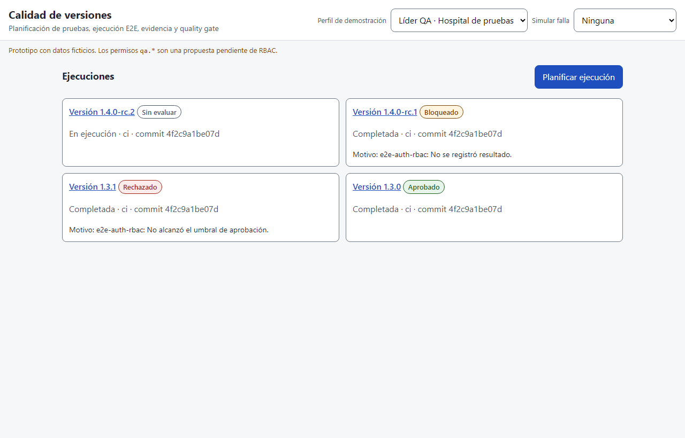

# Semana 12 — Segunda evaluación parcial

**Entregable:** presentación breve, recorrido navegable, matriz decisión→RF/RNF→evidencia y respuesta documentada a un cambio solicitado.

## Presentación breve (5 puntos)

1. **Componentes** (S7): mismo núcleo para CLI de CI, API y prototipo; el YAML solo mueve evidencia.
2. **UX por rol** (S8): líder QA vs. observador; los botones dependen de permiso **y** estado.
3. **Accesibilidad** (S9): 8 hallazgos medidos, 8 corregidos; contraste de bordes 1.57 → 4.46:1.
4. **Movilidad** (S10): tabla → tarjetas a < 720 px, veredicto antes que la tabla, 44 px por control.
5. **Riesgos tratados**: doble evaluación (H-02), evidencia con metadato falso (H-03), aviso de error permanente (H-07), aprobación por omisión (regla `SUITE_MISSING`).

## Recorrido navegable (con el servidor de demo encendido)

| # | Abrir | Qué demuestra |
|---|---|---|
| 1 | `http://127.0.0.1:8093/prototipo/` | Lista con veredictos y motivo (cambio de esta semana) |
| 2 | «Planificar ejecución» → enviar sin E2E obligatoria | Validación, foco al error (H-04) |
| 3 | Guardar un plan válido → Iniciar → Registrar resultado | Estados planned → running; bytes reales (H-03) |
| 4 | Completar (confirmación) → Evaluar quality gate | Diálogo, foco al panel (H-06), un solo POST (H-02) |
| 5 | `?perfil=observador` en el detalle | Solo lectura (rol) |
| 6 | `?falla=almacen` y `?falla=rbac` | Error crítico recuperable 503 |
| 7 | Perfil «Líder QA · Hospital 2» y abrir el id de una ejecución del hospital 1 | 404: aislamiento por tenant |

## Matriz decisión → RF/RNF → evidencia

| Decisión | RF/RNF | Evidencia |
|---|---|---|
| Botones según permiso y estado (`allowedActions`) | RNF-01, RF-02 | VM04; captura [d8-observador](../semana-11/capturas/d8-observador.png); E2E-QA-04 |
| Bloqueo de doble envío | RNF-03 | H-02 medido: 2 → 1 POST |
| Tamaño real de la evidencia obligatorio | RF-04, RNF-03 | H-03 medido: `[1,1]` → `[2370, 911]`; VM03 |
| Veredicto con texto, no solo color | RNF-08 | Checklist S9 ítem 15; capturas d4–d6 |
| Tabla → tarjetas en móvil | RNF-08 | [m2-detalle-aprobado](../semana-10/capturas/m2-detalle-aprobado.png) |
| Error 503 recuperable sin pérdida de datos | RNF-01 | [d7](../semana-11/capturas/d7-error-almacen.png), E2E-QA-07, VM05 |
| Otro tenant → 404 | RF-06 | BN11, E2E-QA-05 |
| Motivo del veredicto en la lista | RF-05, RF-06 | VM07; [lista-con-motivo.png](capturas/lista-con-motivo.png) |

## Cambio solicitado y respuesta

**Pedido:** «Desde la lista quiero saber por qué una versión quedó bloqueada o rechazada sin abrir cada ejecución.»

**Respuesta:** se agregó `mainReason(gate)` en `view-model.js` (puro, probado en VM07): toma el primer hallazgo **bloqueante** y, si no hay, el primero de **rechazo**; las aprobadas no muestran motivo (los avisos no deciden). `app.js` lo pinta como «Motivo: …» bajo cada tarjeta. No cambió la API ni el dominio: el dato ya venía en `gate.findings`.

