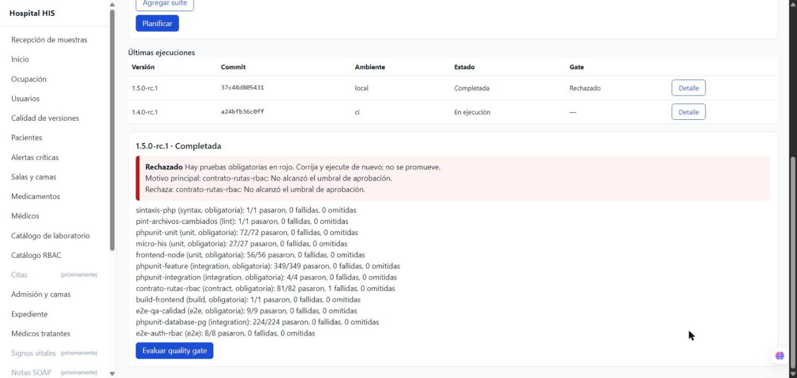

# Semana 16 — Gate completo en local con PostgreSQL e importación a `/calidad-versiones` (parte 4)

Cierra dos pendientes de esta semana: «Suite `Database` y E2E de pila completa: solo corren en el job `e2e`» y que
las ejecuciones automatizadas no llegaban a la pantalla de calidad de versiones (había que capturar a mano totales,
bytes y SHA-256 de cada suite).

## Qué cambia

| Pieza | Cambio |
|---|---|
| `bin/pipeline-local.sh` | Si hay PostgreSQL en `127.0.0.1:55431/55433` (credenciales de los servicios del workflow), crea y migra `his_*_test`, ejecuta la suite `Database`, recrea `his_*_e2e`, carga los datos ficticios, levanta Laravel aislado (puerto 8100) y corre el E2E de pila completa. Sin PostgreSQL se comporta como antes. `QA_IMPORT_RELEASE` importa el resultado a la aplicación. |
| `bin/postgres-ci-local.php` | Comprueba los dos puertos y crea o recrea bases con PDO, sin `psql`. Solo acepta 55431/55433 y nombres `his_(central\|hospital)_(test\|e2e)`; `reset` solo para `*_e2e`. |
| `php artisan qa:import-evidence` | Lee un paquete de evidencias (JUnit + archivos con SHA-256) y recorre planificar → iniciar → registrar → completar → gate con los mismos casos de uso que la API y `quality-gate.php`, en el almacén de la aplicación, para el hospital de la instancia (`HOSPITAL_DB_TENANT_ID`), con la cuenta de servicio `ci-bot` y auditoría real en Gobernanza. Salida 0/1/2/3 como `quality-gate.php`. |
| Guía de despliegue §1.1 | P1 sin GitHub Actions: cómo levantar las bases, correr el pipeline e importar. |

La cuenta `ci-bot` solo existe dentro del proceso de consola, que ejecuta quien opera el servidor; por HTTP las
mismas operaciones siguen exigiendo `qa.ejecuciones.registrar` y `qa.gates.evaluar`.

## Resultado sobre `develop` (37c48d80, 2026-10-31)

Pipeline completo con PostgreSQL local en los puertos del workflow ([resumen del gate](evidencias/05-gate-local-postgres.md)):

| Suite | Resultado |
|---|---|
| phpunit-feature | 352/352 (antes 303/349 sin PostgreSQL: los 46 fallos eran de entorno, no de código) |
| phpunit-database-pg | 224/224 (primera ejecución; antes «ausente») |
| e2e-auth-rbac | 8/8: primera ejecución verde del E2E de pila completa (login, tenant, RBAC, aislamiento y revocación) |
| contrato-rutas-rbac | 81/82: `GET api/v1/dashboard/resumen` no declara middleware RBAC |

**Veredicto: RECHAZADO**, por la razón correcta: una ruta protegida sin permiso del catálogo (módulo Dashboard,
ASII-26). Se informa a su responsable; no se modificó ese módulo.

La ejecución importada con `qa:import-evidence` aparece en `/calidad-versiones` con sus 12 suites y la decisión:

## Validación

- `QaImportEvidenceTest` (3 pruebas): evidencia completa → ejecución aprobada del hospital de la instancia y
  auditada como `ci-bot`; reporte obligatorio ausente → bloqueado (código 2), sin inventar el resultado; carpeta o
  commit inválidos → código 3 y nada guardado.
- `php vendor/bin/phpunit tests/Feature/QaCalidad` → `OK (6 tests, 58 assertions)`; Pint sin hallazgos.
