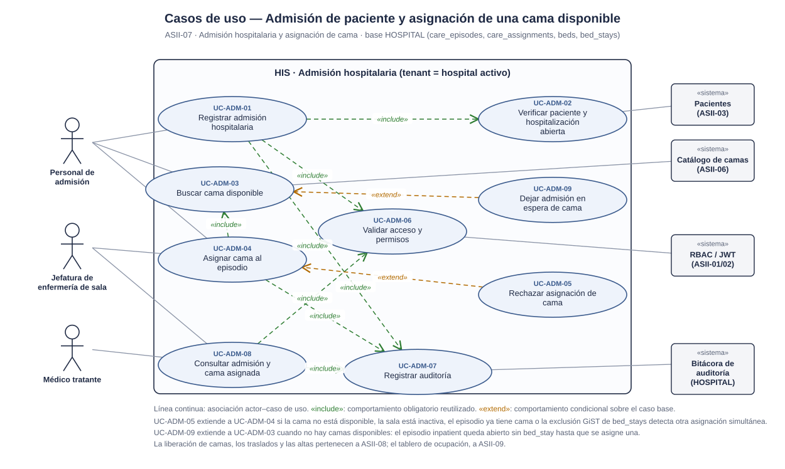
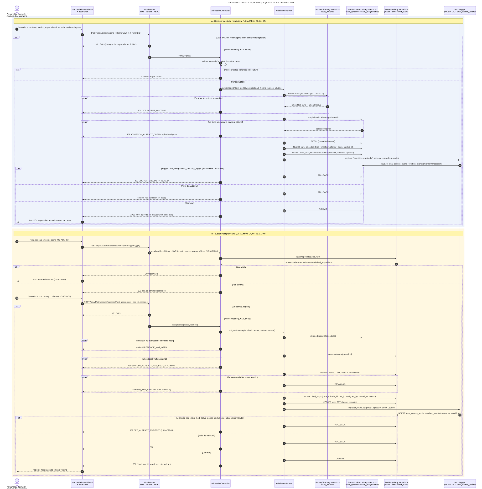

# Admisión hospitalaria y asignación de cama — Semana 1

## Ficha de la asignación

- **Estudiante:** Herrera Sánchez, Axel Eliú (`AxelHerrera11`)
- **Módulo:** ASII-07 — Admisión hospitalaria y asignación de cama (módulo absorbido tras la reorganización del grupo)
- **Semana:** Semana 1 — Conceptos generales, orientación a objetos y UML
- **Tarea individual:** Modele el proceso «admisión de paciente y asignación de una cama disponible». Casos de uso: delimitar actores y objetivo; el de actividad debe incluir decisiones, excepciones y resultado; el de secuencia debe mostrar participantes, mensajes, validaciones y respuesta. Mantenga trazabilidad entre los tres diagramas.
- **Entregable / evidencia:** UML de casos de uso, actividad y secuencia, y narrativa de alcance y trazabilidad.
- **Estructura:** Sistema Hospitalario Integrado 2026 | Semanas 1–15.

---

## Contexto arquitectónico

- **Backend:** Laravel 12 (PHP 8.2+), JWT y RBAC por permisos (`admisiones.registrar`, `camas.asignar`, `admisiones.ver`).
- **Base de datos HOSPITAL (PostgreSQL):** las tablas ya existen en las migraciones `2026_08_11_000200_create_patient_and_care_tables.php` y `2026_08_11_000300_create_scheduling_and_bed_tables.php`:
  - `care_episodes`: la admisión es un episodio con `type = 'inpatient'` y `status = 'open'`, con `started_at`, `reason` y `service_code`.
  - `care_assignments`: el médico responsable se asigna al episodio (`doctor_profile_id`, `specialty_id`, `source = 'episode'`). El trigger `care_assignments_specialty_trigger` exige que el médico tenga esa especialidad activa.
  - `wards` y `beds`: sala `active`/`inactive`; cama `available`, `occupied`, `maintenance` o `inactive`.
  - `bed_stays`: la asignación de cama. La exclusión GiST `bed_stays_bed_active_period_exclusion` impide que **dos estancias se solapen en la misma cama**, el índice `bed_stays_open_care_episode_unique` permite **una sola cama abierta por episodio** y el trigger `bed_stays_episode_period_trigger` exige que la estancia empiece dentro del episodio. Las estancias no se borran ni se modifican una vez cerradas.
- **Auditoría:** se reutiliza la propuesta de `local_access_audits` (entidad `local_access_audit`, slice H8) documentada por Notas SOAP. Va en la misma conexión y transacción `hospital`.
- **Multitenancy:** el hospital activo llega en `X-Tenant-ID`; episodios, salas y camas viven en la base de ese hospital.
- **Frontend:** Vue 3, Pinia y Axios (`AdmissionWizard` y `BedPicker`).
- **Endpoints preliminares** (se formalizan en la Semana 5):
  - `POST /api/v1/admissions`
  - `GET /api/v1/beds/available?ward={ward}&type={type}`
  - `POST /api/v1/admissions/{episode}/bed-assignment`
  - `GET /api/v1/admissions/{episode}`

---

## 1. Diagrama de casos de uso

[Abrir el diagrama de casos de uso en SVG](./01-casos-de-uso.svg) · [Fuente PlantUML](./fuentes/01-casos-de-uso.puml)

### Descripción

El objetivo es que **todo paciente hospitalizado tenga una admisión abierta, un médico responsable y, cuando haya disponibilidad, exactamente una cama asignada**, sin que dos pacientes ocupen la misma cama al mismo tiempo.

- **Actores principales:**
  - *Personal de admisión:* registra la admisión, busca y asigna la cama.
  - *Jefatura de enfermería de sala:* asigna la cama y consulta las admisiones de su sala.
  - *Médico tratante:* consulta la admisión y la cama de su paciente.
- **Actores secundarios (sistemas):** *Pacientes (ASII-03)*, *Catálogo de camas (ASII-06)*, *RBAC / JWT* y la *Bitácora de auditoría*.
- **UC-ADM-01 (Registrar admisión)** incluye `<<include>>` la verificación del paciente y de que no tenga otra hospitalización abierta (UC-ADM-02), la validación de acceso (UC-ADM-06) y la auditoría (UC-ADM-07).
- **UC-ADM-04 (Asignar cama)** incluye la búsqueda de cama disponible (UC-ADM-03), la validación de acceso y la auditoría. **UC-ADM-05 (Rechazar asignación)** la extiende `<<extend>>` si la cama dejó de estar disponible, la sala está inactiva, el episodio ya tiene cama o hubo una asignación simultánea.
- **UC-ADM-09 (Dejar en espera de cama)** extiende a UC-ADM-03 cuando no hay camas: el episodio queda abierto sin estancia.
- **UC-ADM-08 (Consultar)** incluye la validación de acceso y la auditoría de la lectura.

## 2. Diagrama de actividades

[Abrir el diagrama de actividades en SVG](./02-actividad.svg) · [Fuente Mermaid](./fuentes/02-actividad.mmd)

### Descripción

Recorre el proceso en tres particiones, con sus decisiones, excepciones y resultados.

- **A · Registrar admisión:** acceso (401/403), datos válidos (422), paciente existente y activo (404/409) y sin otra hospitalización abierta (`409 ADMISSION_ALREADY_OPEN`). Episodio, asignación del médico y auditoría van en una sola transacción: si el trigger de especialidad falla, `422 DOCTOR_SPECIALTY_INVALID`; si la auditoría falla, `500`. Resultado: admisión abierta sin cama (201).
- **B · Buscar y asignar cama:** acceso (401/403), episodio `inpatient` y `open` (404/409) y sin cama abierta (409). Si no hay camas, la admisión **queda en espera** (UC-ADM-09). Si hay, se bloquea la cama con `SELECT … FOR UPDATE`; si dejó de estar disponible, `409 BED_NOT_AVAILABLE`. `bed_stays`, el estado de la cama y la auditoría van en la misma transacción; la exclusión GiST resuelve la carrera entre dos asignaciones (`409 BED_ALREADY_ASSIGNED`). Resultado: cama asignada (201).
- **C · Consultar admisión:** acceso (401/403) y episodio (404). Muestra sala y cama o «En espera de cama». La lectura se audita sin bloquear la consulta.

## 3. Diagrama de secuencia

[Abrir el diagrama de secuencia en SVG](./03-secuencia.svg) · [Fuente Mermaid](./fuentes/03-secuencia.mmd)

### Descripción

- **Participantes:** Vue (`AdmissionWizard` + `BedPicker`), middlewares, `AdmissionController`, `AdmissionService`, `PatientDirectory` «interfaz», `AdmissionRepository` «interfaz», `BedRepository` «interfaz» y `AuditLogger` (HOSPITAL · `local_access_audits`).
- **Dependencias como interfaces:** `PatientDirectory` aísla el módulo de Pacientes; `AdmissionRepository` y `BedRepository` separan episodios y camas, porque las camas pertenecen al catálogo de ASII-06. La decisión se desarrolla en la Semana 2.
- **Escenario A (registrar admisión, mensajes 1–25):** `alt` para 401/403 y 422; `break` para paciente inexistente o inactivo (404/409) y hospitalización ya abierta (409). La transacción termina en `alt`: trigger de especialidad (422), falla de auditoría (500) o `COMMIT` y 201.
- **Escenario B (buscar y asignar cama, mensajes 26–56):** la búsqueda devuelve lista vacía (en espera, UC-ADM-09) o camas. La asignación usa `alt` para 401/403; `break` para episodio no abierto (404/409), episodio con cama (409) y cama no disponible tras el bloqueo (409). Al final, `alt` para la exclusión GiST o el índice único (409), falla de auditoría (500) o `COMMIT` y 201.

---

Narrativa completa, trazabilidad, riesgos y dependencias: [narrativa-alcance-trazabilidad.md](./narrativa-alcance-trazabilidad.md) · Uso de IA: [DECLARACION_IA.md](./DECLARACION_IA.md)
