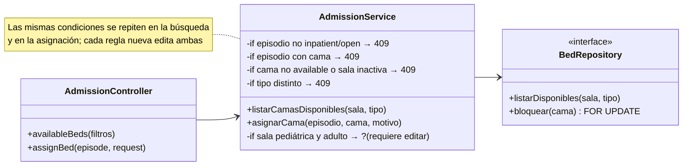
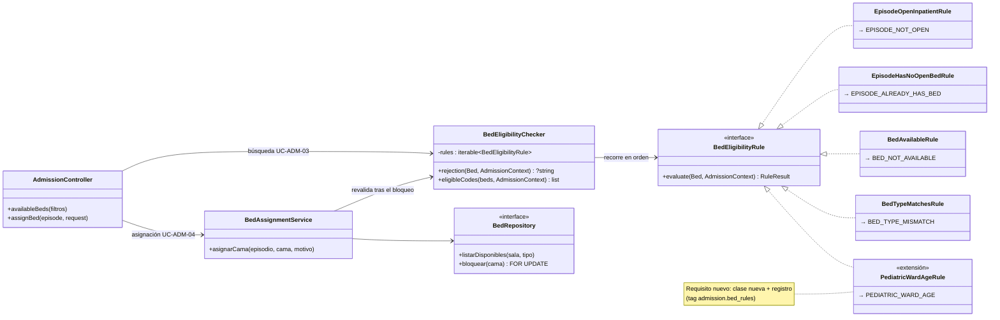

# Aplicación de OCP — Admisión hospitalaria y asignación de cama

## Principio aplicado

> «No se debe modificar el código de una clase o entidad, sino que estas deben de ser extendidas.» Se logra mediante herencia e interfaces, de modo que agregar un comportamiento nuevo no requiere modificar el código existente, solo crear clases nuevas.
>
> — Rodríguez González, L. M. *Principios básicos del diseño de software*. MVP Cluster. <https://mvpcluster.com/diseno-de-software-2/>

La fuente lo ilustra con una clase `Oferta` que crecía con un método por servicio. En la admisión, lo que crece son las **reglas de elegibilidad de cama**: hoy se exige cama disponible, sala activa, tipo de cama correcto y que el episodio no tenga otra cama, pero el hospital pedirá más (camas pediátricas por edad, aislamiento por infección, salas por sexo, camas de UCI solo con orden médica…). Si esas reglas viven en el servicio, cada pedido lo modifica, y además hay que repetir el cambio en la búsqueda y en la asignación.

Flujo de la Semana 1 al que se aplica: **B · Buscar y asignar cama** (UC-ADM-03, UC-ADM-04 y UC-ADM-05).

## Diseño antes de OCP

*Antes de OCP — la elegibilidad de cama es una cadena de if* · [fuente](./fuentes/01-diseno-antes.mmd)

### Problemas detectados

- **Modificación en cada regla nueva:** la regla de pediatría obliga a abrir `AdmissionService`, agregar otro `if` y volver a probar los rechazos existentes.
- **Lógica duplicada:** la búsqueda de camas (UC-ADM-03) y la asignación (UC-ADM-04) repiten las mismas condiciones; si una se actualiza y la otra no, la interfaz ofrece camas que luego se rechazan.
- **Pruebas acopladas:** no se puede probar una regla sola; hay que montar el servicio completo con su repositorio.
- **Responsabilidad difusa:** el mismo servicio decide reglas, bloquea filas y escribe la estancia.

## Diseño después de OCP

*Después de OCP — reglas de elegibilidad extensibles* · [fuente](./fuentes/02-diseno-despues.mmd)

## Responsabilidades

| Elemento | Responsabilidad | ¿Cambia al agregar una regla? |
|---|---|---|
| `BedEligibilityRule` «interfaz» | Contrato: `evaluate(Bed, AdmissionContext): RuleResult` con el código de rechazo. | No |
| `EpisodeOpenInpatientRule` | El episodio es `inpatient` y está `open` (`EPISODE_NOT_OPEN`). | No |
| `EpisodeHasNoOpenBedRule` | El episodio no tiene otra estancia abierta (`EPISODE_ALREADY_HAS_BED`). | No |
| `BedAvailableRule` | Cama `available` y sala `active` (`BED_NOT_AVAILABLE`). | No |
| `BedTypeMatchesRule` | Tipo de cama igual al solicitado (`BED_TYPE_MISMATCH`). | No |
| `PediatricWardAgeRule` (extensión) | En sala pediátrica, solo pacientes de hasta 14 años (`PEDIATRIC_WARD_AGE`). | Es la clase nueva |
| `BedEligibilityChecker` | Recorre las reglas en orden y devuelve el primer rechazo; filtra la lista de búsqueda con las mismas reglas. | No |
| `BedAssignmentService` | Bloquea la cama (`FOR UPDATE`), **vuelve a evaluar** las reglas con el dato bloqueado, escribe `bed_stays`, actualiza `beds` y audita en una transacción. | No |
| `BedRepository` «interfaz» | Lectura y bloqueo de camas y salas (HOSPITAL · `wards`, `beds`, `bed_stays`). | No |
| Registro en el contenedor | Lista ordenada de reglas activas (en Laravel, *tag* `admission.bed_rules`). | Una línea |

## Justificación de dependencias

- `BedEligibilityChecker` depende **solo de la interfaz** `BedEligibilityRule`; nunca nombra una regla concreta. La demo lo verifica inspeccionando su código.
- Búsqueda y asignación usan **el mismo verificador**, así que una regla nueva se aplica a ambas a la vez. Se elimina la duplicación del diseño antes.
- `BedAssignmentService` evalúa las reglas **después** del `SELECT … FOR UPDATE`, porque la cama pudo cambiar entre la búsqueda y la confirmación. La exclusión GiST de `bed_stays` sigue siendo la última barrera contra la concurrencia: OCP organiza las reglas de negocio, pero no reemplaza las garantías de la base.
- El orden de las reglas importa para el mensaje (primero el episodio, luego la cama). Por eso el registro es una lista ordenada y no un conjunto.
- `AdmissionContext` reúne los datos que las reglas necesitan (tipo y estado del episodio, estancia abierta, edad calculada desde `local_patients.birth_date` y tipo solicitado), para que ninguna regla consulte la base por su cuenta.

## Cómo se agrega una regla nueva (paso a paso)

1. Crear la clase que implementa `BedEligibilityRule` (por ejemplo, `PediatricWardAgeRule`, que rechaza si la sala es pediátrica y el paciente tiene más de 14 años).
2. Registrarla en la lista ordenada del contenedor (`admission.bed_rules`).
3. Escribir su prueba unitaria aislada.
4. No se toca `BedEligibilityChecker`, ni `BedAssignmentService`, ni las reglas existentes, ni el controlador. La búsqueda deja de ofrecer esas camas y la asignación las rechaza automáticamente.

> **Supuesto de datos:** `wards` no tiene hoy una columna que diga si la sala es pediátrica (solo `code`, `name`, `location` y `status`). La regla necesitaría ese dato del *Catálogo de salas y camas* (ASII-06), por ejemplo una columna `kind`. Se deja como pendiente de coordinación; la demo lo simula con `Ward::kind`.

## Beneficio verificable

La [demo ejecutable](./evidencia/demo-ocp.php) implementa los dos diseños y comprueba que:

- El diseño después reproduce los seis resultados del diseño antes (elegible, cama ocupada, sala inactiva, tipo distinto, episodio con cama y episodio cerrado).
- La búsqueda usa las mismas reglas que la asignación.
- Al registrar `PediatricWardAgeRule`, un adulto ya no puede recibir ni ver la cama pediátrica, un niño sí, y las reglas anteriores no cambian.
- El código de `BedEligibilityChecker` no menciona ninguna regla concreta.

La salida está en [evidencia-verificable.md](./evidencia-verificable.md).
