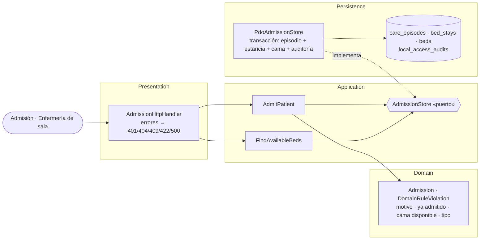

# Admisión hospitalaria y asignación de cama — Semana 3: micro-HIS por capas

**Estudiante:** Herrera Sánchez, Axel Eliú (`AxelHerrera11`) · **Módulo:** ASII-07 · **Código:** [`micro-his/admision-camas`](../../../micro-his/admision-camas/)

Flujo implementado: **admitir a un paciente y asignarle una cama disponible** (UC-ADM-01 a 05), en PHP 8.2+ vanilla con PDO y sentencias preparadas, sobre las columnas reales de `beds`, `care_episodes` y `bed_stays` (migraciones HOSPITAL 000200 y 000300).

## Vista de componentes (C4, nivel 3)

| Capa | Responsabilidad |
|---|---|
| Presentation | `POST /admissions` y `GET /beds/available?type=`; mapea errores a HTTP |
| Application | Paciente y cama existentes (404) y la carrera por la misma cama: si la base rechaza el guardado, responde 409 |
| Domain | `Admission` nace válida o no nace: `REASON_REQUIRED`, `PATIENT_ALREADY_ADMITTED`, `BED_NOT_AVAILABLE`, `BED_TYPE_MISMATCH` |
| Persistence | Episodio `inpatient`, estancia abierta, `beds.status = occupied` (solo si seguía `available`) y auditoría en una transacción |

**Sin dos pacientes en la misma cama ni dos camas por episodio:** lo garantizan la base (índices únicos parciales de estancias abiertas; en PostgreSQL, la exclusión GiST de la migración) y el `UPDATE … WHERE status = 'available'`.

## Pruebas (`php micro-his/admision-camas/tests/run.php`)

SQLite en memoria desde `database/schema.sql`, con datos ficticios. Las **15 verificaciones** cubren el camino feliz (cama ocupada, episodio abierto y auditoría), la cama ocupada o en mantenimiento (409), el paciente ya admitido (409), tipo y motivo (422), paciente y cama inexistentes (404), sin usuario (401), la búsqueda de camas y la falla de auditoría con rollback. La salida completa está en el PR.

**Limitaciones:** `beds.status` debe tener un solo escritor acordado con ASII-06 (salas y camas) y ASII-08 (traslados y altas). Lista de espera, médico responsable, MVC con Repository y el contrato API quedan para las Semanas 4 y 5. La auditoría escribe las columnas de `local_access_audits` del contrato H8 (migración 000700); `correlation_id` se genera en el adaptador porque aquí no hay petición HTTP. Uso de IA: [DECLARACION_IA.md](./DECLARACION_IA.md).
