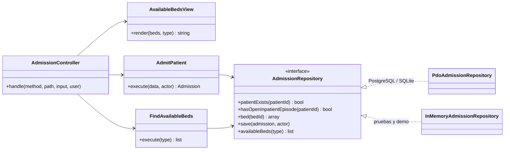

# Admisión hospitalaria y asignación de cama — Semana 4: MVC y Repository

**Estudiante:** Herrera Sánchez, Axel Eliú (`AxelHerrera11`) · **Módulo:** ASII-07 · **Código:** [`micro-his/admision-camas`](../../../micro-his/admision-camas/)

Sobre el micro-HIS de la [Semana 3](../semana-03/README.md), esta semana organiza la presentación en **MVC** y formaliza el acceso a datos con el patrón **Repository**, con dos adaptadores que cumplen el mismo contrato.

## Mapa MVC

| Rol | Clase | Qué hace |
|---|---|---|
| Model | `Domain/Admission` + `AdmitPatient`, `FindAvailableBeds` + `AdmissionRepository` | Reglas de admisión y de cama y acceso a datos; no sabe de HTTP ni de HTML |
| View | `Presentation/AvailableBedsView` | Tablero de camas disponibles; si no hay, sugiere la lista de espera. Escapa todo texto |
| Controller | `Presentation/AdmissionController` | Traduce la petición, llama al caso de uso, elige JSON o la View (`?format=html`) y mapea errores |
| Front controller | `public/index.php` | Arma las dependencias, lee la petición y escribe la respuesta |



## Repository

- El puerto `AdmissionStore` de la Semana 3 pasa a ser `AdmissionRepository`.
- `PdoAdmissionRepository` guarda episodio, estancia, `beds.status` y auditoría en una transacción. `InMemoryAdmissionRepository` da las mismas garantías: rechaza la cama que dejó de estar disponible y puede simular una base caída.
- **Prueba de contrato:** `tests/run.php` ejecuta la misma batería de 16 verificaciones con los dos adaptadores (32 en total).

## Repositorio compartido (base HOSPITAL)

`care_episodes`, `bed_stays` y `beds` viven en la base HOSPITAL que comparten todos los módulos. **Regla propuesta:** un solo módulo escribe cada tabla. Admisión abre `care_episodes` de tipo `inpatient` y `bed_stays`; Traslados y altas (ASII-08) las cierra; `beds` es de Salas y camas (ASII-06), así que **quién escribe `beds.status` se acuerda con ASII-06 y ASII-08**. El Dashboard de ocupación (ASII-09) solo lee. Integrarlo es cambiar `MICROHIS_DSN` a esa base.

## Cómo ejecutarlo

```bash
php micro-his/admision-camas/tests/run.php                      # 32 verificaciones
php -S 127.0.0.1:8081 -t micro-his/admision-camas/public        # SQLite temporal con datos ficticios
curl -s "127.0.0.1:8081/beds/available?format=html" -H 'X-User-Ref: admision1'
```

**Limitaciones:** el usuario llega en `X-User-Ref` (el JWT y el tenant son de la Semana 5). Uso de IA: [DECLARACION_IA.md](./DECLARACION_IA.md).
