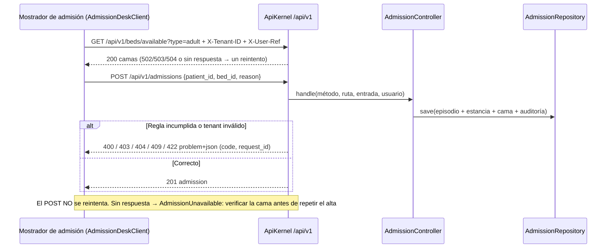

# Admisión hospitalaria y asignación de cama — Semana 5: cliente-servidor y frontera de microservicio

**Estudiante:** Herrera Sánchez, Axel Eliú (`AxelHerrera11`) · **Módulo:** ASII-07 · **Código:** [`micro-his/admision-camas`](../../../micro-his/admision-camas/) · **Contrato:** [`openapi.yaml`](../../../micro-his/admision-camas/openapi.yaml)

El micro-HIS de la [Semana 4](../semana-04/README.md) pasa a ser un **servidor API v1** con un **cliente** separado que solo conoce el contrato HTTP.



| Pieza | Qué hace |
|---|---|
| `Presentation/ApiKernel` | Prefijo `/api/v1`, `X-Tenant-ID` igual al del servidor (`MICROHIS_TENANT`), `X-Request-Id` (lo recibe o lo genera), errores RFC 9457 y `/health` y `/health/ready` |
| `public/index.php` | Front controller del servidor y log de acceso en JSON sin datos clínicos |
| `client/AdmissionDeskClient` | Timeout de 0,5 s al conectar y 2 s en total. Reintenta solo el GET: repetir un alta sin saber si llegó podría duplicarla, así que da `AdmissionUnavailable` con la instrucción de verificar |
| `openapi.yaml` | Contrato OpenAPI 3.1 validado con `npx @redocly/cli@1.34.5 lint`; una prueba comprueba que cada ruta declarada existe en el servidor |

## Frontera de microservicio

**Decisión: no se separa Admisión sola.** Su transacción toca `care_episodes`, `bed_stays` y `beds` a la vez, y `beds` es de Salas y camas (ASII-06), mientras que Traslados y altas (ASII-08) cierra las estancias. Separar solo ASII-07 partiría esa transacción en tres servicios. La única frontera razonable es un servicio de **gestión de camas** (06 + 07 + 08) con un solo escritor de `beds.status`, y eso se acuerda con Madelin y Yamilet antes de mover código.

**Propuesto, no implementado:** JWT en lugar de `X-User-Ref` e `Idempotency-Key` en `POST /admissions`, para poder reintentar el alta sin duplicarla.

## Cómo ejecutarlo

```bash
php micro-his/admision-camas/tests/run.php && php micro-his/admision-camas/tests/api.php
php -S 127.0.0.1:8081 -t micro-his/admision-camas/public
curl -s "127.0.0.1:8081/api/v1/beds/available?type=adult" -H 'X-Tenant-ID: HOSP-DEMO' -H 'X-User-Ref: admision1'
```

Uso de IA: [DECLARACION_IA.md](./DECLARACION_IA.md).
