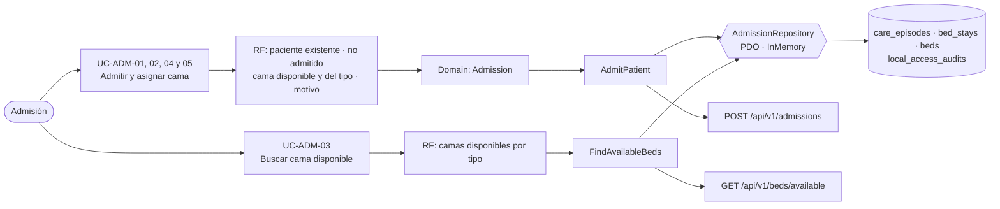

# Admisión hospitalaria y asignación de cama — Semana 6: primera evaluación parcial

**Estudiante:** Herrera Sánchez, Axel Eliú (`AxelHerrera11`) · **Módulo:** ASII-07 · **Entrega:** defensa teórica y caso práctico arquitectónico.

## Tesis arquitectónica

En el flujo «admisión de paciente y asignación de una cama disponible», **ni dos pacientes en la misma cama ni dos camas por episodio, y eso lo garantiza la base, no solo la aplicación**. El dominio (`Admission`) rechaza lo que ya sabe que es inválido: sin motivo, paciente ya admitido, cama no disponible o de otro tipo. La carrera entre dos admisiones simultáneas la resuelven los índices únicos de estancias abiertas (en PostgreSQL, la exclusión GiST de la migración) y el `UPDATE … WHERE status = 'available'`, dentro de una sola transacción que abre el episodio, la estancia, ocupa la cama y deja la auditoría.

## Trazabilidad de punta a punta

| Semana | Qué aportó | Evidencia |
|---|---|---|
| 1 | Actores, UC-ADM-01..09, actividad y secuencia sobre las migraciones 000200 y 000300 | `docs/admision-camas/semana-01/` (PR #41, integrado) |
| 2 | RF/RNF y OCP para las reglas de elegibilidad de cama | `docs/admision-camas/semana-02/` (PR #46, integrado) |
| 3 | Micro-HIS por capas con la transacción completa y pruebas | `micro-his/admision-camas/` (PR #201) |
| 4 | MVC (tablero de camas) + Repository PDO e InMemory | Reentrega de la Semana 4 (diseño del PR #57) |
| 5 | API v1, `AdmissionDeskClient` que no reintenta el alta, OpenAPI y frontera | Reentrega de la Semana 5 (diseño del PR #61) |

## Decisiones defendidas

| Decisión | Por qué | Evidencia verificable |
|---|---|---|
| `Admission` nace válida o no nace | La regla está en un solo lugar y las pruebas la cubren sin base | `REASON_REQUIRED`, `PATIENT_ALREADY_ADMITTED`, `BED_NOT_AVAILABLE`, `BED_TYPE_MISMATCH` |
| La base decide la carrera por la cama | Dos operadores pueden elegir la misma cama al mismo tiempo; la validación previa no alcanza | Índices únicos parciales de estancias abiertas y `UPDATE … WHERE status = 'available'` (409) |
| Episodio, estancia, cama y auditoría en una transacción | Una cama ocupada sin estancia, o una estancia sin auditoría, es un dato clínico roto | Prueba de rollback: la cama sigue disponible y no queda episodio |
| Elegibilidad de cama abierta a extensión (OCP) | Requisitos nuevos (pediatría, aislamiento) sin tocar el verificador | Demo de la Semana 2 (`semana-02/evidencia/demo-ocp.php`) |
| El cliente no reintenta el alta | Repetir un POST sin saber si llegó podría duplicar la admisión | `AdmissionUnavailable`: «verifique la cama antes de repetir el alta» |
| Frontera: gestión de camas (06 + 07 + 08), no Admisión sola | La transacción toca tablas de tres módulos | Evaluación de la frontera de la Semana 5 |

**Riesgos que sigo defendiendo como abiertos:** `beds.status` necesita un solo escritor acordado con Madelin (ASII-06) y Yamilet (ASII-08), y la lista de espera (UC-ADM-09) todavía no está implementada.
