# Admisión hospitalaria y asignación de cama — Semana 7: componentes backend/frontend

**Estudiante:** Herrera Sánchez, Axel Eliú (`AxelHerrera11`) · **Módulo:** ASII-07 · **Entrega:** diagrama de componentes y propuesta de refactorización.

## Objetivo

Diseñar los componentes del flujo «admisión de paciente y asignación de una cama disponible» dentro del HIS real (Laravel 12 y Vue 3, ya presentes en `develop`), separando UI, aplicación, dominio y persistencia. El diseño reutiliza el dominio y los casos de uso del micro-HIS de las Semanas 3 a 5 sin reescribirlos.

[Fuente Mermaid](./fuentes/01-componentes.mmd)

## Componentes y responsabilidades

| Componente | Responsabilidad | Dónde está hoy |
|---|---|---|
| Middlewares `tenant` y `jwt.auth` | Resolver el hospital (`X-Tenant-ID`) y el usuario del JWT | En `develop`: `TenantMiddleware` y `JwtAuth` |
| Middleware `permission:modulo.accion` | Proteger cada ruta con el permiso de RBAC | Parcial: `spatie/laravel-permission` y `config/permission.php` están; falta registrar el alias `permission` en `bootstrap/app.php` y el catálogo de permisos (María, ASII-02) |
| `Api/V1/AdmissionController` + `StoreAdmissionRequest` | Controller delgado: valida tipos y obligatorios con el FormRequest y llama al caso de uso | No (propuesto) |
| Application: AdmitPatient · FindAvailableBeds | Orquestan el caso de uso; se copian del micro-HIS sin cambios de lógica | Micro-HIS, `micro-his/admision-camas/src/Application` (PR #201) |
| Domain: Admission · DomainRuleViolation | Reglas puras, sin Laravel | Micro-HIS, `micro-his/admision-camas/src/Domain` (PR #201) |
| `AdmissionRepository` «interfaz» + `EloquentAdmissionRepository` | Puerto de persistencia; el adaptador usa el Query Builder sobre la conexión `hospital` | Micro-HIS: el puerto (PR #201) y los adaptadores PDO/InMemory (Semana 4) |
| `AuditLogger` | Evidencia en `local_access_audits` | Interfaz común de Cindy (plan de integración) |
| Vue: `AdmissionPage.vue`, `BedBoard.vue · AdmissionForm.vue` | El tablero de camas disponibles por tipo y el formulario de admisión | No (propuesto) |
| `stores/admission.js` y `api/admissionApi.js` | Estado de la pantalla y llamadas HTTP con el plugin `axios` existente | En `develop`: plugin `resources/js/plugins/axios.js` |

El botón «Admitir» se deshabilita mientras el POST está en curso y, si la red falla, la pantalla pide verificar la cama en lugar de reintentar sola (el alta no es idempotente).

## Rutas protegidas

| Método | Ruta | Permiso |
|---|---|---|
| GET | `/api/v1/beds/available` | `camas.ver` |
| POST | `/api/v1/admissions` | `admision.crear` |

## Propuesta de refactorización (micro-HIS → HIS Laravel)

| En el micro-HIS (Semanas 3 a 5) | Problema al integrar | Refactor propuesto |
|---|---|---|
| `ApiKernel` valida `X-Tenant-ID` y `X-User-Ref` | Duplica lo que ya hacen `TenantMiddleware` y `JwtAuth`; `X-User-Ref` no es seguro fuera del gateway | Quitar esas validaciones: el usuario sale de `auth()->user()` y el tenant del middleware |
| `AdmissionController::handle()` con un `match` de rutas | Laravel ya enruta; el `match` mezcla enrutamiento y presentación | Una acción por método en el controller y rutas en `routes/api.php` dentro del grupo `['tenant', 'jwt.auth']` |
| Validación de tipos en el caso de uso | Laravel tiene FormRequest con mensajes por campo | `StoreAdmissionRequest` valida tipos y obligatorios; el dominio conserva las reglas de negocio |
| `PersistenceFailure` y `DomainRuleViolation` mapeados a mano | Cada controller repetiría el mapeo | Renderizar ambas excepciones en `bootstrap/app.php` como `problem+json` con el mismo `code` |
| `PdoAdmissionRepository` con PDO directo | Otra conexión aparte de la del HIS | `EloquentAdmissionRepository` con `DB::connection('hospital')` y transacción de Laravel, enlazado en un ServiceProvider; el InMemory queda para las pruebas |
| View HTML (`AvailableBedsView`) | La UI del HIS es Vue | Se reemplaza por los componentes Vue; la View queda solo en el micro-HIS |
| Cliente PHP (`AdmissionDeskClient`) | Dentro del HIS, los consumidores están en el mismo proceso | Traslados (ASII-08) y el Dashboard de ocupación (ASII-09) llaman al caso de uso o al endpoint; el cliente HTTP se usa solo si el módulo se separa |

**Qué no cambia:** el dominio, los casos de uso, el contrato `/api/v1` y los códigos de error. Por eso el refactor es de bajo riesgo: las pruebas de dominio y de contrato de las Semanas 3 a 5 siguen valiendo.

## Plan de la refactorización

1. Copiar `Domain` y `Application` a `app/Modules/Admision/` y ajustar el namespace.
2. Crear `EloquentAdmissionRepository` y enlazarlo a `AdmissionRepository` en un ServiceProvider del módulo.
3. Crear el controller, el FormRequest y las rutas con `permission:` (cuando María publique el catálogo de permisos).
4. Renderizar `DomainRuleViolation` y `PersistenceFailure` como `problem+json`.
5. Crear la página Vue, el store y el cliente `api/`, con los estados de la Semana 8.
6. Correr la prueba de contrato con `EloquentAdmissionRepository` contra PostgreSQL.

**Estado:** este PR es diseño; el código Laravel/Vue queda **propuesto** para la integración (plan de Josué, 20–21 de octubre). Uso de IA: [DECLARACION_IA.md](./DECLARACION_IA.md).
