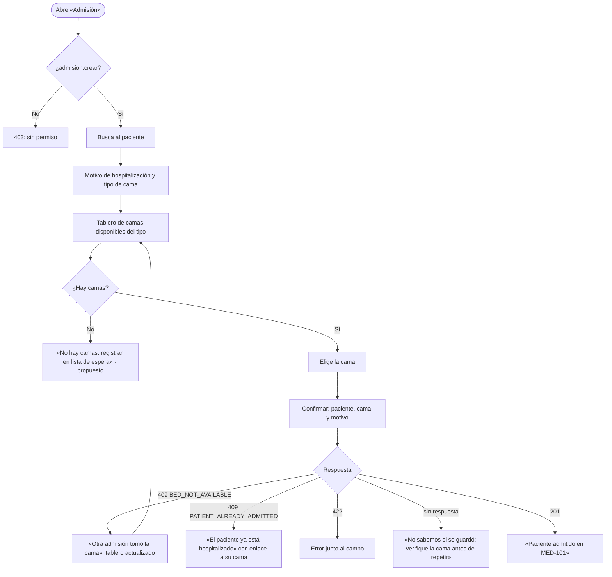

# Admisión hospitalaria y asignación de cama — Semana 8: flujo UX por rol

**Estudiante:** Herrera Sánchez, Axel Eliú (`AxelHerrera11`) · **Módulo:** ASII-07 · **Entrega:** user flow, wireframes iniciales y reglas de interacción.

## Objetivo

Diseñar la experiencia del flujo «admisión de paciente y asignación de una cama disponible» para cada rol autorizado, con estados vacío, carga, éxito y error recuperable, y mensajes que usan los códigos reales del contrato API.

## Roles

| Rol | Objetivo en el flujo | Permiso |
|---|---|---|
| Personal de admisión | Admitir al paciente y asignarle una cama del tipo adecuado | `admision.crear` · `camas.ver` |
| Enfermería de sala | Ver qué camas están libres en su sala | `camas.ver` |
| Jefatura de servicio | Revisar la lista de espera cuando no hay camas | `camas.ver` |

## User flow



## Wireframes iniciales (baja fidelidad)

### 1. Datos de la admisión

```text
┌ Admisión hospitalaria ─────────────────────────────── Hospital: HOSP-DEMO ┐
│ Paciente* [P-DEMO · Juan Pérez (ficticio) ▼]                             │
│ Motivo*   [Neumonía, requiere oxígeno_______________________]           │
│ Tipo de cama* (•) Adulto ( ) Pediátrica ( ) Aislamiento                  │
│                                          [Buscar camas disponibles]     │
└──────────────────────────────────────────────────────────────────────────┘
```

### 2. Tablero de camas disponibles

```text
┌ Camas disponibles · Adulto (2) ──────────────────────────────────────────┐
│ [MED-101 ✓ libre]  [MED-102 ✓ libre]  [MED-103 ✕ ocupada]  [MED-104 🔧]  │
│ Seleccionada: MED-101                          [Volver] [Admitir]        │
└──────────────────────────────────────────────────────────────────────────┘
```

### 3. Error recuperable: la cama se ocupó

```text
┌──────────────────────────────────────────────────────────────────────────┐
│ ⚠ Otra admisión tomó MED-101 hace un momento (BED_NOT_AVAILABLE).        │
│   Elija otra cama del tablero actualizado.                [Ver tablero] │
└──────────────────────────────────────────────────────────────────────────┘
```

## Estados de la pantalla

| Estado | Qué ve el usuario |
|---|---|
| Carga | Tablero en gris con el botón «Admitir» deshabilitado |
| Vacío (sin camas) | «No hay camas de este tipo: registrar en lista de espera» (UC-ADM-09, propuesto) |
| Cama tomada (409) | Aviso y tablero refrescado; la selección se limpia |
| Paciente ya admitido (409) | Enlace a la cama actual del paciente |
| Validación (422) | Error junto al motivo o al tipo de cama |
| Sin respuesta | «No sabemos si se guardó: verifique la cama antes de repetir»; no se reintenta solo |
| Éxito (201) | «Paciente admitido en MED-101» con enlace al episodio |

## Reglas de interacción

- «Admitir» se deshabilita mientras la petición está en curso, para evitar el doble clic (el alta no es idempotente).
- Las camas ocupadas o en mantenimiento se muestran, pero no se pueden seleccionar.
- El tipo de cama filtra el tablero; una cama de otro tipo no aparece como opción.
- Tras un 409 por cama tomada, el tablero se vuelve a pedir automáticamente.

Los wireframes se evalúan en la Semana 9 (usabilidad y accesibilidad) y se adaptan a móvil en la Semana 10. Uso de IA: [DECLARACION_IA.md](./DECLARACION_IA.md).
