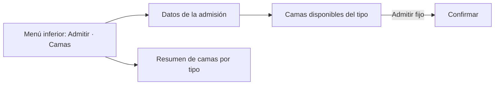

# Admisión hospitalaria y asignación de cama — Semana 10: adaptación responsive y móvil

**Estudiante:** Herrera Sánchez, Axel Eliú (`AxelHerrera11`) · **Módulo:** ASII-07 · **Entrega:** escenarios móviles y prioridades de pantalla.

## Objetivo

Adaptar las pantallas de la [Semana 8](../semana-08/README.md) a teléfono y tablet según cómo se usan en el hospital, con las reglas de [breakpoints.md](./breakpoints.md) y las mejoras de la [Semana 9](../semana-09/README.md).

## Escenarios móviles

| # | Quién y dónde | Qué necesita | Respuesta del diseño |
|---|---|---|---|
| 1 | Enfermería de sala, con tablet | Ver qué camas quedan libres en su sala | Tablero en cuadrícula de 3 columnas con el estado en texto |
| 2 | Personal de admisión, en la estación | Admitir con el flujo completo | Layout de escritorio de la Semana 8 |
| 3 | Jefatura de servicio, con el teléfono | Ver cuántas camas libres hay por tipo | Resumen por tipo (adulto 2 · pediátrica 1) y lista al tocar |

## Prioridad de cada pantalla

| Pantalla | `sm` (teléfono) | `md` (tablet) |
|---|---|---|
| Datos de la admisión | Paciente, motivo y tipo en una columna | Igual, más ancho |
| Tablero de camas | Lista de tarjetas con el estado en texto; «Admitir» fijo abajo | Cuadrícula de 3 columnas |
| Confirmación | Paciente, cama y motivo en tarjetas; «Confirmar» fijo | Diálogo centrado |

## Navegación móvil

## Mejoras de la Semana 9 incorporadas

H1 («sin respuesta») se resuelve con una pantalla completa que bloquea el reenvío hasta «Verificar cama»; H2 (`radiogroup`) se mantiene en las tarjetas del teléfono.

El prototipo navegable de la Semana 11 implementa estos breakpoints. Uso de IA: [DECLARACION_IA.md](./DECLARACION_IA.md).
