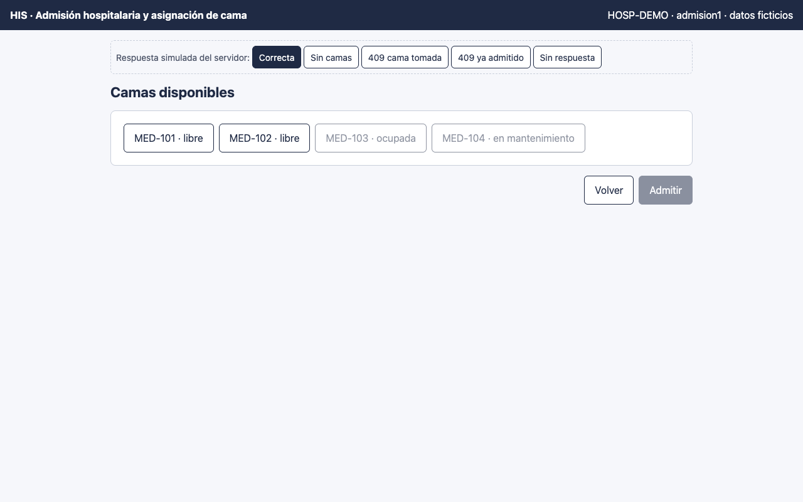
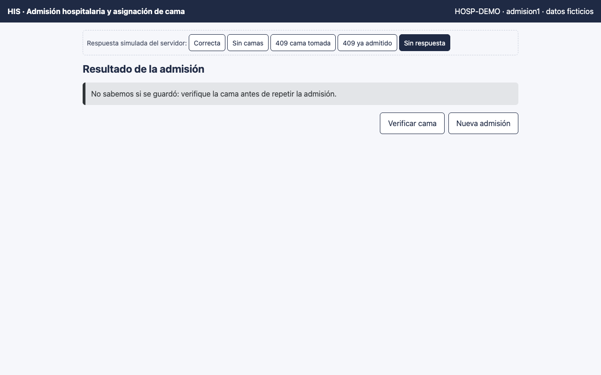
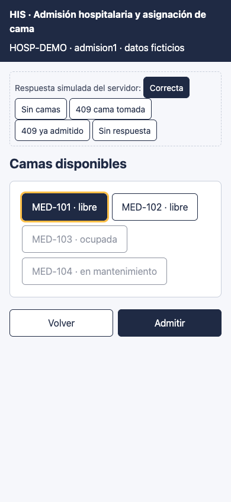

# Admisión hospitalaria y asignación de cama — Semana 11: prototipo navegable

**Estudiante:** Herrera Sánchez, Axel Eliú (`AxelHerrera11`) · **Módulo:** ASII-07 · **Entrega:** prototipo navegable de escritorio y móvil.

## Cómo abrirlo

Abra [`prototipo/index.html`](./prototipo/index.html) en cualquier navegador. Es un solo archivo, funciona sin conexión y no llama a ningún servidor. Para verlo como teléfono, use el modo de dispositivo del navegador (390 px).

- **Pantallas:** datos de la admisión, tablero de camas disponibles y resultado.
- **Simulador:** la barra «Respuesta simulada del servidor» elige qué responde el servidor (Correcta, Sin camas, 409 cama tomada, 409 ya admitido y Sin respuesta), con los mismos códigos del contrato `/api/v1`, para recorrer los caminos de error sin backend.

## Accesibilidad incluida

- Objetivos táctiles de 44 px como mínimo y foco visible (contorno ámbar de 3 px).
- Etiquetas en todos los campos y `fieldset` con `legend` en los grupos.
- Mensajes con texto, no solo color.
- `role="alert"` para lo crítico y `role="status"` para las confirmaciones.
- El foco va al título de cada pantalla y, ante un error, al campo afectado.

## Mejoras de las Semanas 9 y 10 aplicadas

- **H1 («sin respuesta»):** pantalla propia «No sabemos si se guardó» con «Verificar cama» antes de repetir.
- **H2 (`radiogroup`):** las camas son botones con `role="radio"` y `aria-checked`, y la seleccionada se resalta.
- **H3 (mantenimiento sin texto):** cada cama dice «libre», «ocupada» o «en mantenimiento».
- **Doble clic:** «Admitir» se deshabilita al enviar, porque el alta no es idempotente.

## Recorrido automatizado (Chrome headless)

El prototipo se recorrió con Chrome headless (puppeteer), que hace clic y escribe como un usuario y verifica el texto visible: **9 pasos OK y ningún error de JavaScript**. La salida completa está en el PR.

## Capturas

**Tablero de camas adultas (escritorio)**

**«No sabemos si se guardó: verifique la cama»**

**Tablero en el teléfono con «Admitir» fijo abajo**

**Limitaciones:** el diseño visual final depende del layout base de Lis. La prueba con usuarios reales y la medición de contraste con herramienta quedan como siguiente paso. Uso de IA: [DECLARACION_IA.md](./DECLARACION_IA.md).
