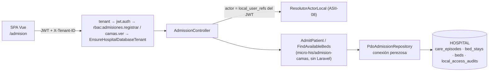

# Admisión hospitalaria y asignación de cama — Semana 16: integración, validación y primera entrega funcional

**Estudiante:** Herrera Sánchez, Axel Eliú (`AxelHerrera11`) · **Módulo:** ASII-07 · **Issue:** #37

El micro-HIS de admisión (Semanas 3 a 5) deja de correr aislado. Ahora está integrado en la API v1 del HIS en Laravel y en la SPA. Los middlewares `tenant`, `jwt.auth` y `rbac` son los reales, más el guard de #1154. La persistencia va a la base HOSPITAL: `care_episodes`, `bed_stays`, `beds.status` y `local_access_audits` H8, en una sola transacción.

| Parte | PR | Alcance |
|---|---|---|
| 1 | #1236 | `AdmissionController`, `AdmisionServiceProvider` (conexión perezosa y guard), pruebas Feature |
| 2 | #1243 | Pantalla Vue `/admision`, recorrido real de la SPA y capturas |
| 3 | este PR | Prueba contra PostgreSQL, recorrido HTTP con login real y este documento |

## Arquitectura de la integración



La transacción abre el episodio `inpatient`, crea la estancia y ocupa la cama con `UPDATE … WHERE status = 'available'`. Si otra admisión gana la carrera, el `UPDATE` no afecta ninguna fila y todo se revierte con `409 BED_NOT_AVAILABLE`.

## Requisitos de la semana

| Requisito | Estado | Evidencia |
|---|---|---|
| Integrar con los componentes reales del HIS | **Hecho** | API v1 detrás de `tenant`, `jwt.auth`, `RequirePermission` y el guard de #1154 (#1236). Pantalla en la SPA (#1243). |
| Límites de autorización y de hospital | **Hecho y probado** | `admisiones.registrar` y `camas.ver` (recepcion y superadmin). El médico recibe 403 al admitir y al listar camas. |
| Persistencia real | **Probado** | `AdmisionPostgresTest`: episodio, estancia, cama y auditoría en una transacción; cama ocupada sin restos; resolver real; base caída → 503. |
| Primera entrega funcional | **Hecho** | Recorrido HTTP 10/10 y recorrido de la SPA 6/6 con login real. |
| Evidencia en staging u on-premise | **Entorno local de verificación** | No hay acceso a un staging del grupo. Se usó la misma pila con el seed de E2E de CI. |
| Errores corregidos | **Hecho** | Ver la tabla «Errores corregidos». |

## Evidencia ejecutada

Entorno: macOS, PHP 8.4.21, PostgreSQL 18.4 y Chrome headless. Bases desechables `his_central_e2e` y `his_hospital_e2e`, migradas con `composer migrate:*` y sembradas con `tests/E2E/fixtures/seed-e2e.php`. El usuario de recepción se agregó con [`agregar-usuario-e2e.php`](./evidencia/agregar-usuario-e2e.php), que solo corre sobre bases `*_e2e`. Todos los datos son ficticios.

```text
$ php vendor/bin/phpunit --testdox tests/Feature/Admision tests/Database/Hospital/AdmisionPostgresTest.php
Admision Postgres
 ✔ Episode stay bed and h8 audit persist in one transaction
 ✔ Occupied bed is rejected and nothing is left behind
 ✔ User without local reference is rejected by the real resolver
 ✔ Unreachable hospital database answers 503 and not 500
Admission Api
 ✔ Identity tenant permission and hospital guard are enforced
 ✔ Reception lists beds and admits the patient
 ✔ Domain rules map to http codes
 ✔ Actor without local reference cannot admit
 ✔ Unavailable hospital answers 503 without details
OK (9 tests, 90 assertions)
```

- Recorrido HTTP con login JWT real: [`evidencia/recorrido-admision.sh`](./evidencia/recorrido-admision.sh). Salida en [`salida-recorrido-admision.txt`](./evidencia/salida-recorrido-admision.txt) (10/10) y lo que quedó en PostgreSQL en [`salida-psql.txt`](./evidencia/salida-psql.txt).
- Recorrido de la SPA: `evidencia/spa-admision.mjs` y `capturas/` (#1243), 6/6.

## Qué es real y qué se simula

| Prueba | Real | Simulado |
|---|---|---|
| `tests/Feature/Admision` | Middlewares, matriz RBAC, guard y controller | Identidad (tenant y JWT); HOSPITAL en memoria |
| `AdmisionPostgresTest` | Además, PostgreSQL con las migraciones de `develop` y el resolver de actor | Identidad |
| Recorrido HTTP y SPA | Login JWT, CENTRAL, tenant, RBAC, guard y HOSPITAL | Nada; solo los datos ficticios |

## Errores corregidos

| Error | Causa | Corrección |
|---|---|---|
| Con la base caída, la API habría respondido 500 | `PdoAdmissionRepository` recibía el `PDO` abierto y las lecturas no traducían `PDOException` | Conexión perezosa y `read()` → `PersistenceFailure` → 503 |
| Un `patient_id` o `bed_id` que no es UUID habría llegado a PostgreSQL (`22P02`) y respondido 503 | Faltaba validar el formato | El controller valida el UUID → 404 |
| La pantalla decía «No hay camas disponibles» mientras cargaba | La lista empezaba vacía | Estado `null` = «Cargando camas…» |
| El error «Seleccione una cama» seguía visible después de elegirla | El error solo se limpiaba al enviar | Se limpia al corregir el formulario |
| Alergias y Admisión chocaban en `bootstrap/providers.php` y en el router | Los dos agregaban líneas en el mismo punto | Cada módulo registra en una línea propia |

## Dependencias y pendientes

| Pendiente | Responsable |
|---|---|
| Selección dinámica de base HOSPITAL por tenant; hasta entonces aplica el guard de #1154 | Integración / Tenants (ASII-25) |
| Sincronización de `local_user_refs` desde CENTRAL; en el recorrido se sembró a mano | Tenants (ASII-25) |
| Liberar la cama al trasladar o dar de alta | Traslados y altas (ASII-08), ya en `develop` |
| Vista de consulta de admisiones para `admision.ver` (médico, enfermería) | ASII-07, siguiente iteración |

[Declaración de uso de IA](./DECLARACION_IA.md)
