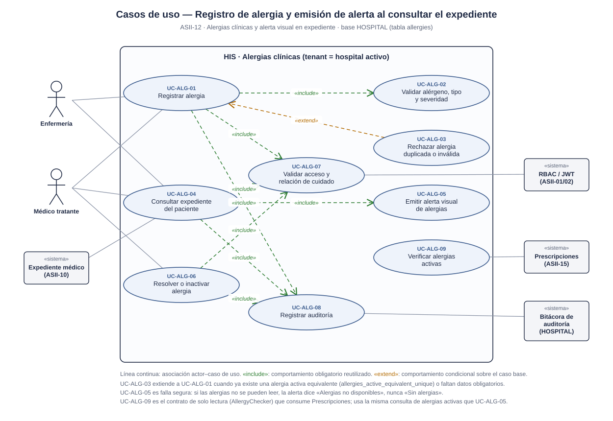
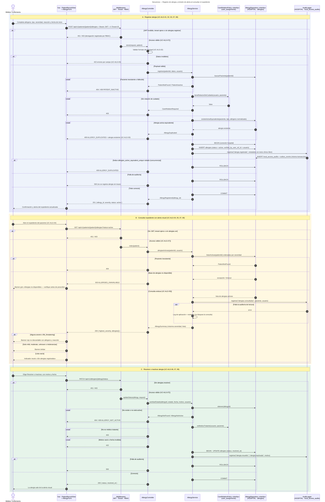

# Alergias clínicas y alerta visual en expediente — Semana 1

## Ficha de la asignación

- **Estudiante:** Herrera Sánchez, Axel Eliú (`AxelHerrera11`)
- **Módulo:** ASII-12 — Alergias clínicas y alerta visual en expediente
- **Semana:** Semana 1 — Conceptos generales, orientación a objetos y UML
- **Tarea individual:** Modele el proceso «registro de alergia y emisión de alerta al consultar el expediente». Casos de uso: delimitar actores y objetivo; el de actividad debe incluir decisiones, excepciones y resultado; el de secuencia debe mostrar participantes, mensajes, validaciones y respuesta. Mantenga trazabilidad entre los tres diagramas.
- **Entregable / evidencia:** UML de casos de uso, actividad y secuencia, y narrativa de alcance y trazabilidad.
- **Estructura:** Sistema Hospitalario Integrado 2026 | Semanas 1–15.

---

## Contexto arquitectónico

- **Backend:** Laravel 12 (PHP 8.2+), JWT y RBAC por permisos (`alergias.registrar`, `alergias.ver`, `alergias.resolver`).
- **Base de datos HOSPITAL (PostgreSQL):** la tabla ya existe en la migración `2026_08_11_000401_create_allergy_and_vital_sign_tables.php`:
  - `allergies`: `local_patient_id`, `verified_by_user_ref_id`, `allergen_code` y/o `allergen_name` (al menos uno), `reaction`, `allergy_type` (`allergy`, `intolerance`, `unknown`), `severity` (`mild`, `moderate`, `severe`, `life_threatening`, `unknown`), `status` (`active`, `inactive`, `resolved`), `onset_date`, `resolved_at` y `recorded_at`.
  - El índice único parcial `allergies_active_equivalent_unique` impide **dos alergias activas equivalentes** (mismo paciente, tipo y alérgeno normalizado).
  - `allergies_status_date_check` exige `resolved_at` cuando la alergia se resuelve o inactiva, y que no sea anterior a `onset_date`.
  - El trigger `allergies_retention` **impide borrar** alergias: se resuelven o inactivan.
- **Relación de cuidado:** se valida con `care_assignments` (médico con asignación activa en un episodio del paciente).
- **Auditoría:** se reutiliza la propuesta de `local_access_audits` (entidad `local_access_audit`, slice H8) documentada por Notas SOAP. Va en la misma conexión y transacción `hospital` que `allergies`.
- **Multitenancy:** el hospital activo llega en `X-Tenant-ID`; las alergias viven en la base de ese hospital.
- **Frontend:** Vue 3, Pinia y Axios (`AllergyForm` y `AllergyBanner` dentro de la vista del expediente).
- **Endpoints preliminares** (se formalizan en la Semana 5):
  - `POST /api/v1/patients/{patient}/allergies`
  - `GET /api/v1/patients/{patient}/allergies?status=active`
  - `PATCH /api/v1/allergies/{allergy}/status`

---

## 1. Diagrama de casos de uso

[Abrir el diagrama de casos de uso en SVG](./01-casos-de-uso.svg) · [Fuente PlantUML](./fuentes/01-casos-de-uso.puml)

### Descripción

El objetivo es que **toda alergia conocida del paciente quede registrada una sola vez, verificada por un profesional, y que cualquier persona que abra el expediente la vea de inmediato**, de forma proporcional a su severidad.

- **Actores principales:**
  - *Médico tratante:* registra, consulta y resuelve o inactiva alergias.
  - *Enfermería:* registra alergias reportadas en la valoración inicial y consulta.
- **Actores secundarios (sistemas):** *Expediente médico (ASII-10)*, que muestra la alerta; *RBAC / JWT*; *Prescripciones (ASII-15)*, que consulta las alergias activas, y la *Bitácora de auditoría*.
- **UC-ALG-01 (Registrar alergia)** incluye `<<include>>` la validación del alérgeno, tipo y severidad (UC-ALG-02), la validación de acceso y relación de cuidado (UC-ALG-07) y la auditoría (UC-ALG-08).
- **UC-ALG-03 (Rechazar alergia duplicada o inválida)** extiende `<<extend>>` a UC-ALG-01 cuando ya existe una alergia activa equivalente o faltan datos obligatorios.
- **UC-ALG-04 (Consultar expediente)** incluye la emisión de la alerta visual (UC-ALG-05), la validación de acceso y la auditoría de la lectura.
- **UC-ALG-06 (Resolver o inactivar)** incluye la validación de acceso y la auditoría.
- **UC-ALG-09 (Verificar alergias activas)** es el contrato de solo lectura que consume Prescripciones (interfaz `AllergyChecker` en su diseño).

## 2. Diagrama de actividades

[Abrir el diagrama de actividades en SVG](./02-actividad.svg) · [Fuente Mermaid](./fuentes/02-actividad.mmd)

### Descripción

Recorre el proceso en cuatro particiones, con sus decisiones, excepciones y resultados.

- **A · Registrar alergia:** acceso (401/403), datos válidos (422), paciente existente y no fallecido (404/409), relación de cuidado (403) y duplicado activo (409 `ALLERGY_DUPLICATED`). El `INSERT` en `allergies` y la auditoría van en una sola transacción: si el índice único salta por un registro concurrente, `409`; si la auditoría falla, `ROLLBACK` y `500`. Resultado: alergia `active` (201).
- **B · Consultar expediente con alerta visual:** acceso (401/403) y paciente (404). Si la consulta de alergias falla, **falla segura**: banner gris «Alergias no disponibles», nunca «sin alergias». Si hay alergias `severe` o `life_threatening`, banner rojo no descartable; si solo hay leves, moderadas, desconocidas o intolerancias, banner ámbar; si no hay, indicador neutro «Sin alergias registradas». La lectura se audita sin bloquear la consulta clínica.
- **C · Resolver o inactivar:** acceso, alergia existente y `active` (404/409), médico tratante (403) y motivo y fecha válidos (422). `UPDATE` y auditoría en la misma transacción. Resultado: la alergia sale de la alerta visual (200).
- **D · Verificar alergias activas para Prescripciones:** acceso de servicio (401/403), paciente (404) y base no disponible (`503 ALLERGIES_UNAVAILABLE`, Prescripciones no guarda ni firma). Resultado: lista de alergias activas (200).

## 3. Diagrama de secuencia

[Abrir el diagrama de secuencia en SVG](./03-secuencia.svg) · [Fuente Mermaid](./fuentes/03-secuencia.mmd)

### Descripción

- **Participantes:** Vue (`PatientRecordView` + `AllergyForm`), middlewares, `AllergyController`, `AllergyService`, `CareRelationPolicy` «interfaz», `AllergyRepository` «interfaz» (HOSPITAL) y `AuditLogger` (HOSPITAL · `local_access_audits`).
- **Dependencias como interfaces:** `CareRelationPolicy` y `AllergyRepository` se modelan como interfaces para que el servicio no dependa de cómo se consulte la relación de cuidado ni de la persistencia. La decisión se desarrolla en la Semana 2.
- **Escenario A (registrar, mensajes 1–30):** `alt` para 401/403 y 422; `break` para paciente inexistente o fallecido (404/409), sin relación de cuidado (403) y duplicado (409). La transacción termina en `alt`: índice único violado por concurrencia (409), falla de auditoría (500) o `COMMIT` y 201.
- **Escenario B (consultar con alerta, mensajes 31–50):** `alt` para 401/403; luego paciente inexistente (404), base no disponible (503 y banner gris) o consulta exitosa. La auditoría de lectura es `opt`: si falla, se registra en el log y no bloquea. La vista elige el banner según la severidad máxima.
- **Escenario C (resolver o inactivar, mensajes 51–68):** `alt` para 401/403; `break` para 404/409, 403 y 422; `UPDATE` y auditoría en la misma transacción, con `ROLLBACK` (500) o `COMMIT` (200).

---

Narrativa completa, trazabilidad, riesgos y dependencias: [narrativa-alcance-trazabilidad.md](./narrativa-alcance-trazabilidad.md) · Uso de IA: [DECLARACION_IA.md](./DECLARACION_IA.md)
