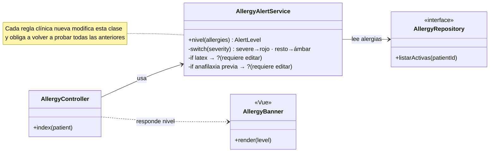
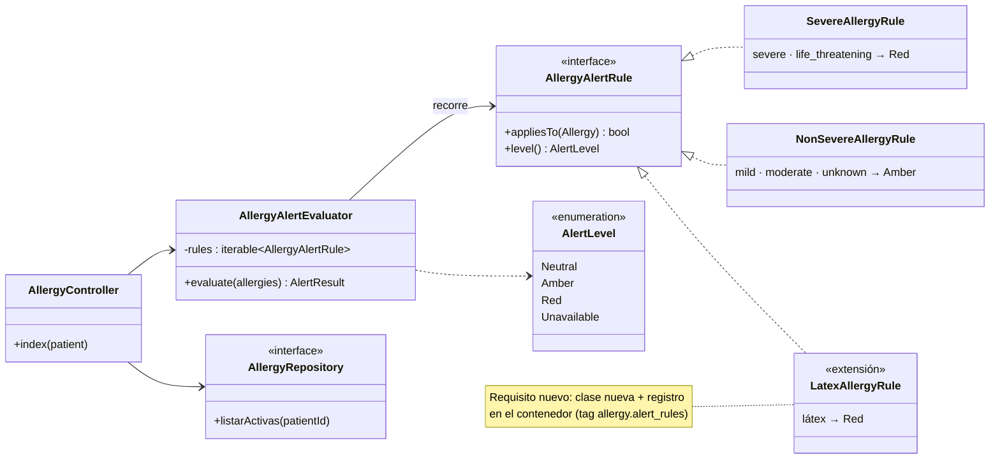

# Aplicación de OCP — Alergias clínicas y alerta visual en expediente

## Principio aplicado

> «No se debe modificar el código de una clase o entidad, sino que estas deben de ser extendidas.» Se logra mediante herencia e interfaces, de modo que agregar un comportamiento nuevo no requiere modificar el código existente, solo crear clases nuevas.
>
> — Rodríguez González, L. M. *Principios básicos del diseño de software*. MVP Cluster. <https://mvpcluster.com/diseno-de-software-2/>

La fuente lo ilustra con una clase `Oferta` que tenía un método por tipo de servicio (consultoría, outsourcing…) y que se resuelve con una subclase por servicio. En este módulo pasa lo mismo con la **alerta visual**: las reglas clínicas que deciden si el banner es rojo o ámbar cambian con el tiempo (el comité de quirófano pide el látex siempre en rojo, farmacia pide destacar la anafilaxia previa…). Si esas reglas viven en un `switch`, cada pedido obliga a modificar y volver a probar la misma clase.

Flujo de la Semana 1 al que se aplica: **B · Consultar expediente con alerta visual** (UC-ALG-04 y UC-ALG-05).

## Diseño antes de OCP

*Antes de OCP — la alerta de alergias se decide con un switch* · [fuente](./fuentes/01-diseno-antes.mmd)

### Problemas detectados

- **Modificación en cada cambio clínico:** agregar la regla del látex implica abrir `AllergyAlertService::nivel()`, agregar otro `if` y volver a probar los casos rojo, ámbar, neutro y no disponible.
- **Riesgo de regresión clínica:** un error en el `switch` puede bajar una alergia grave a ámbar. Es el comportamiento más sensible del módulo y el que más se tocaría.
- **Pruebas acopladas:** no se puede probar una regla aislada; solo el método completo.
- **Responsabilidad difusa:** el servicio lee, decide reglas y arma la respuesta.

## Diseño después de OCP

*Después de OCP — reglas extensibles con AllergyAlertRule* · [fuente](./fuentes/02-diseno-despues.mmd)

## Responsabilidades

| Elemento | Responsabilidad | ¿Cambia al agregar una regla? |
|---|---|---|
| `AllergyAlertRule` «interfaz» | Contrato de una regla: `appliesTo(Allergy)` y `level()`. | No |
| `SevereAllergyRule` | `severe` y `life_threatening` → rojo. | No |
| `NonSevereAllergyRule` | `mild`, `moderate` y `unknown` → ámbar. | No |
| `LatexAllergyRule` (extensión) | Látex → rojo, sin importar la severidad. | Es la clase nueva |
| `AllergyAlertEvaluator` | Recorre las reglas registradas, se queda con el nivel máximo y las alergias que lo disparan; si no hay datos, devuelve `Unavailable` (falla segura). | No |
| `AlertLevel` | Niveles `Neutral`, `Amber`, `Red` y `Unavailable` que entiende la vista. | No |
| `AllergyRepository` «interfaz» | Leer las alergias activas del paciente (HOSPITAL · `allergies`). | No |
| `AllergyController` | Orquestar: leer alergias, evaluar y responder `200` o `503`. | No |
| Registro en el contenedor | Lista de reglas activas (en Laravel, servicios con *tag* `allergy.alert_rules`). | Una línea |

## Justificación de dependencias

- `AllergyAlertEvaluator` depende **solo de la interfaz** `AllergyAlertRule`, nunca de una regla concreta. Por eso está cerrado a modificación: la demo verifica que su código no menciona ninguna regla.
- Las reglas concretas dependen de `Allergy` y `AlertLevel`, que son datos estables del esquema (`allergy_type`, `severity` y `status` ya tienen `CHECK` en la migración `000401`).
- El controlador depende del evaluador y de `AllergyRepository` (interfaz), no de PDO ni de Eloquent. Esto se desarrolla en las Semanas 3 y 4 (capas y Repository).
- La falla segura (`Unavailable`) está en el evaluador y no en una regla, porque no depende de una alergia sino de que los datos existan. Así, ninguna regla nueva puede desactivarla por error.

## Cómo se agrega una regla nueva (paso a paso)

1. Crear la clase que implementa `AllergyAlertRule` (por ejemplo, `LatexAllergyRule` con `appliesTo` = el alérgeno contiene «látex» y `level` = `Red`).
2. Registrarla en el contenedor junto a las demás (`$this->app->tag([...], 'allergy.alert_rules')`).
3. Escribir su prueba unitaria aislada.
4. No se toca `AllergyAlertEvaluator`, ni las reglas existentes, ni el controlador, ni la vista: el nivel sigue siendo uno de los cuatro de `AlertLevel`.

## Beneficio verificable

La [demo ejecutable](./evidencia/demo-ocp.php) implementa los dos diseños y comprueba que:

- El diseño después reproduce el comportamiento del diseño antes en los seis casos base (neutro, ámbar, rojo, intolerancia, alergia resuelta y falla segura).
- Al registrar `LatexAllergyRule`, una alergia al látex leve pasa de ámbar a rojo sin modificar ninguna clase existente.
- El código de `AllergyAlertEvaluator` no menciona ninguna regla concreta.

La salida está en [evidencia-verificable.md](./evidencia-verificable.md).
