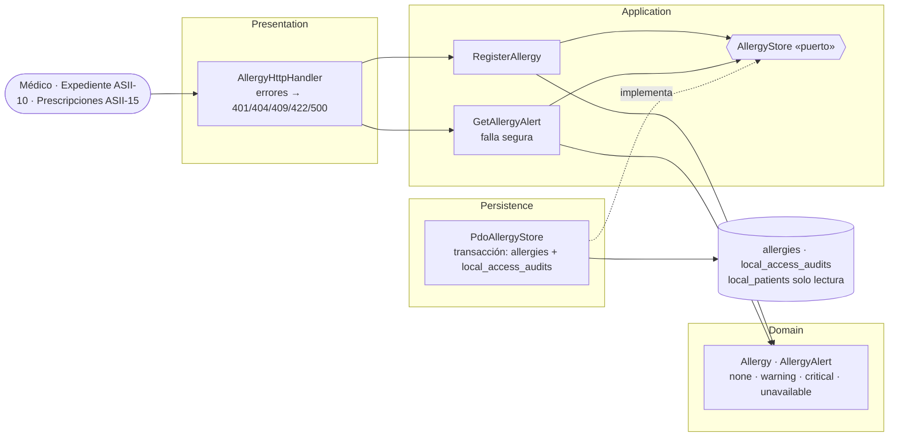

# Alergias clínicas y alerta visual — Semana 3: micro-HIS por capas

**Estudiante:** Herrera Sánchez, Axel Eliú (`AxelHerrera11`) · **Módulo:** ASII-12 · **Código:** [`micro-his/alergias`](../../../micro-his/alergias/)

Flujo implementado: **registrar una alergia y obtener la alerta visual del expediente** (UC-ALG-01 y 05), en PHP 8.2+ vanilla con PDO y sentencias preparadas, sobre las columnas reales de `allergies` (migración HOSPITAL 000401).

## Vista de componentes (C4, nivel 3)

| Capa | Responsabilidad |
|---|---|
| Presentation | Rutas `POST /patients/{id}/allergies` y `GET /patients/{id}/allergy-alert`; mapea errores a HTTP |
| Application | Paciente existente (404), alergia activa equivalente (409) y **falla segura**: si la base no responde, la alerta es «no disponible» |
| Domain | `Allergy` valida alérgeno, tipo y severidad; `AllergyAlert` decide el banner: `critical` si hay una alergia grave o que amenaza la vida |
| Persistence | Alergia y auditoría en una transacción; el índice único parcial de la migración detecta el duplicado aunque cambien mayúsculas o espacios |

## Pruebas (`php micro-his/alergias/tests/run.php`)

SQLite en memoria desde `database/schema.sql`, con datos ficticios. Las **14 verificaciones** cubren los cuatro niveles del banner, el alta auditada, el duplicado (409), tres reglas de dominio (422), paciente inexistente (404), sin usuario (401), la falla de auditoría con rollback y la falla segura de lectura. La salida completa está en el PR.

**Limitaciones:** en el HIS el actor y el tenant llegan por JWT y `X-Tenant-ID`; aquí el actor es un parámetro. Inactivar o resolver alergias, MVC con Repository y el contrato API quedan para las Semanas 4 y 5. Uso de IA: [DECLARACION_IA.md](./DECLARACION_IA.md).
