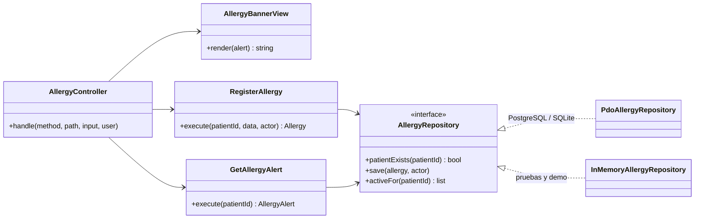

# Alergias clínicas y alerta visual — Semana 4: MVC y Repository

**Estudiante:** Herrera Sánchez, Axel Eliú (`AxelHerrera11`) · **Módulo:** ASII-12 · **Código:** [`micro-his/alergias`](../../../micro-his/alergias/)

Sobre el micro-HIS de la [Semana 3](../semana-03/README.md), esta semana organiza la presentación en **MVC** (con el banner del expediente como View) y formaliza el acceso a datos con el patrón **Repository**, con dos adaptadores que cumplen el mismo contrato.

## Mapa MVC

| Rol | Clase | Qué hace |
|---|---|---|
| Model | `Domain/Allergy`, `Domain/AllergyAlert` + `RegisterAllergy`, `GetAllergyAlert` + `AllergyRepository` | Reglas, falla segura y acceso a datos; no sabe de HTTP ni de HTML |
| View | `Presentation/AllergyBannerView` | Banner con `role="alert"` y color por nivel (`critical`, `warning`, `none`, `unavailable`); escapa todo texto |
| Controller | `Presentation/AllergyController` | Traduce la petición, llama al caso de uso, elige JSON o el banner (`?format=html`) y mapea errores |
| Front controller | `public/index.php` | Arma las dependencias, lee la petición y escribe la respuesta |



## Repository

- El puerto `AllergyStore` de la Semana 3 pasa a ser `AllergyRepository`.
- `PdoAllergyRepository` usa la tabla real `allergies` con su índice único parcial; `InMemoryAllergyRepository` aplica el mismo criterio de duplicado (paciente, tipo y alérgeno sin mayúsculas) y puede simular la base caída al escribir o al leer.
- **Prueba de contrato:** `tests/run.php` ejecuta la misma batería de 15 verificaciones con los dos adaptadores (30 en total), incluida la falla segura: sin base, el banner dice «Alergias no disponibles», nunca «Sin alergias».

## Repositorio compartido (base HOSPITAL)

`allergies` vive en la base HOSPITAL que comparten todos los módulos. **Regla propuesta:** un solo módulo escribe cada tabla. ASII-12 escribe `allergies` y su auditoría y solo lee `local_patients` (dueño: ASII-03). Prescripciones (ASII-15) y el Expediente (ASII-10) leen por la API del módulo, para conservar la falla segura; Reportes, por una vista de solo lectura. Integrarlo es cambiar `MICROHIS_DSN` a esa base.

## Cómo ejecutarlo

```bash
php micro-his/alergias/tests/run.php                           # 30 verificaciones
php -S 127.0.0.1:8082 -t micro-his/alergias/public             # SQLite temporal con el paciente P-DEMO
curl -s "127.0.0.1:8082/patients/P-DEMO/allergy-alert?format=html" -H 'X-User-Ref: medico1'
```

**Limitaciones:** el usuario llega en `X-User-Ref` (el JWT y el tenant son de la Semana 5). Uso de IA: [DECLARACION_IA.md](./DECLARACION_IA.md).
