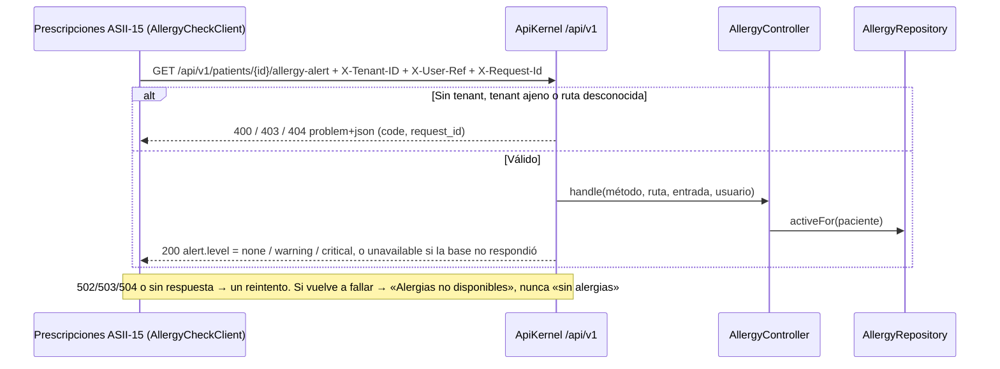

# Alergias clínicas y alerta visual — Semana 5: cliente-servidor y frontera de microservicio

**Estudiante:** Herrera Sánchez, Axel Eliú (`AxelHerrera11`) · **Módulo:** ASII-12 · **Código:** [`micro-his/alergias`](../../../micro-his/alergias/) · **Contrato:** [`openapi.yaml`](../../../micro-his/alergias/openapi.yaml)

El micro-HIS de la [Semana 4](../semana-04/README.md) pasa a ser un **servidor API v1** con un **cliente** separado que solo conoce el contrato HTTP.



| Pieza | Qué hace |
|---|---|
| `Presentation/ApiKernel` | Prefijo `/api/v1`, `X-Tenant-ID` igual al del servidor (`MICROHIS_TENANT`), `X-Request-Id` (lo recibe o lo genera), errores RFC 9457 y `/health` y `/health/ready` |
| `public/index.php` | Front controller del servidor y log de acceso en JSON sin datos clínicos |
| `client/AllergyCheckClient` | Timeout de 0,5 s al conectar y 2 s en total y un reintento seguro. **Falla segura en dos niveles:** el servidor responde `unavailable` si su base cae, y el cliente también, si el servidor no responde |
| `openapi.yaml` | Contrato OpenAPI 3.1 validado con `npx @redocly/cli@1.34.5 lint`; una prueba comprueba que cada ruta declarada existe en el servidor |

## Frontera de microservicio

**Decisión: no se separa.** Prescripciones consulta las alergias de forma síncrona antes de firmar y el Expediente pinta el banner en cada apertura. Un servicio aparte sumaría un salto de red y un punto de falla en el camino clínico más sensible, y la tabla `allergies` comparte transacción con la auditoría de la base HOSPITAL. Se queda como módulo con esta API como frontera; si se separa después, solo cambia la URL base del cliente.

**Propuesto, no implementado:** JWT en lugar de `X-User-Ref`, `Idempotency-Key` en el alta y un evento `alergia.registrada` por outbox para la red federada.

## Cómo ejecutarlo

```bash
php micro-his/alergias/tests/run.php && php micro-his/alergias/tests/api.php
php -S 127.0.0.1:8082 -t micro-his/alergias/public
curl -s 127.0.0.1:8082/api/v1/patients/P-DEMO/allergy-alert -H 'X-Tenant-ID: HOSP-DEMO' -H 'X-User-Ref: medico1'
```

Uso de IA: [DECLARACION_IA.md](./DECLARACION_IA.md).
