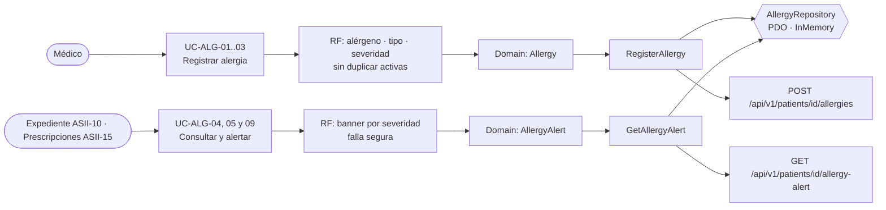

# Alergias clínicas y alerta visual — Semana 6: primera evaluación parcial

**Estudiante:** Herrera Sánchez, Axel Eliú (`AxelHerrera11`) · **Módulo:** ASII-12 · **Entrega:** defensa teórica y caso práctico arquitectónico.

## Tesis arquitectónica

En el flujo «registro de alergia y emisión de alerta al consultar el expediente», **el sistema nunca dice «sin alergias» cuando no lo sabe**. La alerta se decide en el dominio (`AllergyAlert`) con cuatro niveles: `none`, `warning`, `critical` y `unavailable`. La falla segura se aplica en dos lugares: el servidor responde `unavailable` si su base cae, y el cliente de Prescripciones también, si el servidor no responde. Las alergias se guardan en la tabla real `allergies` de la base HOSPITAL, cuyo índice único parcial impide duplicar una alergia activa.

## Trazabilidad de punta a punta

| Semana | Qué aportó | Evidencia |
|---|---|---|
| 1 | Actores, UC-ALG-01..09, actividad y secuencia sobre la migración HOSPITAL 000401 | `docs/alergias/semana-01/` (PR #42, integrado) |
| 2 | RF/RNF y OCP para la decisión de la alerta | `docs/alergias/semana-02/` (PR #47, integrado) |
| 3 | Micro-HIS por capas con PDO, falla segura y pruebas | `micro-his/alergias/` (PR #200) |
| 4 | MVC (el banner como View) + Repository PDO e InMemory | Reentrega de la Semana 4 (diseño del PR #58) |
| 5 | API v1, `AllergyCheckClient` con falla segura, OpenAPI y frontera | Reentrega de la Semana 5 (diseño del PR #62) |

## Decisiones defendidas

| Decisión | Por qué | Evidencia verificable |
|---|---|---|
| `unavailable` es un nivel propio, distinto de `none` | Confundir «no se pudo leer» con «no tiene» autoriza prescribir a ciegas | Prueba «base sin respuesta → no disponible, nunca sin alergias» (servidor y cliente) |
| La decisión del banner vive en el dominio (`AllergyAlert`) | El Expediente y Prescripciones ven exactamente la misma regla | `critical` si hay una alergia grave o que amenaza la vida |
| Reglas de alerta abiertas a extensión (OCP) | Un pedido clínico nuevo no debe tocar el evaluador | Demo de la Semana 2 (`semana-02/evidencia/demo-ocp.php`) |
| El duplicado lo decide el índice único de la migración real | Dos médicos pueden registrar la misma alergia al mismo tiempo | `409 ALLERGY_ALREADY_ACTIVE` aunque cambien mayúsculas o espacios |
| Alergia y auditoría en una transacción; `local_patients` solo se lee | La evidencia no se pierde y no se escribe la tabla de otro módulo (ASII-03) | Prueba de rollback con la auditoría caída |
| Repository como puerto y contrato `/api/v1` | Prescripciones depende del contrato, no de la base | Misma batería con PDO e InMemory; `openapi.yaml` validado |

**Riesgos que sigo defendiendo como abiertos:** el código de alérgeno debe acordarse con el catálogo de medicamentos (Yamilet), y Prescripciones (María) debe tratar `unavailable` como bloqueo o confirmación manual.
