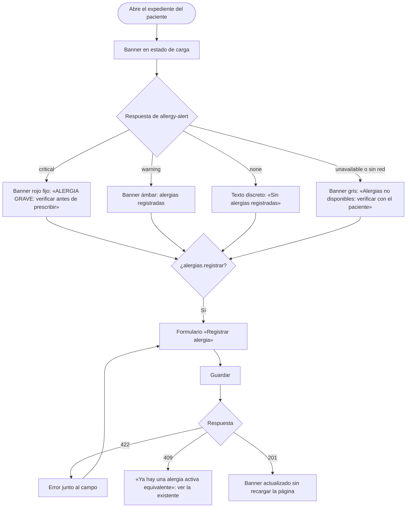

# Alergias clínicas y alerta visual en expediente — Semana 8: flujo UX por rol

**Estudiante:** Herrera Sánchez, Axel Eliú (`AxelHerrera11`) · **Módulo:** ASII-12 · **Entrega:** user flow, wireframes iniciales y reglas de interacción.

## Objetivo

Diseñar la experiencia del flujo «registro de alergia y emisión de alerta al consultar el expediente» para cada rol autorizado, con estados vacío, carga, éxito y error recuperable, y mensajes que usan los códigos reales del contrato API.

## Roles

| Rol | Objetivo en el flujo | Permiso |
|---|---|---|
| Médico | Ver el banner al abrir el expediente y registrar una alergia | `alergias.ver` · `alergias.registrar` |
| Enfermería | Ver el banner antes de administrar un medicamento | `alergias.ver` |
| Prescripciones (ASII-15) | Consultar el nivel antes de firmar una receta | `alergias.ver` |

## User flow

