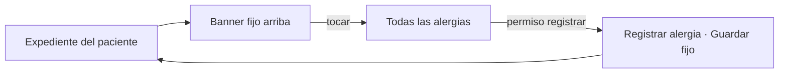

# Alergias clínicas y alerta visual en expediente — Semana 10: adaptación responsive y móvil

**Estudiante:** Herrera Sánchez, Axel Eliú (`AxelHerrera11`) · **Módulo:** ASII-12 · **Entrega:** escenarios móviles y prioridades de pantalla.

## Objetivo

Adaptar las pantallas de la [Semana 8](../semana-08/README.md) a teléfono y tablet según cómo se usan en el hospital, con las reglas de [breakpoints.md](./breakpoints.md) y las mejoras de la [Semana 9](../semana-09/README.md).

## Escenarios móviles

| # | Quién y dónde | Qué necesita | Respuesta del diseño |
|---|---|---|---|
| 1 | Enfermería, junto a la cama, con el teléfono | Confirmar que el paciente no es alérgico antes de administrar un antibiótico | Banner arriba del expediente, siempre visible, con el alérgeno y la severidad |
| 2 | Médico de guardia, en urgencias | Registrar una alergia que refiere el paciente | Formulario corto en una columna con el botón «Guardar» fijo abajo |
| 3 | Médico en Prescripciones, en tablet | Ver el banner al lado de la receta | Banner sobre el formulario de receta; con `critical` bloquea «Firmar» hasta confirmar |

## Prioridad de cada pantalla

| Pantalla | `sm` (teléfono) | `md` (tablet) |
|---|---|---|
| Banner del expediente | Fijo arriba al hacer scroll; muestra la alergia más grave y «+n» | Igual, con las 2 más graves |
| Lista de alergias | Tarjetas: alérgeno, severidad y reacción | Tabla |
| Registrar alergia | Una columna; severidad como lista grande; «Guardar» fijo | Dos columnas |

## Navegación móvil

## Mejoras de la Semana 9 incorporadas

H1 (contraste de «no disponible») se resuelve con gris oscuro e ícono también en `sm`; H3 (banner largo) se resuelve mostrando solo la alergia más grave y «+n» en el teléfono.

El prototipo navegable de la Semana 11 implementa estos breakpoints. Uso de IA: [DECLARACION_IA.md](./DECLARACION_IA.md).
