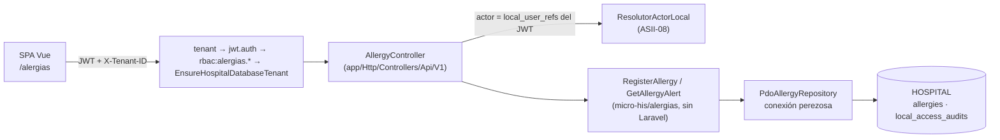

# Alergias clínicas y alerta visual en expediente — Semana 16: integración, validación y primera entrega funcional

**Estudiante:** Herrera Sánchez, Axel Eliú (`AxelHerrera11`) · **Módulo:** ASII-12 · **Issue:** #38

El micro-HIS de alergias (Semanas 3 a 5) deja de correr aislado. Ahora está integrado en la API v1 del HIS en Laravel y en la SPA. Los middlewares `tenant`, `jwt.auth` y `rbac` son los reales, y la persistencia va a la base HOSPITAL (`allergies` y `local_access_audits` H8).

| Parte | PR | Alcance |
|---|---|---|
| 1 | #1232 | `AllergyController`, `AlergiasServiceProvider` (conexión perezosa y guard de #1154), pruebas Feature |
| 2 | #1235 | Pantalla Vue `/alergias`, recorrido real de la SPA y capturas |
| 3 | este PR | Prueba contra PostgreSQL, recorrido HTTP con login real y este documento |

## Arquitectura de la integración



El dominio no conoce Laravel. El provider solo cablea el adaptador PDO sobre la conexión `hospital`. Si la base no responde, el fallo ocurre dentro del caso de uso y la API responde 503 y no 500.

## Requisitos de la semana

| Requisito | Estado | Evidencia |
|---|---|---|
| Integrar con los componentes reales del HIS | **Hecho** | API v1 detrás de `tenant`, `jwt.auth`, `RequirePermission` y el guard de #1154 (#1232). Pantalla en la SPA (#1235). |
| Límites de autorización y de hospital | **Hecho y probado** | Matriz real de `config/rbac.php`: `alergias.ver` y `alergias.registrar` para medico, enfermeria y superadmin. Respuestas 401, 403 por tenant, 403 por permiso y 403 o 503 del guard. |
| Persistencia real | **Probado** | `AlergiasPostgresTest`: fila en `allergies`, auditoría H8 en la misma transacción, índice único real y resolver real de actor. |
| Primera entrega funcional | **Hecho** | Recorrido HTTP 9/9 y recorrido de la SPA 7/7 con login real. |
| Evidencia en staging u on-premise | **Entorno local de verificación** | No hay acceso a un staging del grupo. El recorrido corre en local, con la misma pila y el seed de E2E de CI. |
| Errores corregidos | **Hecho** | Ver la tabla «Errores corregidos». |

## Evidencia ejecutada

Entorno: macOS, PHP 8.4.21, PostgreSQL 18.4 y Chrome headless. Bases desechables `his_central_e2e` y `his_hospital_e2e`, migradas con `composer migrate:*` y sembradas con `tests/E2E/fixtures/seed-e2e.php`. `HOSPITAL_DB_TENANT_ID` es el hospital E2E 1. Todos los datos son ficticios.

```text
$ php vendor/bin/phpunit --testdox tests/Feature/Alergias tests/Database/Hospital/AlergiasPostgresTest.php
Alergias Postgres
 ✔ Allergy and h8 audit persist through the api
 ✔ Real unique index rejects an equivalent active allergy
 ✔ User without local reference is rejected by the real resolver
 ✔ Unreachable hospital database answers 503 and not 500
Allergy Api
 ✔ Identity tenant and permission are enforced
 ✔ Hospital database guard fails closed
 ✔ Register then alert shows critical banner
 ✔ Domain rules map to http codes
 ✔ Unavailable hospital answers 503 and never no allergies
 ✔ Failed read keeps the domain safe warning
OK (10 tests, 93 assertions)
```

- Recorrido HTTP con login JWT real: [`evidencia/recorrido-alergias.sh`](./evidencia/recorrido-alergias.sh). Salida en [`salida-recorrido-alergias.txt`](./evidencia/salida-recorrido-alergias.txt) (9/9) y lo que quedó en PostgreSQL en [`salida-psql.txt`](./evidencia/salida-psql.txt).
- Recorrido de la SPA: `evidencia/spa-alergias.mjs` y `capturas/` (#1235), 7/7.

## Qué es real y qué se simula

| Prueba | Real | Simulado |
|---|---|---|
| `tests/Feature/Alergias` | Middlewares, matriz RBAC, guard y controller | Identidad (tenant y JWT); HOSPITAL en memoria |
| `AlergiasPostgresTest` | Además, PostgreSQL con las migraciones de `develop` y el resolver de actor | Identidad |
| Recorrido HTTP y SPA | Login JWT, CENTRAL, tenant, RBAC, guard y HOSPITAL | Nada; solo los datos ficticios |

## Errores corregidos

| Error | Causa | Corrección |
|---|---|---|
| Con la base HOSPITAL caída, la API habría respondido 500 | `PdoAllergyRepository` recibía el `PDO` ya abierto al construir el controller | Conexión perezosa (`Closure`); `patientExists` traduce `PDOException` a `PersistenceFailure` → 503 |
| `GET …/allergy-alert` de un paciente inexistente respondía «Sin alergias registradas» | `activeFor` devuelve `[]` y el dominio lo interpreta como `none` | El controller comprueba antes que el paciente exista → 404 |
| Un identificador que no es UUID caía en la ruta comodín de la SPA | `whereUuid` en la ruta | Se valida con `Str::isUuid` en el controller → 404 JSON |
| Un tenant ajeno con permiso podía leer las alergias de la única base HOSPITAL | Hay una sola conexión fija | Guard `EnsureHospitalDatabaseTenant` de #1154 |
| En la pantalla, un 409 mostraba «Indique el código o el nombre del alérgeno» | El mensaje salía del campo, no del código del servidor | El mensaje del campo sale del código del servidor |

## Dependencias y pendientes

| Pendiente | Responsable |
|---|---|
| Selección dinámica de base HOSPITAL por tenant; hasta entonces aplica el guard de #1154 | Integración / Tenants (ASII-25) |
| Sincronización de `local_user_refs` desde CENTRAL; en el recorrido se sembró a mano | Tenants (ASII-25) |
| Ligar `allergen_code` al principio activo del catálogo de medicamentos | ASII-14 |
| Consumo del banner desde Prescripciones (`AllergyChecker`) | ASII-15 |
| Caso de uso «resolver alergia» (`alergias.resolver` ya existe en la matriz) | ASII-12, siguiente iteración |

[Declaración de uso de IA](./DECLARACION_IA.md)
