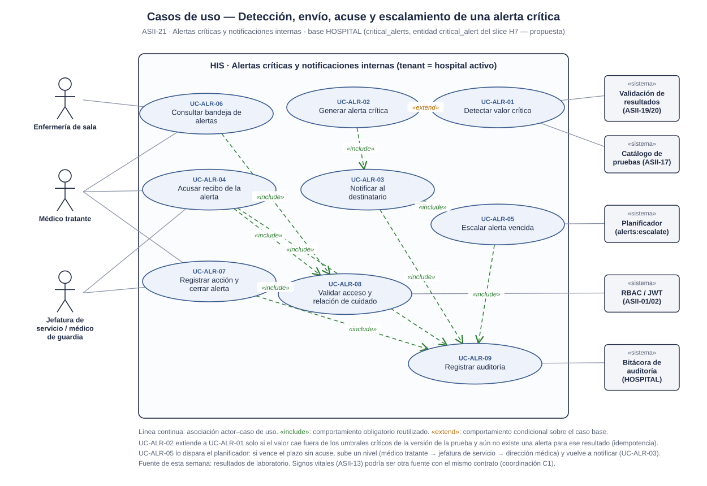
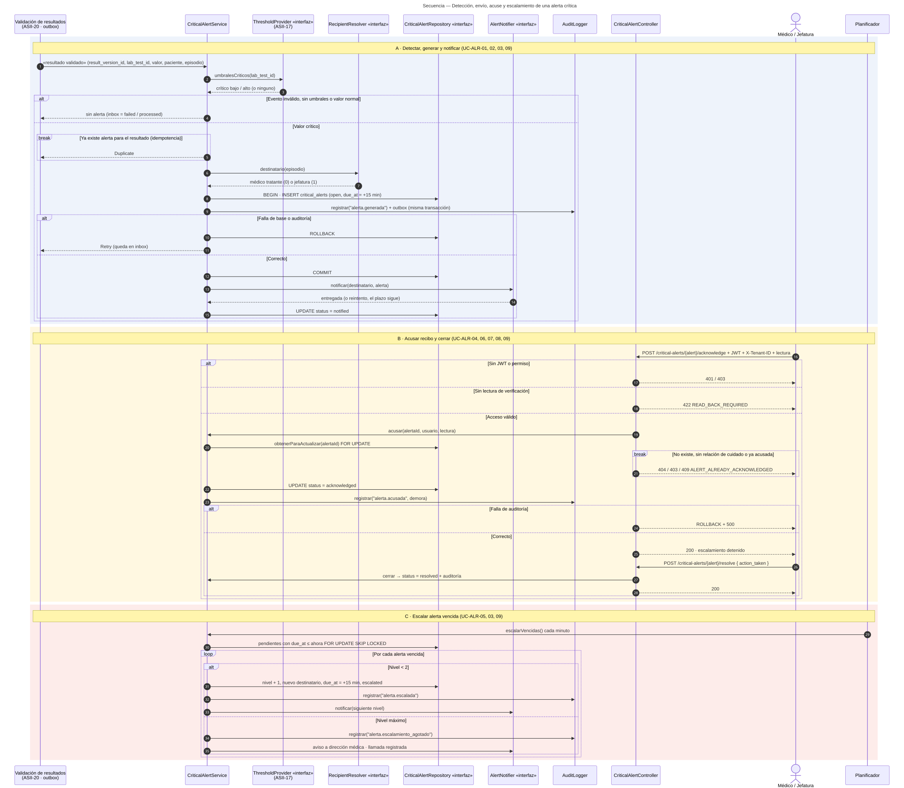

# Alertas críticas y notificaciones internas — Semana 1

## Ficha de la asignación

- **Estudiante:** Herrera Sánchez, Axel Eliú (`AxelHerrera11`)
- **Módulo:** ASII-21 — Alertas críticas y notificaciones internas
- **Semana:** Semana 1 — Conceptos generales, orientación a objetos y UML
- **Tarea:** modelar el proceso «detección, envío, acuse y escalamiento de una alerta crítica» con casos de uso, actividad (decisiones, excepciones y resultado) y secuencia (participantes, mensajes, validaciones y respuesta), con trazabilidad entre los tres.
- **Evidencia:** los tres diagramas UML y la [narrativa de alcance y trazabilidad](./narrativa-alcance-trazabilidad.md).

## Contexto arquitectónico

- **Backend:** Laravel 12 con JWT y permisos `alertas.ver`, `alertas.acusar` y `alertas.cerrar`. Una cola consume los eventos y el planificador ejecuta `alerts:escalate`.
- **Base HOSPITAL:** la entidad `critical_alert` está prevista en el slice H7, pero **aún no tiene migración**. La propuesta de columnas está en el [Anexo A](./narrativa-alcance-trazabilidad.md#anexo-a--propuesta-de-critical_alerts). Los umbrales vienen de `lab_tests` (ASII-17) y el médico tratante, de `care_assignments`.
- **Eventos:** `outbox_events` e `inbox_messages` (slice H8) para la entrega al menos una vez y la idempotencia.
- **Multitenancy:** la alerta vive en la base del hospital donde se validó el resultado (`X-Tenant-ID`).
- **Endpoints preliminares:** `GET /api/v1/critical-alerts`, `POST /api/v1/critical-alerts/{alert}/acknowledge` y `POST /api/v1/critical-alerts/{alert}/resolve`.

## 1. Diagrama de casos de uso

[Fuente PlantUML](./fuentes/01-casos-de-uso.puml)

- **Actores:** médico tratante (acusa y registra la acción), jefatura de servicio o guardia (recibe las alertas escaladas), enfermería de sala (consulta la bandeja).
- **Sistemas:** Validación de resultados (ASII-20) publica el evento; Catálogo de pruebas (ASII-17) define los umbrales; el planificador escala; RBAC/JWT y la bitácora de auditoría.
- UC-ALR-02 (Generar alerta) `<<extend>>` UC-ALR-01 (Detectar valor crítico) solo si el valor supera un umbral y no hay alerta previa; incluye la notificación (UC-ALR-03).
- UC-ALR-04 (Acusar), UC-ALR-06 (Bandeja) y UC-ALR-07 (Cerrar) incluyen la validación de acceso y relación de cuidado (UC-ALR-08). UC-ALR-05 (Escalar) incluye UC-ALR-03. Los que cambian estado incluyen la auditoría (UC-ALR-09).

## 2. Diagrama de actividades

[Fuente Mermaid](./fuentes/02-actividad.mmd)

- **A · Detectar y notificar:** un evento incompleto se marca `failed`; sin umbrales o con valor normal no hay alerta; un duplicado se ignora (idempotencia). La alerta, la auditoría y el outbox van en una transacción; si falla, el evento se reintenta. Si el canal falla, se reintenta y el plazo de acuse sigue corriendo.
- **B · Acusar y cerrar:** 401/403 sin acceso, `422 READ_BACK_REQUIRED` sin lectura de verificación, 404/403/409 si no existe, no hay relación de cuidado o ya fue acusada, y 500 con ROLLBACK si falla la auditoría. El acuse detiene el escalamiento; luego se registra la acción y se cierra.
- **C · Escalar:** cada minuto, con `FOR UPDATE SKIP LOCKED`, sube un nivel (tratante → jefatura → dirección médica) con un plazo nuevo. En el nivel máximo marca el escalamiento como agotado y la alerta sigue abierta.

## 3. Diagrama de secuencia

[Fuente Mermaid](./fuentes/03-secuencia.mmd)

- **Responsabilidades separadas:** detectar (`ThresholdProvider`), elegir destinatario (`RecipientResolver`), persistir (`CriticalAlertRepository`) y entregar (`AlertNotifier`) son interfaces distintas, base del SRP de la Semana 2.
- Usa `alt` para los caminos de error, `break` para el duplicado y los rechazos del acuse, y `loop` para las alertas vencidas.

Uso de IA: [DECLARACION_IA.md](./DECLARACION_IA.md)
