# Aplicación de SRP — Alertas críticas y notificaciones internas

> «Cada clase tiene que tener una responsabilidad única y concreta.» «Una clase debería tener una y sólo una razón para cambiar» (R. C. Martin).
> — Rodríguez González, L. M. *Principios básicos del diseño de software*. MVP Cluster.

La fuente separa un `Vendedor` que generaba ofertas y cerraba ventas. En las alertas hay **cuatro** orígenes de cambio sobre la misma clase: laboratorio (umbrales), dirección médica (a quién escalar), TI (canal) y calidad (plazos).

## Antes

Cada cambio abre `CriticalAlertManager` y obliga a volver a probar todo, incluida la detección: un cambio de canal podría hacer que un valor crítico no genere alerta.

## Después

| Clase | Única razón para cambiar |
|---|---|
| `CriticalValueDetector` | La política clínica de valores críticos (laboratorio) |
| `RecipientResolver` | El organigrama y las guardias (dirección médica) |
| `EscalationPolicy` | Los plazos y el nivel máximo (calidad) |
| `AlertNotifier` «interfaz» (`InboxNotifier`, `OutboxNotifier`) | El canal (TI) |
| `CriticalAlertRegistrar` | Cómo nace una alerta: idempotencia, destinatario y plazo inicial |
| `AlertEscalator` | El procedimiento de escalamiento |
| `AlertRepository` / `AuditLogger` | La persistencia / el formato de auditoría |
| `CriticalAlertFlow` | El orden del flujo; no decide reglas |

## Dependencias

- El detector y el resolvedor **no tienen dependencias**; la demo lo verifica por reflexión.
- El registrador **no depende del canal**: un fallo de entrega nunca deshace una alerta registrada (regla de la Semana 1: notificar después del `COMMIT`).
- El plazo vive solo en `EscalationPolicy`, inyectada en el registrador y el escalador.
- El acuse y el cierre se implementan en el micro-HIS de la Semana 3.
