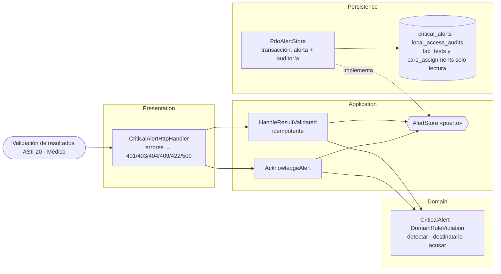

# Alertas críticas y notificaciones internas — Semana 3: micro-HIS por capas

**Estudiante:** Herrera Sánchez, Axel Eliú (`AxelHerrera11`) · **Módulo:** ASII-21 · **Código:** [`micro-his/alertas-criticas`](../../../micro-his/alertas-criticas/). Flujo implementado: **resultado validado → alerta crítica → acuse con lectura de verificación** (UC-ALR-01, 02 y 04), en PHP 8.2+ vanilla con PDO y sentencias preparadas.

| Capa | Responsabilidad |
|---|---|
| Presentation | `POST /internal/result-validated` (201 creada, 200 `duplicate` o `not_critical`) y `POST /critical-alerts/{id}/acknowledge` |
| Application | Valida el evento (422), detecta y guarda una sola vez por resultado; en el acuse, el primero gana (409) |
| Domain | `CriticalAlert::detect` compara con los umbrales de la versión de la prueba y elige médico tratante (nivel 0) o jefatura (nivel 1), con plazo de 15 min; `acknowledge` exige relación de cuidado (403) y lectura de paciente, prueba y valor (422) |
| Persistence | Alerta o acuse con su auditoría en una transacción; el `UNIQUE` por resultado da la idempotencia y el `UPDATE … WHERE status = 'open'`, el acuse único |

**Pruebas** (`php micro-his/alertas-criticas/tests/run.php`): SQLite en memoria desde `database/schema.sql`, con datos ficticios. Las **13 verificaciones** cubren detección, idempotencia, valor normal o prueba sin umbrales, jefatura sin médico, evento inválido, lectura incorrecta, sin relación de cuidado, alerta inexistente, acuse doble, sin usuario y la falla de auditoría con rollback. La salida completa está en el PR. **Limitaciones:** la notificación (outbox), el escalamiento y el cierre quedan para las Semanas 4 y 5; `critical_alerts` sigue siendo una propuesta (Anexo A). Uso de IA: [DECLARACION_IA.md](./DECLARACION_IA.md).
