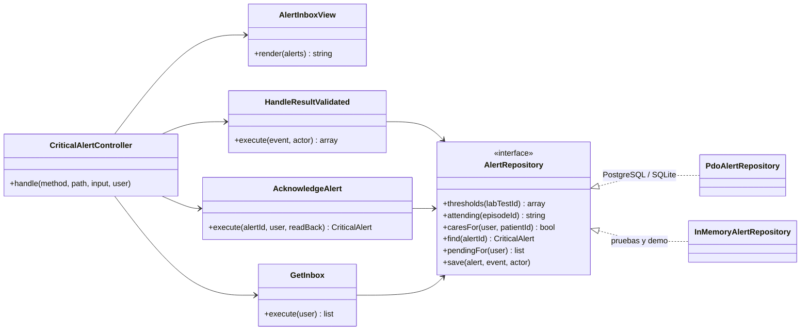

# Alertas críticas y notificaciones internas — Semana 4: MVC y Repository

**Estudiante:** Herrera Sánchez, Axel Eliú (`AxelHerrera11`) · **Módulo:** ASII-21 · **Código:** [`micro-his/alertas-criticas`](../../../micro-his/alertas-criticas/)

Sobre el micro-HIS de la [Semana 3](../semana-03/README.md), esta semana organiza la presentación en **MVC** (con la bandeja del médico como View) y formaliza el acceso a datos con el patrón **Repository**, con dos adaptadores que cumplen el mismo contrato.

## Mapa MVC

| Rol | Clase | Qué hace |
|---|---|---|
| Model | `Domain/CriticalAlert` + `HandleResultValidated`, `AcknowledgeAlert`, `GetInbox` + `AlertRepository` | Detección, idempotencia, acuse y bandeja; no sabe de HTTP ni de HTML |
| View | `Presentation/AlertInboxView` | Bandeja de alertas pendientes (UC-ALR-06) con `role="alert"`, valor y vencimiento; escapa todo texto |
| Controller | `Presentation/CriticalAlertController` | Traduce la petición, llama al caso de uso, elige JSON o la View (`?format=html`) y mapea errores |
| Front controller | `public/index.php` | Arma las dependencias, lee la petición y escribe la respuesta |



## Repository

- El puerto `AlertStore` de la Semana 3 pasa a ser `AlertRepository`, con una consulta nueva: `pendingFor` para la bandeja.
- `PdoAlertRepository` guarda alerta o acuse con su auditoría en una transacción. `InMemoryAlertRepository` da las mismas garantías: una alerta por resultado, un solo acuse y la falla simulada de la base.
- **Prueba de contrato:** `tests/run.php` ejecuta la misma batería de 15 verificaciones con los dos adaptadores (30 en total).

## Repositorio compartido (base HOSPITAL)

**Regla propuesta:** un solo módulo escribe cada tabla. ASII-21 es dueño de `critical_alerts` (Anexo A, propuesta) y escribe su auditoría. Solo lee `lab_tests` (dueño ASII-17) y `care_assignments` (ASII-04/10), y guarda el `lab_test_id` exacto de la versión usada. El evento «resultado validado» llega de ASII-20 por el inbox, no por SQL directo. Integrarlo es cambiar `MICROHIS_DSN` a esa base.

## Cómo ejecutarlo

```bash
php micro-his/alertas-criticas/tests/run.php                     # 30 verificaciones
php -S 127.0.0.1:8084 -t micro-his/alertas-criticas/public       # SQLite temporal con datos ficticios
curl -s "127.0.0.1:8084/critical-alerts?format=html" -H 'X-User-Ref: dra.lopez'
```

**Limitaciones:** el usuario llega en `X-User-Ref` (el JWT y el tenant son de la Semana 5); la notificación y el escalamiento siguen fuera de alcance. Uso de IA: [DECLARACION_IA.md](./DECLARACION_IA.md).
