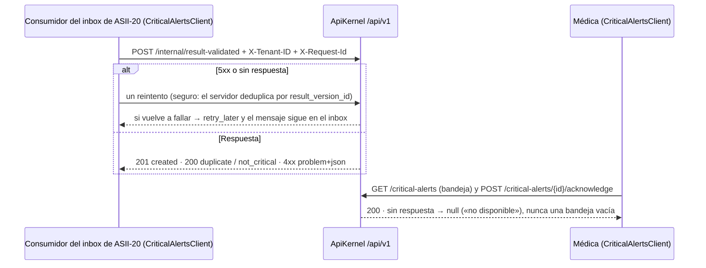

# Alertas críticas y notificaciones internas — Semana 5: cliente-servidor y frontera de microservicio

**Estudiante:** Herrera Sánchez, Axel Eliú (`AxelHerrera11`) · **Módulo:** ASII-21 · **Código:** [`micro-his/alertas-criticas`](../../../micro-his/alertas-criticas/) · **Contrato:** [`openapi.yaml`](../../../micro-his/alertas-criticas/openapi.yaml). El micro-HIS de la [Semana 4](../semana-04/README.md) pasa a ser un **servidor API v1** con un **cliente** separado que solo conoce el contrato HTTP.



| Pieza | Qué hace |
|---|---|
| `Presentation/ApiKernel` | Prefijo `/api/v1`, `X-Tenant-ID` igual al del servidor (`MICROHIS_TENANT`), `X-Request-Id`, errores RFC 9457 y `/health` y `/health/ready` |
| `client/CriticalAlertsClient` | `publish` (reintenta también ante 5xx porque la operación es idempotente) e `inbox`; timeout de 0,5 s al conectar y 2 s en total |
| `openapi.yaml` y `public/index.php` | Contrato OpenAPI 3.1 validado con `npx @redocly/cli@1.34.5 lint` (una prueba compara sus rutas con el servidor) y front controller con log de acceso sin datos clínicos |

## Frontera de microservicio

**Decisión: el núcleo (detección, acuse y bandeja) sigue siendo un módulo del HIS**, porque necesita leer en la misma base los umbrales (ASII-17) y las relaciones de cuidado y guardar la alerta con su auditoría. **Lo que sí conviene separar es el despachador** de notificaciones y escalamiento, como un *worker*: no atiende peticiones de usuarios, escala por su cuenta y puede caerse sin perder alertas, porque el plazo vive en `critical_alerts`.

**Propuesto, no implementado:** el *worker*, JWT en lugar de `X-User-Ref` y `Idempotency-Key` en el acuse.

```bash
php micro-his/alertas-criticas/tests/run.php && php micro-his/alertas-criticas/tests/api.php
php -S 127.0.0.1:8084 -t micro-his/alertas-criticas/public
```

Uso de IA: [DECLARACION_IA.md](./DECLARACION_IA.md).
