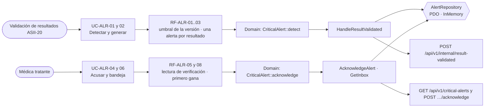

# Alertas críticas y notificaciones internas — Semana 6: primera evaluación parcial

**Estudiante:** Herrera Sánchez, Axel Eliú (`AxelHerrera11`) · **Módulo:** ASII-21 · **Entrega:** defensa teórica y caso práctico arquitectónico.

## Tesis arquitectónica

En el flujo «detección, envío, acuse y escalamiento de una alerta crítica», **ningún valor crítico queda sin una persona responsable que lo confirme**. Hay una sola alerta por resultado aunque el evento llegue repetido (idempotencia en la base), el acuse exige leer de vuelta paciente, prueba y valor, y solo el primero que acusa gana. Cada responsabilidad tiene una sola razón para cambiar (SRP): detectar, elegir destinatario, persistir, notificar y escalar son piezas distintas. Por eso el canal o el plazo cambian sin tocar la detección.

## Trazabilidad de punta a punta

| Semana | Qué aportó | Evidencia |
|---|---|---|
| 1 | Actores, UC-ALR-01..09, actividad, secuencia y Anexo A (`critical_alerts` propuesta) | `docs/alertas-criticas/semana-01/` (PR #196) |
| 2 | RF/RNF y SRP: una razón para cambiar por clase | `docs/alertas-criticas/semana-02/` (PR #198) |
| 3 | Micro-HIS por capas con idempotencia, acuse y pruebas | `micro-his/alertas-criticas/` (PR #202) |
| 4 | MVC (la bandeja como View) + Repository PDO e InMemory | Reentrega de la Semana 4 (diseño del PR #60) |
| 5 | API v1, cliente con publicación idempotente, OpenAPI y frontera | Reentrega de la Semana 5 (diseño del PR #64) |

## Decisiones defendidas

| Decisión | Por qué | Evidencia verificable |
|---|---|---|
| Una alerta por resultado (`UNIQUE` por `result_version_id`) | El evento llega «al menos una vez»; sin esto, un reintento duplicaría la alerta | `200 duplicate` en la prueba del evento repetido |
| Lectura de verificación en el dominio | Acusar sin leer el valor no prueba que la persona entendió la alerta | `422 READ_BACK_MISMATCH` |
| El primero que acusa gana (`UPDATE … WHERE status = 'open'`) | Dos médicos pueden acusar al mismo tiempo | `409 ALERT_ALREADY_ACKNOWLEDGED` |
| SRP: detector, destinatario, persistencia, canal y plazos separados | TI, calidad, laboratorio y dirección médica piden cambios distintos | Demo de la Semana 2: cambiar canal o plazo no toca detector ni registrador |
| Alerta y auditoría en una transacción | Una alerta sin evidencia no se puede auditar | Prueba de rollback con la auditoría caída |
| El emisor puede reintentar sin miedo | El servidor deduplica; si no responde, el mensaje queda en el inbox | `retry_later` en el cliente de la Semana 5 |

**Riesgos que sigo defendiendo como abiertos:** `critical_alerts` no tiene migración, el formato del evento se acuerda con Gerson (ASII-19/20) y el despachador de notificaciones y escalamiento sigue como propuesta de *worker*.

## Caso práctico arquitectónico

**Pedido:** Signos vitales (ASII-13, Josué) quiere que una **saturación de oxígeno menor que 85 %** genere la misma alerta crítica, con el mismo acuse y escalamiento.

| Capa o pieza | ¿Cambia? | Qué cambia |
|---|---|---|
| Domain | Mínimo | `CriticalAlert` ya decide con umbrales y un valor; la fuente pasa a ser un dato más (`source = lab | vital_sign`) |
| Application | Sí, un consumidor | Un caso de uso `HandleVitalSignRecorded` igual al de resultados, con su propio proveedor de umbrales. Por SRP, el registrador, el acuse y la bandeja no cambian |
| Repository | Mínimo | Guardar `vital_sign_id` en lugar de `lab_result_version_id` |
| Base HOSPITAL | Sí | `critical_alerts` con `vital_sign_id` y un `CHECK` de una sola fuente (ya previsto en el Anexo A de la Semana 1) |
| Contrato API | Sí, compatible | `POST /api/v1/internal/vital-sign-recorded`, idempotente por `vital_sign_id` |
| Consumidores | No | La médica ve la alerta en la misma bandeja y la acusa igual |

**Conclusión:** la segunda fuente entra como un consumidor nuevo. El acuse, la bandeja y la auditoría no cambian, que es lo que SRP prometía en la Semana 2.

Guion de la exposición: [presentacion.md](./presentacion.md) · Uso de IA: [DECLARACION_IA.md](./DECLARACION_IA.md)
