# Alertas críticas y notificaciones internas — Semana 7: componentes backend/frontend

**Estudiante:** Herrera Sánchez, Axel Eliú (`AxelHerrera11`) · **Módulo:** ASII-21 · **Entrega:** diagrama de componentes y propuesta de refactorización.

## Objetivo

Diseñar los componentes del flujo «detección, envío, acuse y escalamiento de una alerta crítica» dentro del HIS real (Laravel 12 y Vue 3, ya presentes en `develop`), separando UI, aplicación, dominio y persistencia. El diseño reutiliza el dominio y los casos de uso del micro-HIS de las Semanas 3 a 5 sin reescribirlos.

[Fuente Mermaid](./fuentes/01-componentes.mmd)

## Componentes y responsabilidades

| Componente | Responsabilidad | Ya existe en `develop` |
|---|---|---|
| Middlewares `tenant` y `jwt.auth` | Resolver el hospital (`X-Tenant-ID`) y el usuario del JWT | Sí: `TenantMiddleware` y `JwtAuth` |
| Middleware `permission:modulo.accion` | Proteger cada ruta con el permiso de RBAC | Parcial: `spatie/laravel-permission` y `config/permission.php` están; falta registrar el alias `permission` en `bootstrap/app.php` y el catálogo de permisos (María, ASII-02) |
| `Api/V1/CriticalAlertController` + `AcknowledgeAlertRequest` | Controller delgado: valida tipos y obligatorios con el FormRequest y llama al caso de uso | No (propuesto) |
| Application: HandleResultValidated · AcknowledgeAlert · GetInbox | Orquestan el caso de uso; se copian del micro-HIS sin cambios de lógica | En `micro-his/alertas-criticas/src/Application` |
| Domain: CriticalAlert · DomainRuleViolation | Reglas puras, sin Laravel | En `micro-his/alertas-criticas/src/Domain` |
| `AlertRepository` «interfaz» + `EloquentAlertRepository` | Puerto de persistencia; el adaptador usa el Query Builder sobre la conexión `hospital` | El puerto y los adaptadores PDO/InMemory existen en el micro-HIS |
| `AuditLogger` | Evidencia en `local_access_audits` | Interfaz común de Cindy (plan de integración) |
| Vue: `AlertInboxPage.vue`, `AlertItem.vue · ReadBackDialog.vue` | la bandeja de alertas pendientes y el diálogo de lectura de verificación | No (propuesto) |
| `stores/criticalAlerts.js` y `api/criticalAlertsApi.js` | Estado de la pantalla y llamadas HTTP con el plugin `axios` existente | Plugin `resources/js/plugins/axios.js` |

El evento de ASII-20 no entra por un controller público: lo consume un *job* de cola (`QUEUE_CONNECTION=database`) que llama a `HandleResultValidated`; el endpoint interno queda para pruebas e integración.

## Rutas protegidas

| Método | Ruta | Permiso |
|---|---|---|
| POST | `/api/v1/internal/result-validated` | identidad de servicio |
| GET | `/api/v1/critical-alerts` | `alertas.ver` |
| POST | `/api/v1/critical-alerts/{alert}/acknowledge` | `alertas.acusar` |

## Propuesta de refactorización (micro-HIS → HIS Laravel)

| Hoy en el micro-HIS | Problema al integrar | Refactor propuesto |
|---|---|---|
| `ApiKernel` valida `X-Tenant-ID` y `X-User-Ref` | Duplica lo que ya hacen `TenantMiddleware` y `JwtAuth`; `X-User-Ref` no es seguro fuera del gateway | Quitar esas validaciones: el usuario sale de `auth()->user()` y el tenant del middleware |
| `CriticalAlertController::handle()` con un `match` de rutas | Laravel ya enruta; el `match` mezcla enrutamiento y presentación | Una acción por método en el controller y rutas en `routes/api.php` dentro del grupo `['tenant', 'jwt.auth']` |
| Validación de tipos en el caso de uso | Laravel tiene FormRequest con mensajes por campo | `AcknowledgeAlertRequest` valida tipos y obligatorios; el dominio conserva las reglas de negocio |
| `PersistenceFailure` y `DomainRuleViolation` mapeados a mano | Cada controller repetiría el mapeo | Renderizar ambas excepciones en `bootstrap/app.php` como `problem+json` con el mismo `code` |
| `PdoAlertRepository` con PDO directo | Otra conexión aparte de la del HIS | `EloquentAlertRepository` con `DB::connection('hospital')` y transacción de Laravel, enlazado en un ServiceProvider; el InMemory queda para las pruebas |
| View HTML (`AlertInboxView`) | La UI del HIS es Vue | Se reemplaza por los componentes Vue; la View queda solo en el micro-HIS |
| Cliente PHP (`CriticalAlertsClient`) | Dentro del HIS, los consumidores están en el mismo proceso | Validación de resultados (ASII-20), que publica el evento, y el layout base (Lis), que muestra el contador llaman al caso de uso o al endpoint; el cliente HTTP se usa solo si el módulo se separa |

**Qué no cambia:** el dominio, los casos de uso, el contrato `/api/v1` y los códigos de error. Por eso el refactor es de bajo riesgo: las pruebas de dominio y de contrato de las Semanas 3 a 5 siguen valiendo.
