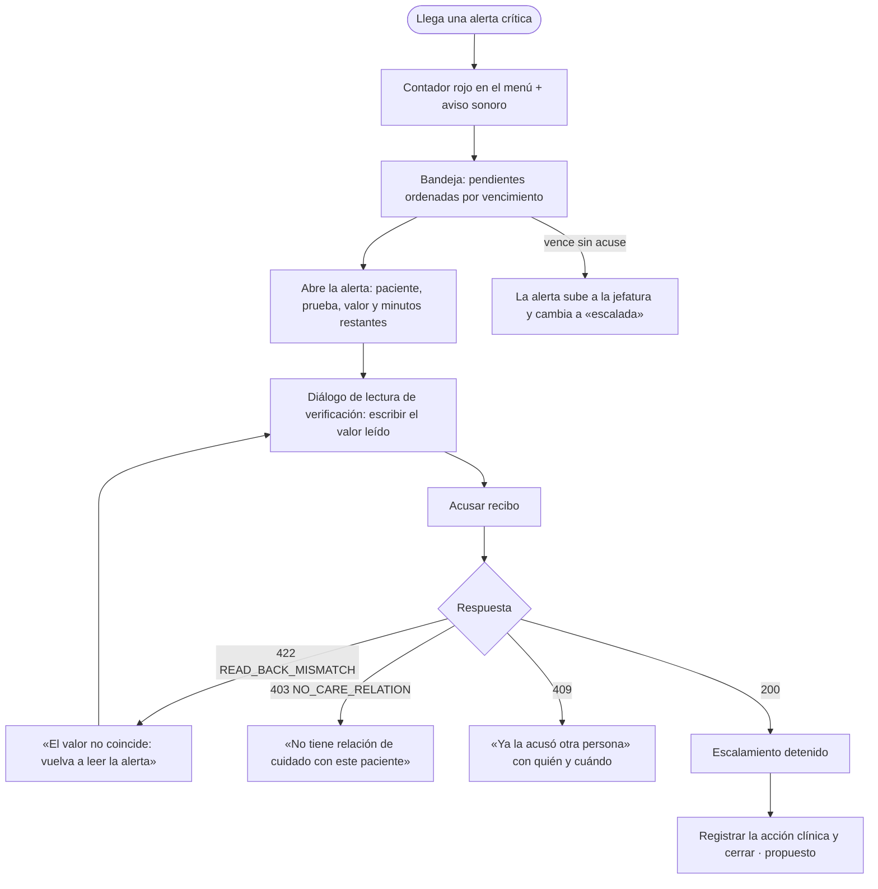

# Alertas críticas y notificaciones internas — Semana 8: flujo UX por rol

**Estudiante:** Herrera Sánchez, Axel Eliú (`AxelHerrera11`) · **Módulo:** ASII-21 · **Entrega:** user flow, wireframes iniciales y reglas de interacción.

## Objetivo

Diseñar la experiencia del flujo «detección, envío, acuse y escalamiento de una alerta crítica» para cada rol autorizado, con estados vacío, carga, éxito y error recuperable, y mensajes que usan los códigos reales del contrato API.

## Roles

| Rol | Objetivo en el flujo | Permiso |
|---|---|---|
| Médico tratante | Ver la alerta, confirmar la lectura y acusar recibo; luego registrar la acción | `alertas.ver` · `alertas.acusar` · `alertas.cerrar` |
| Jefatura de servicio | Recibir las alertas escaladas o sin médico asignado | `alertas.ver` · `alertas.acusar` |
| Enfermería de sala | Ver la bandeja de la sala y avisar al médico | `alertas.ver` |

## User flow



## Wireframes iniciales (baja fidelidad)

### 1. Bandeja de alertas

```text
┌ Alertas críticas pendientes (2) ──────────────────── Dra. López (ficticia) ┐
│ 🔴 GLU-v1 32 mg/dL (bajo el umbral crítico) · P-DEMO · vence en 12 min [Abrir]│
│ 🔴 K 7,1 mmol/L (sobre el umbral crítico) · P-0002 · vence en 3 min   [Abrir]│
└──────────────────────────────────────────────────────────────────────────────┘
```

### 2. Lectura de verificación

```text
┌ Confirmar lectura ───────────────────────────────────────────────────────┐
│ Paciente: P-DEMO   Prueba: Glucosa (GLU-v1)                              │
│ Escriba el valor que leyó*: [32___] mg/dL                                │
│ ⚠ El valor no coincide con la alerta (READ_BACK_MISMATCH)                │
│                                         [Cancelar] [Acusar recibo]      │
└──────────────────────────────────────────────────────────────────────────┘
```

### 3. Alerta ya acusada por otra persona

```text
┌──────────────────────────────────────────────────────────────────────────┐
│ ℹ Esta alerta ya la acusó dr.ruiz a las 08:07 (ALERT_ALREADY_ACKNOWLEDGED).│
│                                                       [Volver a bandeja] │
└──────────────────────────────────────────────────────────────────────────┘
```

## Estados de la pantalla

| Estado | Qué ve el usuario |
|---|---|
| Carga | Bandeja con esqueleto; el contador conserva el último valor conocido |
| Vacía | «No hay alertas pendientes» |
| Lectura incorrecta (422) | Mensaje junto al campo del valor; el diálogo sigue abierto |
| Sin relación de cuidado (403) | Mensaje y botón para avisar a la jefatura |
| Ya acusada (409) | Quién y cuándo la acusó |
| Alertas no disponibles (sin red) | «Alertas no disponibles: consultar al laboratorio por teléfono»; nunca una bandeja vacía |
| Éxito (200) | La alerta sale de la bandeja y aparece «Registrar acción» |

## Reglas de interacción

- La alerta no se puede descartar ni ocultar sin acusarla; el contador solo baja con un acuse válido.
- El valor de la lectura se escribe a mano: no se rellena solo, porque esa es la verificación.
- Las alertas próximas a vencer van primero y muestran los minutos restantes.
- Sin red, la bandeja muestra «no disponible»; una bandeja vacía solo se muestra si el servidor respondió que no hay pendientes.

Los wireframes se evalúan en la Semana 9 (usabilidad y accesibilidad) y se adaptan a móvil en la Semana 10. Uso de IA: [DECLARACION_IA.md](./DECLARACION_IA.md).
