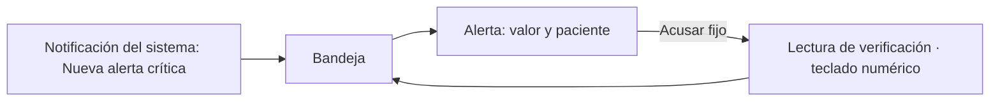

# Alertas críticas y notificaciones internas — Semana 10: adaptación responsive y móvil

**Estudiante:** Herrera Sánchez, Axel Eliú (`AxelHerrera11`) · **Módulo:** ASII-21 · **Entrega:** escenarios móviles y prioridades de pantalla.

## Objetivo

Adaptar las pantallas de la [Semana 8](../semana-08/README.md) a teléfono y tablet según cómo se usan en el hospital, con las reglas de [breakpoints.md](./breakpoints.md) y las mejoras de la [Semana 9](../semana-09/README.md).

## Escenarios móviles

| # | Quién y dónde | Qué necesita | Respuesta del diseño |
|---|---|---|---|
| 1 | Médica de guardia, con el teléfono en el bolsillo | Enterarse de una alerta y acusarla sin ir a la estación | Notificación «Nueva alerta crítica» (sin datos del paciente) que abre la bandeja |
| 2 | Jefatura de servicio | Recibir una alerta escalada fuera de la sala | Bandeja con la etiqueta «escalada» y los minutos vencidos |
| 3 | Enfermería, en tablet | Ver las alertas de la sala y avisar al médico | Bandeja de la sala en dos columnas: lista y detalle |

## Prioridad de cada pantalla

| Pantalla | `sm` (teléfono) | `md` (tablet) |
|---|---|---|
| Bandeja | Tarjetas por vencimiento: valor y dirección en grande, minutos restantes | Lista y detalle lado a lado |
| Lectura de verificación | Pantalla completa con teclado numérico (`inputmode="decimal"`) y «Acusar» fijo | Diálogo centrado |
| Ya acusada (409) | Tarjeta informativa con quién y cuándo | Igual |

## Navegación móvil

## Mejoras de la Semana 9 incorporadas

H1 (bandeja vacía sin red) se resuelve con el estado «no disponible» también en `sm`; H2 (solo aviso sonoro) se resuelve con la notificación del sistema, sin datos clínicos.

El prototipo navegable de la Semana 11 implementa estos breakpoints. Uso de IA: [DECLARACION_IA.md](./DECLARACION_IA.md).
