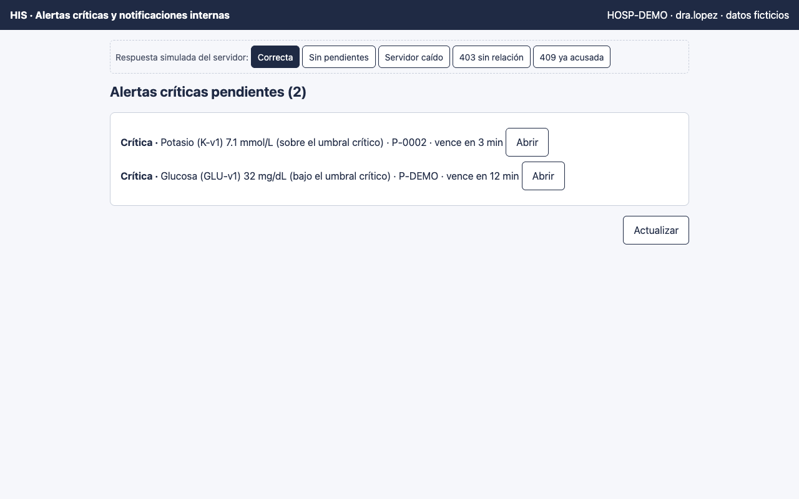
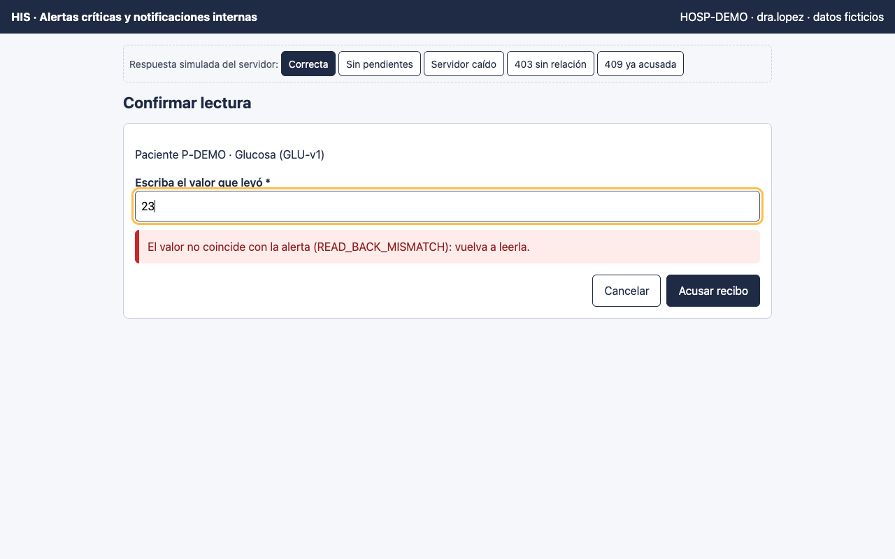
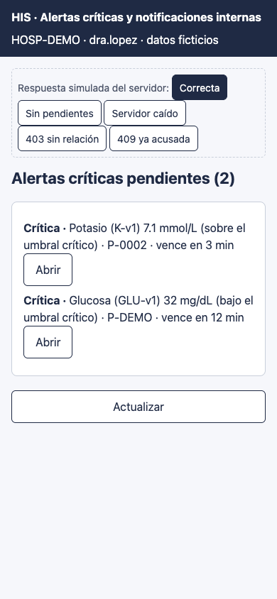

# Alertas críticas y notificaciones internas — Semana 11: prototipo navegable

**Estudiante:** Herrera Sánchez, Axel Eliú (`AxelHerrera11`) · **Módulo:** ASII-21 · **Entrega:** prototipo navegable de escritorio y móvil.

## Cómo abrirlo

Abra [`prototipo/index.html`](./prototipo/index.html) en cualquier navegador. Es un solo archivo, funciona sin conexión y no llama a ningún servidor. Para verlo como teléfono, use el modo de dispositivo del navegador (390 px).

- **Pantallas:** bandeja de alertas pendientes y diálogo de lectura de verificación.
- **Simulador:** la barra «Respuesta simulada del servidor» elige qué responde el servidor (Correcta, Sin pendientes, Servidor caído, 403 sin relación y 409 ya acusada), con los mismos códigos del contrato `/api/v1`, para recorrer los caminos de error sin backend.

## Accesibilidad incluida

- Objetivos táctiles de 44 px como mínimo y foco visible (contorno ámbar de 3 px).
- Etiquetas en todos los campos y `fieldset` con `legend` en los grupos.
- Mensajes con texto, no solo color.
- `role="alert"` para lo crítico y `role="status"` para las confirmaciones.
- El foco va al título de cada pantalla y, ante un error, al campo afectado.

## Mejoras de las Semanas 9 y 10 aplicadas

- **H1 (bandeja vacía sin red):** con el servidor caído se muestra «Alertas no disponibles: consulte al laboratorio por teléfono», distinto de «No hay alertas pendientes» (lo verifica el recorrido).
- **H5 (🔴 sin texto):** cada alerta dice «Crítica» en texto.
- **Lectura de verificación:** el valor se escribe a mano, con teclado numérico en el teléfono (`inputmode="decimal"`).
- **Orden:** la alerta más próxima a vencer va primero.

## Recorrido automatizado (Chrome headless)

El prototipo se recorrió con Chrome headless (puppeteer), que hace clic y escribe como un usuario y verifica el texto visible: **9 pasos OK y ningún error de JavaScript**. La salida completa está en el PR.

## Capturas

**Bandeja ordenada por vencimiento (escritorio)**

**Lectura de verificación incorrecta**

**Bandeja en el teléfono (390 px)**

**Limitaciones:** el diseño visual final depende del layout base de Lis. La prueba con usuarios reales y la medición de contraste con herramienta quedan como siguiente paso. Uso de IA: [DECLARACION_IA.md](./DECLARACION_IA.md).
