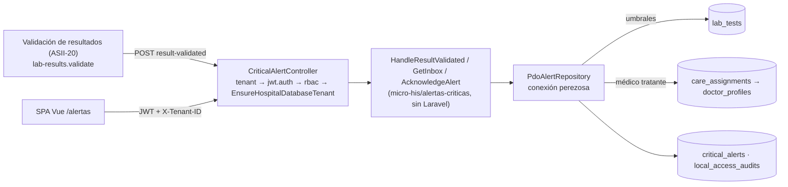

# Alertas críticas y notificaciones internas — Semana 16: integración, validación y primera entrega funcional

**Estudiante:** Herrera Sánchez, Axel Eliú (`AxelHerrera11`) · **Módulo:** ASII-21 · **Issue:** #40

El micro-HIS de alertas (Semanas 3 a 5) deja de correr aislado. Ahora tiene:
- su tabla en HOSPITAL: `critical_alerts`, slice H7, 000660;
- un adaptador que lee la **relación de cuidado real** (`care_assignments` → `doctor_profiles`);
- una API v1 en Laravel con `tenant`, `jwt.auth`, `rbac` y el guard de #1154;
- una bandeja en la SPA.

| Parte | PR | Alcance |
|---|---|---|
| Base | #1244 (ASII-17) | `lab_tests`, de la que la alerta toma la versión de la prueba y sus umbrales críticos |
| 1 | #1321 | `critical_alerts`: una alerta por resultado, episodio del paciente, acuse inmutable y retención |
| 2 | #1321 | Esquema portable con los nombres reales, médico tratante desde `care_assignments` y acuse de la jefatura por quien supervisa |
| 3 | #1322 | `CriticalAlertController` y `AlertasCriticasServiceProvider` (conexión perezosa y guard), pruebas Feature |
| 4 | #1282 | Bandeja Vue `/alertas` con acuse por read-back, recorrido real de la SPA y capturas |
| 5 | este PR | Prueba contra PostgreSQL, recorrido HTTP con login real y este documento |

## Arquitectura de la integración



- Si el valor supera los umbrales de `lab_tests`, la alerta va a la médica tratante (nivel 0).
- Sin médico tratante, va a la jefatura del servicio (nivel 1, destinatario `NULL`).
- El acuse exige la lectura de verificación: paciente, prueba y valor.
- La base garantiza la idempotencia por resultado, que el episodio pertenezca al paciente y que una alerta acusada no cambie.

## Requisitos de la semana

| Requisito | Estado | Evidencia |
|---|---|---|
| Integrar con los componentes reales del HIS | **Hecho** | Tabla en HOSPITAL, `care_assignments` real, API v1 detrás de los middlewares y del guard, bandeja en la SPA (#1282). |
| Límites de autorización y de hospital | **Hecho y probado** | `lab-results.validate` (bioquímico) detecta; `alertas.ver` y `alertas.acusar` (medico, jefatura, superadmin); `alertas.supervisar` (jefatura) ve y acusa la bandeja del servicio. |
| Migraciones y persistencia real | **Hecho y probado** | `CriticalAlertIntegrityTest` (5) y `AlertasPostgresTest` (3) contra PostgreSQL. |
| Primera entrega funcional | **Hecho** | Recorrido HTTP 15/15 y recorrido de la SPA 9/9 con login real. |
| Evidencia en staging u on-premise | **Entorno local de verificación** | No hay acceso a un staging del grupo. Se usó la misma pila con el seed de E2E de CI. |
| Errores corregidos | **Hecho** | Ver la tabla «Errores corregidos». |

## Evidencia ejecutada

Entorno: macOS, PHP 8.4.21, PostgreSQL 18.4 y Chrome headless. Bases desechables `his_*_e2e` sembradas con `tests/E2E/fixtures/seed-e2e.php`. Los usuarios extra y la relación de cuidado se sembraron con [`agregar-usuario-e2e.php`](./evidencia/agregar-usuario-e2e.php) y [`datos-e2e-alertas.sh`](./evidencia/datos-e2e-alertas.sh), que solo corren sobre bases `*_e2e`. Todos los datos son ficticios.

```text
$ php vendor/bin/phpunit --testdox tests/Feature/Alertas tests/Database/Hospital/AlertasPostgresTest.php tests/Database/Hospital/CriticalAlertIntegrityTest.php
Alertas Postgres
 ✔ The attending from the real care assignment receives and acknowledges
 ✔ Episode of another patient is an invalid event not an outage
 ✔ Unreachable hospital database answers 503 and not 500
Critical Alert Api
 ✔ Identity tenant permission and hospital guard are enforced
 ✔ Detection inbox and acknowledgement with read back
 ✔ Alert without attending goes to the service head queue
 ✔ Invalid events and unknown alerts are rejected
 ✔ Unavailable hospital answers 503 without details
Critical Alert Integrity
 ✔ Alert for the attending starts open and one per result
 ✔ Without recipient it goes to the service head from level one
 ✔ Episode must belong to the patient
 ✔ Acknowledgement records who and when and freezes the alert
 ✔ Rollback removes only the alerts
OK (13 tests, 141 assertions)
```

- Recorrido HTTP con login JWT real: [`evidencia/recorrido-alertas.sh`](./evidencia/recorrido-alertas.sh). Salida en [`salida-recorrido-alertas.txt`](./evidencia/salida-recorrido-alertas.txt) (15/15) y lo que quedó en PostgreSQL en [`salida-psql.txt`](./evidencia/salida-psql.txt).
- Recorrido de la SPA: `evidencia/spa-alertas.mjs` y `capturas/` (#1282), 9/9.

## Qué es real y qué se simula

| Prueba | Real | Simulado |
|---|---|---|
| `tests/Feature/Alertas` | Middlewares, matriz RBAC, guard y controller | Identidad (tenant y JWT); HOSPITAL en memoria |
| `CriticalAlertIntegrityTest` y `AlertasPostgresTest` | PostgreSQL con las migraciones de `develop` más 000600 y 000660, la `care_assignments` real y el resolver de actor | Identidad |
| Recorrido HTTP y SPA | Login JWT, CENTRAL, tenant, RBAC, guard y HOSPITAL | Nada; solo los datos ficticios. El resultado validado se publica por HTTP en nombre del bioquímico, porque ASII-20 aún no lo emite |

## Errores corregidos

| Error | Causa | Corrección |
|---|---|---|
| El micro-HIS leía una `care_assignments` simplificada que no existe en HOSPITAL | El esquema portable de la Semana 3 era propio | El esquema portable usa los nombres reales y el médico tratante sale de `care_assignments` → `doctor_profiles` |
| La jefatura no podía acusar las alertas de su bandeja | El dominio solo aceptaba al destinatario o a quien cuida al paciente, y esas alertas no tienen destinatario | Regla explícita: quien supervisa el servicio acusa las alertas de la jefatura, por una ruta con `alertas.supervisar` |
| Un episodio de otro paciente habría respondido 503 | La base lo rechaza (trigger o FK) y el adaptador lo trataba como una caída | El controller lo traduce a `422 EVENT_INVALID` |
| La alerta no guardaba su episodio | El dominio lo recibía pero no lo conservaba | `episodeId` en `CriticalAlert`; `care_episode_id` en la tabla y en la auditoría H8 |
| Con la base caída, la API habría respondido 500 | `PDO` abierto al construir y lecturas sin traducir | Conexión perezosa y `read()` → `PersistenceFailure` → 503 |

## Dependencias y pendientes

| Pendiente | Responsable |
|---|---|
| Emitir «resultado validado» desde la validación de resultados (outbox o llamada al endpoint) | ASII-20 |
| FK de `critical_alerts.lab_result_version_id` cuando exista `lab_result_versions` | ASII-19 |
| Activar `alertas.ver` y `alertas.acusar` para `enfermeria` (hoy en `pending`) | RBAC (ASII-02) |
| Escalamiento automático por vencimiento (job) y notificación push | ASII-21, siguiente iteración |
| Mostrar nombre del paciente y de la prueba en la bandeja | ASII-21 con ASII-03 y ASII-17 |
| Selección dinámica de base HOSPITAL por tenant; hasta entonces aplica el guard de #1154 | Integración / Tenants (ASII-25) |

[Declaración de uso de IA](./DECLARACION_IA.md)
