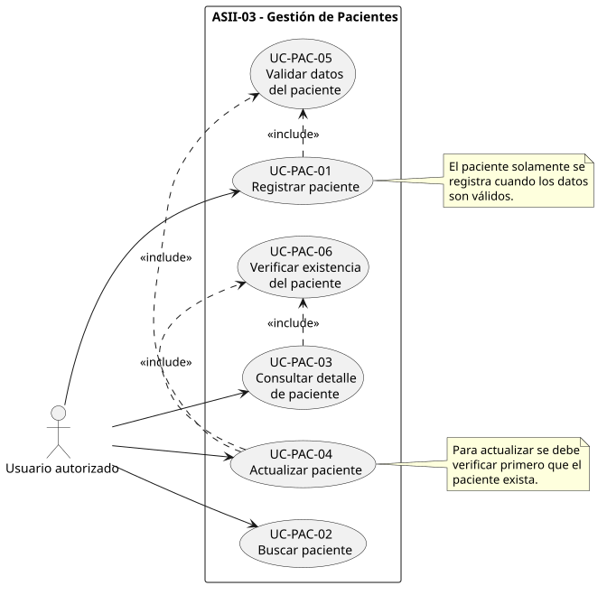
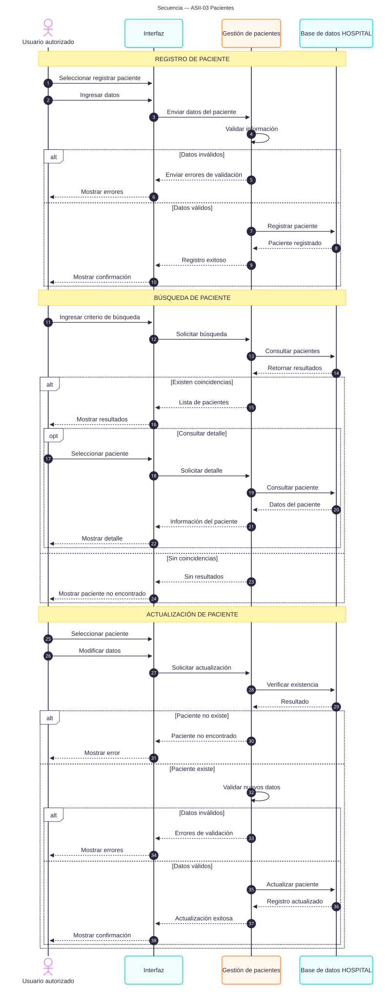

# ASII-03 · Pacientes: registro, edición, búsqueda y detalle — Semana 1

## Ficha de la asignación

- **Estudiante:** Cerón Molina, Madelin Jazmín (`MadelinCeron`)
- **Módulo:** Pacientes: registro, edición, búsqueda y detalle
- **Semana:** Semana 1 — Conceptos generales, orientación a objetos y UML
- **Tarea individual:** Modelar el proceso «registro, búsqueda y actualización segura de un paciente».
- **Casos de uso:** delimitar actores y objetivo.
- **Actividad:** incluir decisiones, excepciones y resultado.
- **Secuencia:** mostrar participantes, mensajes, validaciones y respuesta.
- **Trazabilidad:** mantener correspondencia entre los tres diagramas.
- **Entregable / evidencia:** UML de casos de uso y narrativa de alcance.
- **Estructura:** Sistema Hospitalario Integrado 2026.

---

## Contexto del módulo

El módulo ASII-03 administra la información básica de los pacientes del Sistema Hospitalario Integrado.

Para esta primera semana se modelan tres operaciones relacionadas:

1. Registrar un paciente.
2. Buscar un paciente existente.
3. Actualizar de forma segura la información de un paciente.

La implementación futura debe mantener consistencia con la estructura actual del proyecto.

En la base HOSPITAL ya existe la entidad `local_patients`, que contempla información como:

- Identificador local.
- Referencia global del paciente.
- Código.
- Nombres.
- Apellidos.
- Fecha de nacimiento.
- Sexo.
- Información de contacto.
- Estado del paciente.
- Estado de vinculación con el índice global.

Los estados definidos actualmente para un paciente son:

- `active`
- `inactive`
- `deceased`

Los valores de sexo contemplados actualmente son:

- `female`
- `male`
- `other`
- `unknown`

Esta semana no implementa todavía endpoints ni interfaz. El objetivo es analizar y representar correctamente el proceso mediante UML.

---

## Objetivo del proceso

Permitir que un usuario autorizado pueda registrar, buscar y actualizar pacientes manteniendo controles sobre la validez de la información y evitando modificaciones sobre registros inexistentes.

---

## 1. Diagrama de casos de uso

[Abrir diagrama de casos de uso](./01-casos-de-uso.svg)

### Actores

- **Usuario autorizado:** realiza las operaciones relacionadas con los pacientes.
- **Sistema Hospitalario Integrado:** valida, consulta y almacena la información.

### Casos principales

- **UC-PAC-01 · Registrar paciente**
- **UC-PAC-02 · Buscar paciente**
- **UC-PAC-03 · Consultar detalle de paciente**
- **UC-PAC-04 · Actualizar paciente**
- **UC-PAC-05 · Validar datos del paciente**
- **UC-PAC-06 · Verificar existencia del paciente**

### Relación entre casos

El registro incluye la validación de los datos proporcionados.

La búsqueda puede conducir a la consulta del detalle cuando existe una coincidencia.

La actualización requiere primero verificar que el paciente exista y después validar la nueva información.

---

## 2. Diagrama de actividad

[Abrir diagrama de actividad](./02-actividad.svg)

### Descripción

El diagrama representa las tres operaciones principales.

#### Registro

1. El usuario ingresa los datos.
2. El sistema valida la información.
3. Si existen errores, la operación se rechaza.
4. Si la información es válida, se registra el paciente.
5. El sistema confirma el resultado.

#### Búsqueda

1. El usuario proporciona un criterio.
2. El sistema realiza la consulta.
3. Si existen coincidencias, muestra los resultados.
4. Si no existen, informa que no se encontraron pacientes.

#### Actualización

1. El usuario selecciona un paciente.
2. El sistema verifica su existencia.
3. Se reciben los nuevos datos.
4. Los datos son validados.
5. Si son correctos, se actualiza el paciente.
6. Si existe un error, no se guardan cambios.

---

## 3. Diagrama de secuencia

[Abrir diagrama de secuencia](./03-secuencia.svg)

### Participantes

- Usuario autorizado.
- Interfaz del sistema.
- Gestión de pacientes.
- Base HOSPITAL.

### Validaciones representadas

- Datos requeridos.
- Fecha de nacimiento válida.
- Valores permitidos.
- Existencia del paciente antes de actualizar.
- Resultado de búsqueda.

### Respuestas

Los escenarios contemplan respuestas de:

- Registro exitoso.
- Error de validación.
- Paciente encontrado.
- Paciente no encontrado.
- Actualización exitosa.
- Actualización rechazada.

---

## 4. Narrativa y trazabilidad

El detalle completo del alcance, excepciones y correspondencia entre casos de uso, actividad y secuencia está disponible en:

[narrativa-alcance-trazabilidad.md](./narrativa-alcance-trazabilidad.md)

---

## Fuentes editables

- El diagrama de casos de uso se conserva en SVG.
- Actividad:
  [`fuentes/02-actividad.mmd`](./fuentes/02-actividad.mmd)
- Secuencia:
  [`fuentes/03-secuencia.mmd`](./fuentes/03-secuencia.mmd)

Los archivos `.mmd` utilizan Mermaid y permiten regenerar los SVG.

---

## Resultado de Semana 1

Al finalizar la semana se cuenta con:

- Alcance del proceso.
- Actores identificados.
- Casos de uso.
- Decisiones y excepciones.
- Diagrama de actividad.
- Diagrama de secuencia.
- Trazabilidad entre los tres diagramas.

No se incluye todavía implementación funcional del módulo.

---

## Declaración de uso de IA

Se utilizó ChatGPT como apoyo para organizar la documentación y proponer una primera versión de los diagramas a partir del enunciado académico y de la estructura actual del repositorio.

La estudiante revisó la información, validó su correspondencia con el módulo asignado y es responsable del contenido final entregado.
