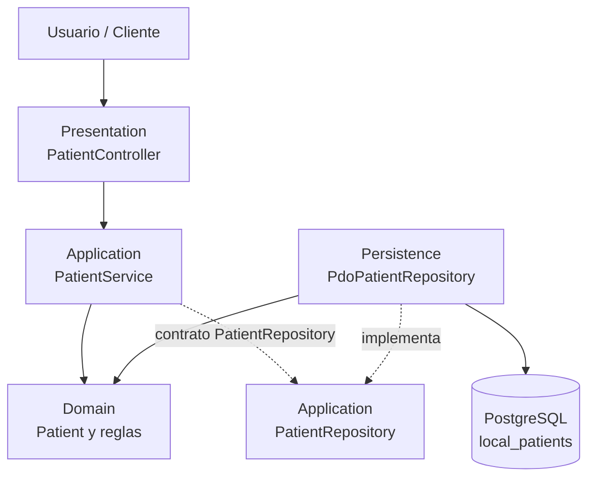

# Arquitectura C4/UML — Pacientes

`PatientController` expone registro, búsqueda y actualización; presenta resultados y traduce errores de aplicación a estados 4xx/5xx. `PatientService` coordina casos de uso y depende del contrato `PatientRepository`. `Patient` aplica invariantes sin depender de infraestructura. `PdoPatientRepository` implementa el contrato, contiene todo PDO/SQL parametrizado y mapea `local_patient_id`, `global_id`, `code`, nombres, nacimiento, sexo, contacto y estado; `mpi_link_status` conserva el default de la tabla.

Dependencias de ejecución: `Presentation → Application → Domain`; `Persistence → Application` (implementación del contrato) y `Persistence → Domain` (hidratación); PostgreSQL se accede exclusivamente desde Persistence.
