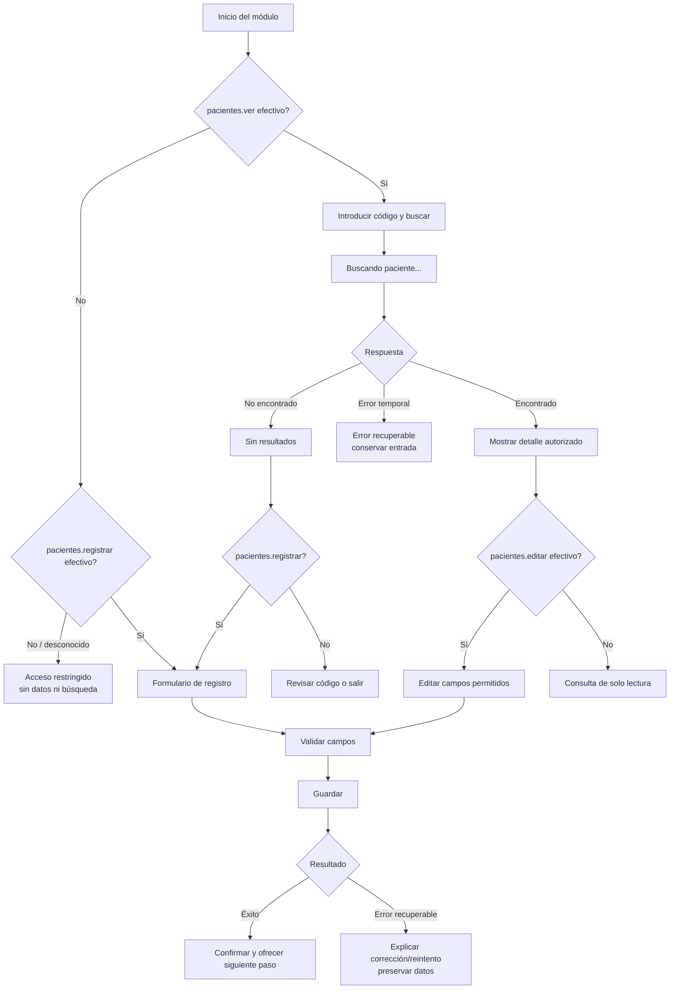

# Flujo de usuario

Diseño para el contrato existente de búsqueda exacta por `code`, registro y actualización parcial. `tenant → jwt.auth → rbac → Pacientes` es la frontera prevista, no una ruta conectada actualmente. El cliente nunca consulta PDO directamente.

## Flujo principal: consultar y, si está autorizado, editar

1. La búsqueda y los datos requieren `pacientes.ver`. El acceso al registro se evalúa independientemente con `pacientes.registrar`, también para una persona que no tenga permiso de consulta. Si ninguno es efectivo o no se puede verificar, se falla cerrada y se explica la restricción sin mostrar datos.
2. El usuario ingresa el código y activa **Buscar paciente**. Mientras espera, aparece “Buscando paciente…” en una región anunciable; se evita una pantalla vacía y se evita enviar solicitudes duplicadas.
3. Un resultado `200` muestra el detalle mínimo necesario. Con `pacientes.editar` se ofrece **Editar datos**; sin él, el detalle permanece de solo lectura. El servidor autoriza cada operación aunque la interfaz oculte botones.
4. `404` produce estado vacío: “No encontramos un paciente con ese código.” Permite corregir/reintentar; solo con `pacientes.registrar` ofrece ir al registro. Un error temporal o de persistencia explica que no se pudo completar la consulta y permite reintentar conservando el código.
5. Si se edita, solo son modificables `given_name`, `family_name`, `birth_date`, `sex`, `contact` y `status`. `patient_id`, `code` y `global_id` nunca aparecen como editables. Al guardar se indica éxito o se conserva el formulario para corregir/reintentar.

## Flujo alterno: registrar

La acción de registro solo se ofrece con `pacientes.registrar`; el servidor vuelve a comprobar el permiso. El formulario marca los requeridos por el contrato: `global_id`, `code`, nombres, apellidos, fecha de nacimiento y sexo. Contacto es opcional; estado inicia en `active`. La fecha no puede ser futura. Tras validar, guardar muestra progreso; en éxito confirma el registro. Si además tiene `pacientes.ver`, ofrece consultar por código; de otro modo, no muestra información de lectura restringida. Ante duplicado, validación o fallo temporal se señala el campo o problema comprensible y se conserva la entrada para corregir o reintentar.

## Permisos efectivos

| Acción UX | Permiso de pantalla/acción |
|---|---|
| Buscar y mostrar información del paciente | `pacientes.ver` |
| Abrir registro y enviar alta | `pacientes.registrar` |
| Abrir edición desde el detalle y guardar cambios | `pacientes.editar` (y `pacientes.ver` para el flujo que carga el detalle) |

Los roles de `config/rbac.php` son una asignación administrativa actual, no una condición codificada en la interfaz. El diseño no consulta el nombre del rol ni deduce permisos desde él. En el estado actual login y `me` no exponen `user.permissions`; hasta que exista una fuente efectiva verificada, el cliente no debe suponer autorización. Una denegación del servidor se presenta sin detalles internos de RBAC.
