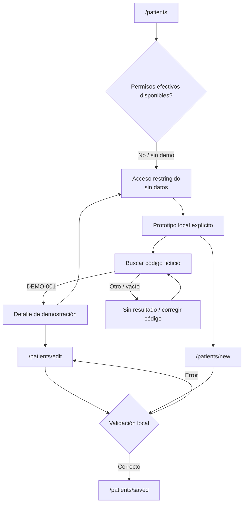

# Mapa de navegación

Las rutas están bajo el guard de sesión existente. El flujo de demostración
requiere `?demo=1`, usa solo datos locales ficticios y nunca llama a la API.

El estado restringido no revela registro ni permite acciones. El enlace a
demo deja claro que es una excepción para explorar solo pantallas con datos
ficticios, no una autorización efectiva.
