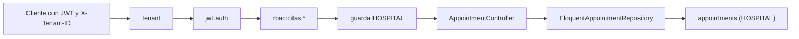

# Gestion de citas medicas y agenda - Semana 16

> Tema guia: **Integracion funcional en la API v1 de Laravel**

## Ficha

- **Estudiante:** Lis Ivette Rosales Colindrez
- **GitHub:** [`Lis671`](https://github.com/Lis671)
- **Identificador:** `ASII-05` | **Issue:** [#207](https://github.com/compilations-teams/sistema-hospitalario-integrado-SistenasII-2026-G3/issues/207)
- **Proceso:** registro y consulta de citas medicas validando disponibilidad
- **Principio SOLID aplicado:** Dependency Inversion (DIP)
## Que se integra

El modulo deja de ser solo un micro-HIS en `docs/` y queda servido por la API v1 de Laravel con
las mismas capas de seguridad que el resto del HIS: tenant, JWT, RBAC (`config/rbac.php`) y la guarda
de base HOSPITAL del tenant cuando se leen datos clinicos.



| Metodo | Ruta | Permiso | Respuesta |
|---|---|---|---|
| `GET` | `/api/v1/citas` | citas.ver | 200 lista paginada (`data`, `meta`) |
| `POST` | `/api/v1/citas` | citas.crear | 201 cita `scheduled` |
| `GET` | `/api/v1/citas/{id}` | citas.ver | 200 detalle |
| `POST` | `/api/v1/citas/{id}/confirmar` | citas.confirmar | 200 `confirmed` |
| `POST` | `/api/v1/citas/{id}/completar` | citas.confirmar | 200 `completed` |
| `POST` | `/api/v1/citas/{id}/cancelar` | citas.cancelar | 200 `cancelled` |
| `DELETE` | `/api/v1/citas/{id}` | citas.cancelar | 405 `appointments_delete_protection` |

Los errores usan el sobre comun de ASII-24 (`message`, `code`, `trace_id` y `errors` en 422) y todas
las respuestas llevan `Cache-Control: no-store, private`. Los permisos usados ya estan activos en
`config/rbac.php`; no se agregan permisos nuevos.

## Archivos (partes 1 y 2)

- `app/Providers/CitasServiceProvider.php`
- `app/Http/Controllers/Api/V1/AppointmentController.php`
- `tests/Feature/Citas/`
- `bootstrap/providers.php (registro del proveedor)`

## Hallazgos de la revision tecnica (Semana 13) corregidos

- RTF-01 (C-04): el status sale de `AppointmentWriteException->status`, no del texto del mensaje.
- RTF-02 (C-03): campos obligatorios, UUID y `ends_at > starts_at` se validan en el borde (422 con `errors`).
- RTF-03 (C-09): las fechas con zona horaria se normalizan a UTC antes de guardar; la prueba lo verifica (`09:00-06:00` -> `15:00+00:00`).
- RTF-05 (C-06): las rutas exigen la guarda de base HOSPITAL del tenant (`EnsureHospitalDatabaseTenant`).

**Hallazgo nuevo durante la integracion:** El cast `datetime` del modelo `Appointment` descartaba el offset al guardar (`09:00-06:00` quedaba como `09:00`). Lo detecto la prueba de solape y se corrige en el controlador.

## Evidencia

Ejecutado el 2026-10-30 sobre la parte 1 actualizada con `origin/develop` (PHP 8.2.33, PHPUnit 11.5.55).

```text
$ php artisan route:list --path=api/v1/citas
  GET|HEAD   api/v1/citas ......................................................... Api\V1\AppointmentController@index
  POST       api/v1/citas ......................................................... Api\V1\AppointmentController@store
  GET|HEAD   api/v1/citas/{appointment} ............................................ Api\V1\AppointmentController@show
  DELETE     api/v1/citas/{appointment} ......................................... Api\V1\AppointmentController@destroy
  POST       api/v1/citas/{appointment}/cancelar ............................. Api\V1\AppointmentController@transition
  POST       api/v1/citas/{appointment}/completar ............................ Api\V1\AppointmentController@transition
  POST       api/v1/citas/{appointment}/confirmar ............................ Api\V1\AppointmentController@transition
                                                                                                    Showing [7] routes
```

```text
$ php vendor/bin/phpunit tests/Feature/Citas --testdox
.......                                                             7 / 7 (100%)
Time: 00:02.012, Memory: 34.00 MB
Appointment Api (Tests\Feature\Citas\AppointmentApi)
 ✔ Sin sesion responde 401 y rol sin permiso responde 403
 ✔ Recepcion agenda y consulta la cita
 ✔ Valida en el borde con el sobre comun
 ✔ El solape se traduce a 409 appointments overlap
 ✔ Transiciones de estado y cita finalizada inmutable
 ✔ Cita inexistente 404 y borrado fisico 405
 ✔ Sin base hospital asignada la guarda real responde 503
OK (7 tests, 43 assertions)
```

La suite Feature completa del repositorio (`php vendor/bin/phpunit --testsuite Feature`) termina con
`Tests: 318, Assertions: 5702, Errors: 44, Failures: 2, Risky: 28`. Los 46 fallos son de Recepcion de
muestras (61 menciones), Salas y camas (10) e Indicadores (3): todos necesitan PostgreSQL en los puertos
55431/55433 (`Connection refused` o 503 por fuente no disponible) y ninguno pertenece a este modulo.

## Lo que no se verifico y dependencias

- **PostgreSQL real:** en este equipo no hay PostgreSQL ni Docker; las pruebas Feature usan dobles del
  repositorio/fuente y las rutas, middlewares y matriz RBAC reales. La consulta contra HOSPITAL queda
  pendiente de un recorrido con base real.
- **Supuesto pendiente de validar:** la conexion `hospital` no fija `timezone`; se asume UTC como en
  `config/app.php`. Debe confirmarlo plataforma y fijarse en la configuracion compartida.
- **Dos ramas apiladas (limite de 400 lineas por PR):** parte 1 `feature/asii-05-semana-16-api-lis671`
  (API y pruebas, PR #1612 hacia `develop`) y parte 2 `feature/asii-05-semana-16-evidencia-lis671`
  (esta evidencia, PR #1616 sobre la parte 1). La parte 2 se reapunta a `develop` cuando se fusione la
  parte 1. Las Semanas 4 (#1182) y 5 (#1404) ya estan fusionadas. Issue del modulo: #207.
