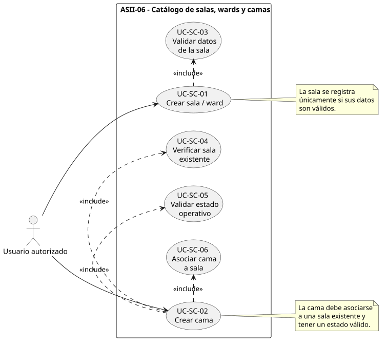
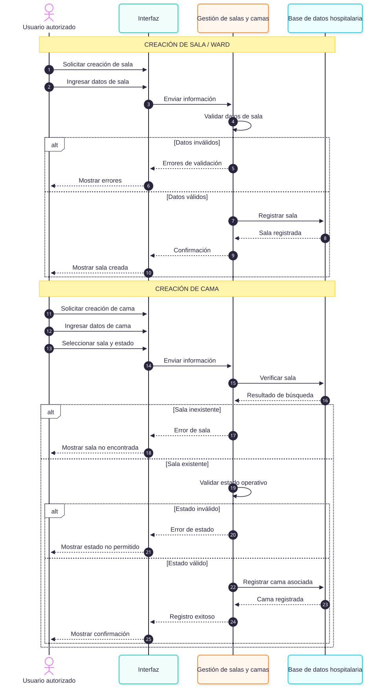

# ASII-06 — Catálogo de salas, wards y camas

## Semana 1 — UML y narrativa de alcance

**Estudiante:** Madelin Jazmín Cerón Molina  
**GitHub:** `@MadelinCeron`  
**Módulo:** ASII-06 — Catálogo de salas, wards y camas  
**Proceso:** creación de sala y cama con control de estado operativo.

## Objetivo

Modelar el proceso de creación de salas y camas del Sistema Hospitalario Integrado, considerando validaciones, asociación entre entidades, decisiones, excepciones y control del estado operativo.

## Alcance

Esta semana contempla:

- Creación de una sala o ward.
- Validación de los datos de la sala.
- Creación de una cama.
- Verificación de la existencia de la sala.
- Asociación de la cama con una sala.
- Validación del estado operativo de la cama.
- Manejo de errores cuando la sala no existe.
- Manejo de estados operativos inválidos.

No se implementan todavía endpoints API, controladores, servicios ni interfaz de usuario.

## Diagramas

### Casos de uso

Representa las operaciones principales:

- Crear sala o ward.
- Crear cama.
- Validar datos.
- Verificar sala existente.
- Validar estado operativo.
- Asociar cama a una sala.

### Actividad

Representa el flujo de creación de sala y cama, incluyendo decisiones y excepciones.

### Secuencia

Representa la comunicación entre:

- Usuario autorizado.
- Interfaz.
- Gestión de salas y camas.
- Base de datos hospitalaria.

## Estados considerados

Para las camas se consideran los estados definidos actualmente en el proyecto:

- `available`
- `occupied`
- `maintenance`
- `inactive`

Para las salas o wards:

- `active`
- `inactive`

## Evidencia

La narrativa de alcance y la trazabilidad se encuentran en:

`narrativa-alcance-trazabilidad.md`

## Resultado

La Semana 1 deja documentado el comportamiento esperado para la creación y asociación de salas y camas antes de iniciar las etapas posteriores de implementación.
