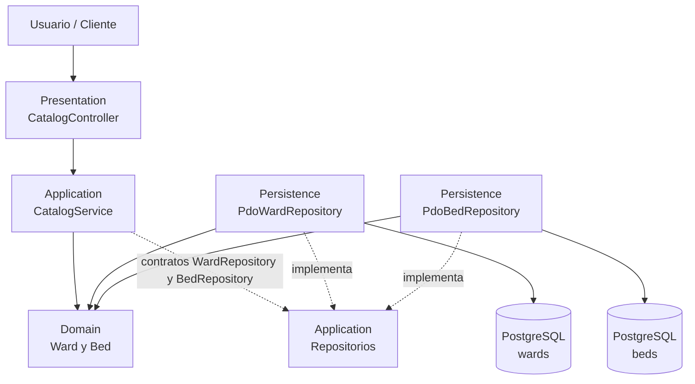

# Arquitectura C4/UML — Salas y camas

`CatalogService` valida la existencia del ward y coordina altas; `Ward` y `Bed` validan sus estados. Persistence implementa los contratos de Application y concentra PDO, SQL parametrizado y la hidratación. Dependencias: `Presentation → Application → Domain`; `Persistence → Application` y `Persistence → Domain`.
