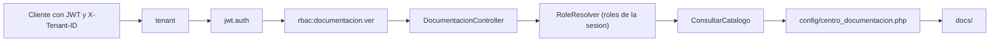

# Centro de documentacion y manuales por rol - Semana 16

> Tema guia: **Integracion funcional en la API v1 de Laravel**

## Ficha

- **Estudiante:** Lis Ivette Rosales Colindrez
- **GitHub:** [`Lis671`](https://github.com/Lis671)
- **Identificador:** `ASII-24` | **Issue:** [#208](https://github.com/compilations-teams/sistema-hospitalario-integrado-SistenasII-2026-G3/issues/208)
- **Proceso:** publicacion y consulta de documentacion y manuales diferenciados por rol
- **Principio SOLID aplicado:** Interface Segregation (ISP)
## Que se integra

El modulo deja de ser solo un micro-HIS en `docs/` y queda servido por la API v1 de Laravel con
las mismas capas de seguridad que el resto del HIS: tenant, JWT, RBAC (`config/rbac.php`) y la guarda
de base HOSPITAL del tenant cuando se leen datos clinicos.



| Metodo | Ruta | Permiso | Respuesta |
|---|---|---|---|
| `GET` | `/api/v1/documentacion` | documentacion.ver | 200 catalogo visible para los roles de la sesion |
| `GET` | `/api/v1/documentacion/{id}` | documentacion.ver | 200 contenido (`application/yaml` o `text/markdown`) o 404 `document_not_found` |

Los errores usan el sobre comun de ASII-24 (`message`, `code`, `trace_id` y `errors` en 422) y todas
las respuestas llevan `Cache-Control: no-store, private`. Los permisos usados ya estan activos en
`config/rbac.php`; no se agregan permisos nuevos.

## Archivos (partes 1 y 2)

- `micro-his/centro-documentacion/ (dominio, caso de uso y verificaciones)`
- `config/centro_documentacion.php (catalogo)`
- `app/Providers/CentroDocumentacionServiceProvider.php`
- `app/Http/Controllers/Api/V1/DocumentacionController.php`
- `tests/Feature/CentroDocumentacion/`
- `bootstrap/providers.php (registro del proveedor)`

## Hallazgos de la revision tecnica (Semana 13) corregidos

- RTF-01 (C-07, critico): el rol ya no viene del cliente; se resuelve con `RoleResolver` desde el usuario del JWT y el hospital del tenant. Una prueba envia `?rol=admin_hospital` y comprueba que se ignora.
- RTF-03 (C-03): un documento sin titulo o sin roles se rechaza al cargar el catalogo.
- Seguridad: un documento de otro rol responde igual que uno inexistente (404) y la ruta del archivo no puede salir de `docs/`.

**Hallazgo nuevo durante la integracion:** La rama de la Semana 5 mencionaba un permiso no catalogado (`documentacion` + `.publicar`), lo que rompia `PublishedContractsTest` de RBAC; se corrigio en las ramas de las semanas 5, 11 y 15.

## Evidencia

Ejecutado el 2026-10-30 sobre la parte 1 actualizada con `origin/develop` (PHP 8.2.33, PHPUnit 11.5.55).

```text
$ php artisan route:list --path=api/v1/documentacion
  GET|HEAD       api/v1/documentacion ........................................... Api\V1\DocumentacionController@index
  GET|HEAD       api/v1/documentacion/{documento} ........................... Api\V1\DocumentacionController@contenido
                                                                                                    Showing [2] routes
```

```text
$ php micro-his/centro-documentacion/tests/run.php
PASS  rechaza documento sin roles
PASS  rechaza documento sin titulo
PASS  rechaza ruta fuera de docs/
PASS  el medico ve los dos documentos
PASS  enfermeria no ve documentos de otros roles
PASS  un documento no visible se trata como inexistente
PASS  la union de roles de la sesion amplia la visibilidad
OK: 7 verificaciones aprobadas
```

```text
$ php vendor/bin/phpunit tests/Feature/CentroDocumentacion --testdox
PHPUnit 11.5.55 by Sebastian Bergmann and contributors.
Runtime:       PHP 8.2.33
Configuration: C:\Users\Lisi\Documents\Analisis_de_sistemas_II\Proyecto\shi-s16-24\phpunit.xml
......                                                              6 / 6 (100%)
Time: 00:05.565, Memory: 30.00 MB
Documentacion Api (Tests\Feature\CentroDocumentacion\DocumentacionApi)
 ✔ Cada rol ve solo su catalogo
 ✔ El rol enviado por el cliente se ignora
 ✔ Entrega el contenido con su tipo y version
 ✔ Documento ajeno o inexistente responde 404 igual
 ✔ Sin sesion 401 y rol sin permiso 403
 ✔ Cada entrada del catalogo apunta a un archivo real
OK (6 tests, 29 assertions)
```

La suite Feature completa del repositorio (`php vendor/bin/phpunit --testsuite Feature`) termina con
`Tests: 317, Assertions: 5682, Errors: 44, Failures: 2, Risky: 28`. Los 46 errores y fallos son de Recepcion de muestras (33), Salas y camas (10), Indicadores (3);
todos necesitan PostgreSQL en los puertos 55431/55433 (`Connection refused` o 503 por fuente no
disponible) y ninguno pertenece a este modulo.

## Lo que no se verifico y dependencias

- **PostgreSQL real:** en este equipo no hay PostgreSQL ni Docker; las pruebas Feature usan dobles del
  repositorio/fuente y las rutas, middlewares y matriz RBAC reales. La consulta contra HOSPITAL queda
  pendiente de un recorrido con base real.
- La publicacion de documentos desde la interfaz requiere un permiso nuevo que debe proponerse a RBAC (ASII-02); por ahora el catalogo se administra en `config/centro_documentacion.php`.
- **Dos ramas apiladas (limite de 400 lineas por PR):** parte 1 `feature/asii-24-semana-16-api-lis671`
  (API y pruebas, sobre la Semana 5) y parte 2 `feature/asii-24-semana-16-evidencia-lis671` (interfaz,
  si aplica, y esta evidencia, sobre la parte 1). Los PR se abren cuando la Semana 5 (y la Semana 4,
  PR #1183) esten fusionadas. `Refs #208`.
