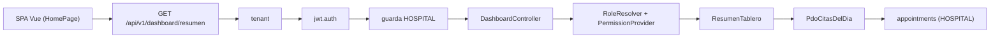

# Tablero de indicadores (dashboard base) - Semana 16

> Tema guia: **Integracion funcional en la API v1 de Laravel**

## Ficha

- **Estudiante:** Lis Ivette Rosales Colindrez
- **GitHub:** [`Lis671`](https://github.com/Lis671)
- **Identificador:** `ASII-26` | **Issue:** [#209](https://github.com/compilations-teams/sistema-hospitalario-integrado-SistenasII-2026-G3/issues/209)
- **Proceso:** consulta del tablero de indicadores por periodo
- **Principio SOLID aplicado:** Single Responsibility (SRP)
## Que se integra

El modulo deja de ser solo un micro-HIS en `docs/` y queda servido por la API v1 de Laravel con
las mismas capas de seguridad que el resto del HIS: tenant, JWT, RBAC (`config/rbac.php`) y la guarda
de base HOSPITAL del tenant cuando se leen datos clinicos.



| Metodo | Ruta | Permiso | Respuesta |
|---|---|---|---|
| `GET` | `/api/v1/dashboard/resumen?fecha=AAAA-MM-DD` | autenticado; cada tarjeta exige el suyo (`citas.ver`) | 200 `data.tarjetas[]` (vacio si no hay permisos) |

Los errores usan el sobre comun de ASII-24 (`message`, `code`, `trace_id` y `errors` en 422) y todas
las respuestas llevan `Cache-Control: no-store, private`. Los permisos usados ya estan activos en
`config/rbac.php`; no se agregan permisos nuevos.

## Archivos (partes 1 y 2)

- `micro-his/dashboard-base/ (Indicador, ResumenTablero, puerto CitasDelDia, adaptador PDO, verificaciones)`
- `app/Providers/DashboardServiceProvider.php`
- `app/Http/Controllers/Api/V1/DashboardController.php`
- `resources/js/pages/HomePage.vue y resources/js/modules/dashboard/ (estados cargando/vacio/error)`
- `tests/Feature/Dashboard/`
- `bootstrap/providers.php (registro del proveedor)`

## Hallazgos de la revision tecnica (Semana 13) corregidos

- RTF-01 (C-11): `Indicador` declara `sentido` (`menor_mejor` / `mayor_mejor`); las cancelaciones mejoran al bajar.
- RTF-02 (C-13): vuelve a rechazarse el valor negativo (RF-02 de la Semana 3).
- RTF-03 (C-09): la fecha se valida como `AAAA-MM-DD` real (422 si no).
- Falla cerrada: sin `citas.ver` no hay tarjeta y ni siquiera se consulta la base.

**Hallazgo nuevo durante la integracion:** Con preparacion nativa, PDO no permite repetir un parametro nombrado; la consulta usa `:desde` y `:hasta` aunque reciban la misma fecha.

## Evidencia

```text
$ php micro-his/dashboard-base/tests/run.php
PASS  menor es mejor: 15 min con meta 20 cumple (RTF-01)
PASS  mayor es mejor: 79.9 con meta 80 no cumple
PASS  rechaza valor negativo (RTF-02)
PASS  compone la tarjeta de citas con su total
PASS  10 % de cancelaciones cumple la meta de 10 %
PASS  sin permisos no hay tarjetas (falla cerrada)
OK: 6 verificaciones aprobadas
```

```text
$ php vendor/bin/phpunit tests/Feature/Dashboard --testdox
...                                                                 3 / 3 (100%)
Time: 00:00.425, Memory: 30.00 MB
Dashboard Api (Tests\Feature\Dashboard\DashboardApi)
 ✔ Recepcion ve la tarjeta de citas con su indicador
 ✔ Sin permiso de citas no hay tarjeta ni consulta
 ✔ Errores del resumen
OK (3 tests, 15 assertions)
```

```text
$ node resources/js/modules/dashboard/resumen.test.mjs
resumen.test.mjs: 7 verificaciones OK
```

```text
$ npm run build
✓ built in 4.57s
```

La suite Feature completa del repositorio se ejecuto tambien: los unicos errores son 4 pruebas de
Salas y camas (ASII-06) que necesitan PostgreSQL en el puerto 55433, ajenas a este modulo.

## Lo que no se verifico y dependencias

- **PostgreSQL real:** en este equipo no hay PostgreSQL ni Docker; las pruebas Feature usan dobles del
  repositorio/fuente y las rutas, middlewares y matriz RBAC reales. La consulta contra HOSPITAL queda
  pendiente de un recorrido con base real.
- Las tarjetas de ocupacion y laboratorio se agregaran cuando esos modulos publiquen su contrato de lectura para composicion.
- **Dos ramas apiladas (limite de 400 lineas por PR):** parte 1 `feature/asii-26-semana-16-api-lis671`
  (API y pruebas, sobre la Semana 5) y parte 2 `feature/asii-26-semana-16-evidencia-lis671` (interfaz,
  si aplica, y esta evidencia, sobre la parte 1). Los PR se abren cuando la Semana 5 (y la Semana 4,
  PR #1184) esten fusionadas. `Refs #209`.
