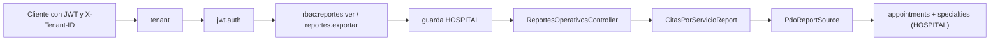

# Reportes exportables - Semana 16

> Tema guia: **Integracion funcional en la API v1 de Laravel**

## Ficha

- **Estudiante:** Lis Ivette Rosales Colindrez
- **GitHub:** [`Lis671`](https://github.com/Lis671)
- **Identificador:** `ASII-27` | **Issue:** [#210](https://github.com/compilations-teams/sistema-hospitalario-integrado-SistenasII-2026-G3/issues/210)
- **Proceso:** generacion y consulta de reportes operativos por periodo
- **Principio SOLID aplicado:** Open/Closed (OCP)
## Que se integra

El modulo deja de ser solo un micro-HIS en `docs/` y queda servido por la API v1 de Laravel con
las mismas capas de seguridad que el resto del HIS: tenant, JWT, RBAC (`config/rbac.php`) y la guarda
de base HOSPITAL del tenant cuando se leen datos clinicos.



| Metodo | Ruta | Permiso | Respuesta |
|---|---|---|---|
| `GET` | `/api/v1/reportes` | reportes.ver | 200 catalogo de reportes |
| `GET` | `/api/v1/reportes/{id}?date_from=&date_to=` | reportes.ver | 200 vista previa paginada con `meta.filters` |
| `GET` | `/api/v1/reportes/{id}/export?format=csv` | reportes.exportar | 200 CSV + `X-Report-Filters`; 406 si el formato no existe |

Los errores usan el sobre comun de ASII-24 (`message`, `code`, `trace_id` y `errors` en 422) y todas
las respuestas llevan `Cache-Control: no-store, private`. Los permisos usados ya estan activos en
`config/rbac.php`; no se agregan permisos nuevos.

## Archivos (partes 1 y 2)

- `micro-his/reportes-operativos/ (CitasPorServicioReport, PdoReportSource, escape de formulas en CSV)`
- `app/Providers/ReportesOperativosServiceProvider.php`
- `app/Http/Controllers/Api/V1/ReportesOperativosController.php`
- `tests/Feature/ReportesOperativos/`
- `bootstrap/providers.php (registro del proveedor)`

## Hallazgos de la revision tecnica (Semana 13) corregidos

- RTF-01 (C-07): el CSV neutraliza celdas que empiezan con `= + - @` (inyeccion de formulas).
- RTF-02 (C-04): el status sale de `ReportFailure->status`, no del texto del mensaje.
- RTF-03 (C-13): formato de fechas y rango maximo de 366 dias del contrato se validan antes de consultar.
- RTF-05 (C-06): la vista previa y la exportacion exigen la guarda de base HOSPITAL del tenant.

**Hallazgo nuevo durante la integracion:** Los filtros invalidos nunca llegan a la base: la prueba registra las consultas y verifica que no se hizo ninguna.

## Evidencia

```text
$ php micro-his/reportes-operativos/tests/run.php
PASS  per_page fuera de rango devuelve report_filter_invalid
PASS  order invalido devuelve report_filter_invalid
PASS  filtros conservan rango y orden
PASS  filtros exponen los valores aplicados
PASS  la fuente devuelve solo el rango pedido
PASS  csv inicia con BOM UTF-8
PASS  csv incluye los encabezados
PASS  csv escapa comas y comillas
PASS  csv termina cada fila con salto de linea
PASS  el exportador acepta csv
PASS  el exportador rechaza pdf
PASS  csv neutraliza formulas (inyeccion CSV)
PASS  citas por servicio declara sus columnas
OK: 17 verificaciones aprobadas
```

```text
$ php vendor/bin/phpunit tests/Feature/ReportesOperativos --testdox
....                                                                4 / 4 (100%)
Time: 00:00.498, Memory: 30.00 MB
Reportes Operativos Api (Tests\Feature\ReportesOperativos\ReportesOperativosApi)
 ✔ Catalogo y permisos
 ✔ Vista previa paginada con los filtros aplicados
 ✔ Exporta csv reproducible y sin formulas
 ✔ Errores del contrato
OK (4 tests, 32 assertions)
```

La suite Feature completa del repositorio se ejecuto tambien: los unicos errores son 4 pruebas de
Salas y camas (ASII-06) que necesitan PostgreSQL en el puerto 55433, ajenas a este modulo.

## Lo que no se verifico y dependencias

- **PostgreSQL real:** en este equipo no hay PostgreSQL ni Docker; las pruebas Feature usan dobles del
  repositorio/fuente y las rutas, middlewares y matriz RBAC reales. La consulta contra HOSPITAL queda
  pendiente de un recorrido con base real.
- PDF sigue sin libreria aprobada por el grupo (406 `report_format_unsupported`).
- **Dos ramas apiladas (limite de 400 lineas por PR):** parte 1 `feature/asii-27-semana-16-api-lis671`
  (API y pruebas, sobre la Semana 5) y parte 2 `feature/asii-27-semana-16-evidencia-lis671` (interfaz,
  si aplica, y esta evidencia, sobre la parte 1). Los PR se abren cuando la Semana 5 (y la Semana 4,
  PR #1185) esten fusionadas. `Refs #210`.
